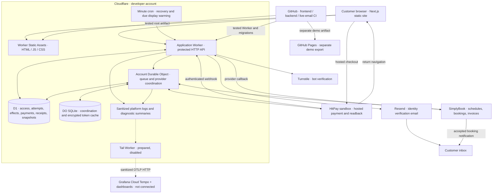
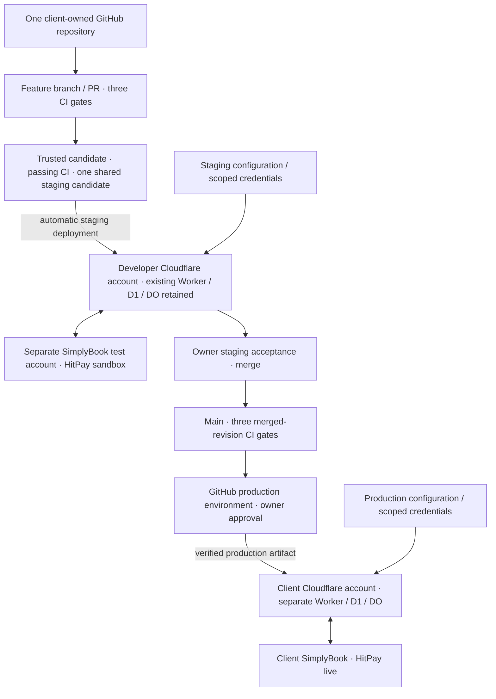

# Current system diagram

Current developer setup; client production migration remains pending. Dashed telemetry links are prepared but disabled/unattached. [One-page explanation](README.md) · [System rules](../SERVICE_CONTRACTS.md#part-1--current-system-rules).

Reconciliation verifies provider state before confirmation; arrows do not imply parallel provider writes or that a callback proves payment. D1 and Durable Object SQLite are separate stores. The diagram shows current integrations, not authorization to provision or activate them.

## Planned client delivery topology

Agreed target, not configured yet. The runtime components above apply independently to each environment.

