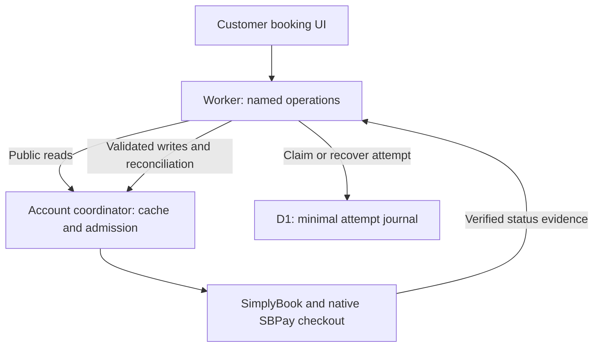
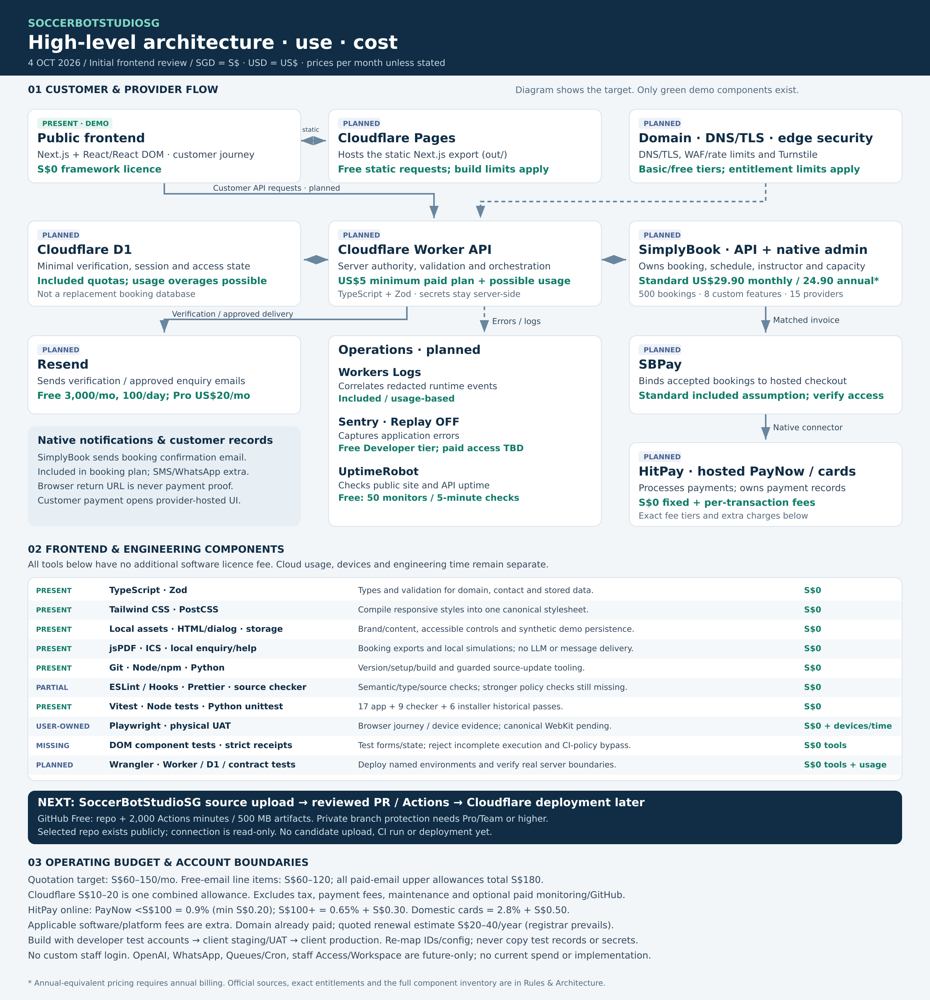

# SoccerBotStudio — Rules & Architecture

## Editable Review, combined checkout and compact confirmation — 19 October 2026 SGT

Owner supersedes creation-during-Review and queued provider edits: Details runs fresh read-only availability checks, then opens editable Review without creating a customer, booking or payment. Changed details reset consent. Continue to payment starts one combined checkout under the existing coordinator and durable attempt identity. Fresh pre-write validation remains necessary because Review can be left open; a read-only offer is not a reservation.

Combined checkout creates the booking, verifies the booking and unpaid invoice, retains the association, then creates HitPay. Its internal exact-attempt/hash/association proof can reuse that readback for at most five seconds, removing a duplicate immediate booking/invoice read. Restored/retried/stale paths retain fresh validation; no client-supplied proof or unverified booking can authorize payment. Consent, owner/freshness, serialized booking writes, idempotency, unknown-write recovery and original eight-minute payment/fifteen-minute hold deadlines remain. Required durable recovery evidence stays on the response path. No speculative payment or background-only financial persistence. The unmerged, unapplied0035 display milestone is removed; existing migrations remain unchanged. Queued edit design is superseded, not delivered.

Handoff says “Opening secure payment…”; pending return says “Verifying your payment…” with a compact spinning logo and do-not-refresh guidance. Confirmation proof remains visible during final receipt loading. Only verified confirmation exposes the five actions, now above a compact session/player/amount summary. Full contact, all sessions, location, tax, references and disclaimers remain under “View full details”. No forced height, clipping or hidden overflow; smaller screens, text zoom and expanded details can scroll. Protected downloads still require fresh authorization.

Test-impact review covers read-only Review, edits/consent, creation/readback barriers, duplicate effects, unknown/failed creation, restored attempts, shared browser setup/counts, compact disclosure/action order and protected downloads. Focused component checks,15 combined-checkout Worker tests and full verify:code (209 tests, types, lint, tooling, build/export) passed. Full Worker suite and exact-head CI remain pending; browser/device coverage remains CI/owner-operated. No provider writes, merge or deployment in this follow-up.

## HAR08 confirmation continuity and record reconciliation — 19 October 2026 SGT

Owner reports successful checkout and asks for pending do-not-refresh guidance, removal of repeated confirmation loading, and read-only record reconciliation. HAR08 shows customerConfirmation in a pending response, followed by confirmed without that snapshot; the hook discarded the proof while the611ms receipt request completed. Preserve the same attempt/session's verified proof specifically across the terminal confirmed response. Denied/unresolved and session changes retain their existing authority behavior; exports still require fresh protected receipt authorization. Reuse the existing “Please don’t close or refresh this page while we finish.” wording below the compact pending loader, without showing it after confirmation.

Regression covers proof arriving through polling (not initial context), a delayed final receipt, stable confirmed heading/verification time and no renewed loader. Existing manual-review, stale-session, authorization and duplicate-effect tests remain. CI's real-Worker payment-return case gates the receipt response and asserts confirmation stays visible; unpaid-return coverage checks the guidance while preserving compact-loader geometry/action suppression. Focused28/28 tests and full verify:code209 tests passed; exact-head CI pending. Initial restricted local verification stopped at the tooling gate without detailed output; the run with permitted execution permissions passed. No local browser run.

Read-only audit of this HAR's exact attempt: retained payment complete/verified, external effect observed, first recovery generation, one payment request and webhook receipt, one observed booking effect, finalized/comment effects observed, immutable480000/900000ms windows, and completed grant archived. Fresh SimplyBook admin booking/invoice reads confirm confirmed/paid/payment-received and matching booking/invoice/client/service/instructor/start/amount/currency/contact fields. Provider invoice contains one matching booking; no refund recorded. Fresh HitPay request read from this environment returned403, so current provider-side payment state is not independently reverified; retained server verification/reconciliation is consistent. A public signed booking read rejected the environment signature; authenticated admin read supplied fresh booking evidence. No correction, financial write, notification or historical cleanup occurred.

The archived grant records source0fd2c6e. HAR hold took13.795seconds versus HAR07's16.678; first Review-eligible response completed about10.633seconds versus13.644. Payment preparation succeeded in3.172seconds. These are browser network milestones, not screen-paint timings or a4–5second target acceptance. PR59 merged after all final gates passed; this follow-up requires its own PR/CI and merge authorization.

## Email-code browser interaction repair — 19 October 2026 SGT

Final-policy CI39200175005 frontend passed74/75 browser cases. Tablet WebKit filled the code while main was still inert during the loading transition; the trace retained an empty input, so native required validation prevented the expected incorrect-code response. Wait for the code heading and removal of main inertness, then assert entered values before submitting. Apply the same readiness milestone to the live-email helper. Preserve invalid-code rejection, corrected-code navigation, existing timeout and every case; no forced interaction, sleeps, retries or production behavior change. Final successor CI is required before the owner-authorized PR59 merge.

## Fifteen-minute hold and eight-minute payment policy — 19 October 2026 SGT

Owner authorizes adding this policy to PR59 and merging only after final-commit required CI passes. Owner reports SimplyBook's timeout changed to15minutes; provider behavior is not independently verified. New creation records retain immutable hold/payment windows of900000/480000ms, anchored to original successful booking creation. Earlier provider/supervision expiry always caps the hold/payment deadline. Review, navigation and checkout consume the same eight-minute window; no renewal on restore/retry. HitPay's existing20-second margin, whole-minute rounding and80-second minimum preparation allowance remain. The shared due-time parser retains its30-second provider margin; only HitPay uses a15-minute handoff ceiling, while historical native-link behavior stays10minutes.

Additive migration0034 defaults existing creation records to their original600000/300000ms policy; existing holds/payment requests are not extended. Policy columns are immutable. Reconciliation, late settlement/manual review, unknown-write evidence and duplicate-effect protections remain. Browser expiry coverage uses an eight-minute-old new-policy creation; combined-hold tests verify policy, anchored expiry and one payment effect; legacy coverage asserts old defaults. The synthetic provider fixture now models a15-minute invoice deadline. No assistant provider setting/write/browser run or deployment; final CI pending.

## Completed-dismissal CI setup repair — 19 October 2026 SGT

Merged-main50656c9 CI39198249437 passed74/75 live-email cases; phone WebKit timed out before reaching dismissal. Trace shows about22seconds spent creating the synthetic hold/payment before navigation, then waiting for fully reconciled confirmation. Customer confirmation was visible, but the completed-dismissal contract correctly requires full reconciliation. Retain that response wait and all lost-response/retry/receipt/single-effect assertions. Use the current combined hold route for this test setup instead of legacy split preparation/native execution, and assert one preflight. Other standalone setup callers keep their existing contracts. No timeout, retry, provider-limit or production-authority change. Exact-head CI remains required; HitPay upstream rejection and live latency remain unresolved.

## Pre-creation concurrency ownership — 19 October 2026 SGT

parallel-reads owns bounded two-lane joining and deterministic drained failure, not physical provider admission. ProviderSession owns ongoing token concurrency; NativePrebooking owns independent validation reads and resets failure-operation diagnostics after draining. prepareCustomerNative owns the validation-before-overlap boundary between immutable D1 preparation and provider warm-up. Journal batches dependent preparation SQL to reduce round trips without pretending writes are independent. The account queue continues serializing booking jobs, and provider transport/admission remain the sole physical-call owner. Cross-customer scheduling and payment fairness remain the separately recorded pending task.

## Payment failure diagnostic boundary — 19 October 2026 SGT

HAR07 exposes an upstream transport failure whose status was discarded. Keep diagnostic classification in provider-transport and structured emission in diagnostics; retain the original creation reservation in hitpay-journal. Fixed metadata must never contain upstream bodies/URLs, headers, credentials or customer data. A clearer diagnostic does not prove non-creation, permit another POST, authorize releasing the attempt, or establish a checkout repair. Preserve the existing503/customer recovery contract. Journey owns incident evidence; Service Contracts owns fields and behavior.

## Customer confirmation and shared checkout deadline — 19 October 2026 SGT

Current owner instruction supersedes the earlier all-reconciliation-before-success UI rule. A server-verified matching HitPay payment against the original verified, unexpired hold may show Booking confirmed and Paid immediately. Accounting reconciliation continues durably; downloads wait locally for the original reconciliation and then obtain fresh protected authorization. Customer success evidence is distinct from the reconciled receipt/export decision. Known conflicts/manual review must not gain confirmation.

Persist the first successful validated creation timestamp. Review time counts toward the same five-minute payment deadline; retries, reloads, returning tabs and checkout creation cannot renew it. Cap it by the actual earlier provider/supervision expiry. Retain HitPay's existing remaining-time expiry request/readback checks and safety margin. A payment verified before the deadline remains on-time even if subsequent accounting takes longer. A provider payment-completion timestamp is not currently validated by this integration; first verification after expiry stays in recovery/manual review rather than inventing an on-time payment.

On expired Review or checkout return, return to calendar with contact intact only after the server establishes unpaid expiry and atomically archives/releases the active grant. A payment creation with unknown outcome, recorded payment, unknown external write or newer webhook blocks release. Preserve attempts, holds, payment/receipt/effect journals and archived grants. No provider cancellation, financial reversal or slot reopening is implied. External HitPay expiry navigation remains provider-owned and physically unverified.

Owner follow-up: payment expires five minutes after original creation, not five fresh minutes at HitPay opening. Review/verification/navigation all consume that window. A separately valid ten-minute SimplyBook hold would leave roughly five minutes for reconciliation; actual provider expiry and in-progress settlement behavior remain unverified. The existing20-second/whole-minute HitPay safety margin and80-second minimum preparation allowance may shorten usable checkout time further. Preserve late settlement, outage and unknown-write recovery. No claim that a local deadline releases provider capacity.

## Pending: controlled account-coordinator concurrency — 19 October 2026 SGT

Owner-requested future implementation, after single-booking checkout is stable. Refresh and review actual latest main before implementation; the current foreground/display queues share one runner. This entry records pending work, not an implemented concurrency contract.

- Allow browsing reads to overlap booking/payment work under the existing shared provider limits.
- Let valid cache hits avoid slow provider work.
- Keep booking writes serialized initially; preserve studio-capacity checks, authentication, freshness, idempotency and unknown-write recovery.
- Prevent payment reconciliation from starving; bound queue waiting and return clear busy responses.
- Test mixed workloads with1,3,5 and10 concurrent customers using simulated providers. Measure queue wait, booking/payment latency and errors; assert no duplicate effects.

Use the existing coordinator, queue, cache and admission owners. Simulated measurements do not establish live-provider throughput or authorize physical bookings/payments. Retain mandatory test-impact review and final exact-source CI; merge/deployment remain separate.

## Retained Review checkout handoff — 19 October 2026

The live checkout handoff guard covers both a Review route and Review retained inside the Details route after history replacement. Keep that owner mounted while payment preparation and protected checkout-context retrieval run, and until external navigation replaces the document. Consent, original hold/attempt identity and the synchronous duplicate-operation guard remain unchanged. Recovery after cancellation, unknown outcomes or browser return remains protected; no automatic new payment is introduced.

Pending protected confirmation uses the compact existing spinning brand loader above details, including the context-loading fallback. It must not inherit the generic 65vh booking loader. Success/paid claims, exports, four actions and Home remain hidden until authoritative confirmation. Saved verification timestamps and fresh export authorization are unchanged.

## Test-impact review is part of every change — 19 October 2026

Every logical change and repair includes the mandatory [Service Contracts test-impact pass](SERVICE_CONTRACTS.md#mandatory-test-impact-pass-after-every-change--19-october-2026): review all affected test layers and duplicated setup, update obsolete assumptions, run affected permitted checks, and obtain final exact-commit CI before acceptance. Preserve failure coverage, browser ownership and all booking/payment protections. Publication for CI is distinct from readiness; a local pass alone cannot certify the browser journey.

## One-month calendar preload — 19 October 2026 SGT

Owner reduces eager calendar loading from four months to the displayed month only. Homepage preloads the current Singapore calendar month; another month is fetched only when opened. The existing four-month navigation horizon is unchanged. Empty results are cached, cache expiry does not poll, fresh entries are reused, and Details/Review/payment still abort or pause calendar work. This reduces eager month requests from four to one, not a measured end-to-end latency claim. Update component call-count expectations, preserve stale-reply/expiry/conflict assertions and explicitly test next-month loading, abort and return reuse. Actual-Worker browser setup now waits for one preload rather than warming all four months.

## Final single-booking optimization pass — 19 October 2026 SGT

CatalogueReads overlaps the independent service/instructor reads only for ongoing customer access under the existing ProviderSession and serialized admission owner. The initial full runtime run exposed three finite-path rate rejections; finite/historical reads retain their original sequential dispatch. Both settle before success or failure; only a complete, fresh, matching-generation pair enters cache. No cache lifetime, token retention, request count, rate/concurrency limit or write-boundary check changes. New deterministic tests prove overlap/coalescing and draining/no partial cache after either read fails; existing stale/superseded/account-isolation tests remain. Live timing improvement is not inferred from concurrency.

Review of the remaining path: public/admin tokens and identity already coalesce and cache within their bounded lifetimes; single booking/invoice readbacks already overlap; Review opens after validated retained creation, before comment completion; payment remains held until validated readback. Payment recovery's lease and before/after external-payment evidence remain necessary. Confirmation detection can still add its server-directed one-second initial/five-second later poll delay, and foreground work can wait for an already-running account queue job. D1 span totals include network/coordination, so no new index or database replacement is justified by the retained HAR. Further queue scheduling or polling-budget changes require targeted evidence rather than removal of guards.

Next owner acceptance, after exact-source CI and deployment: capture single Details→first Review, hold-ready, payment return→pending layout and authoritative confirmation separately, noting cold/warm state and network. Then resume the documented two-browser batch conflict test, followed by unknown-write/lost-response, abandoned/expired checkout, delayed/duplicate webhook, return/reload/two-tab and failed-dismissal scenarios. Synthetic mechanism coverage does not establish SimplyBook batch atomicity or live payment acceptance. No assistant provider mutation or physical test is performed.

Account secondary actions use the shared outlined button style in one three-column row beneath Continue; confirmed Back to home spans the full two-column action width. Existing real-API browser journeys assert alignment, spacing and width across configured viewports.

## Stable Review and confirmation presentation — 19 October 2026 SGT

Additional owner requests: preferred communication has Email as its default with exactly Email, Call (existing phone identifier), SMS and WhatsApp; remove the placeholder and retain stored preferences. The shared method catalogue also supplies SimplyBook comment labels. Enlarge the hero address target with12px vertical/16px horizontal padding and68px minimum height. Hero entry reserves a same-home history entry, replaces it when booking navigation commits, and invalidates delayed callbacks on Back; this prevents returning to an older Studio history entry during the animation. Add an actual browser Back-during-transition regression and padded-corner location click coverage.

Once pending Review is mounted and the hold finishes, commit /book/review/ through native history without fetching/remounting the same page. The route remains refreshable and later navigation uses the normal router. Pending and confirmed customer confirmations share one presentation owner; display details never establish paid or confirmed state. While pending, the heading is the brand spinner, Paid and verification-time claims are absent, and booking actions/home are hidden. Current attempt ownership and session revision govern all detail responses. Both confirmed-page exits use the existing durable-in-browser exit marker and background server dismissal; navigation is immediate, failure remains visible on rebooking and cannot permit a new hold before dismissal succeeds.

## Comment-complete Review and D1 round trips — 19 October 2026 SGT

For a single booking, protected progress exposes payment-disabled Review after creation has been validated and its reference durably retained, before comment completion. The existing finalize effect claim marks this boundary: orchestration creates it only after checking the accepted session against immutable intent. Require that claim plus an observed session:0 reference on a dispatching attempt; raw or unknown creation evidence alone is insufficient. The association milestone remains a later fallback. Comments remain non-blocking for completion and unknown comment writes must not be replayed. Progress is display-only: original holding execution still owns booking/invoice readback, matching and unpaid checks, hold evidence and expiry. Payment requires that completed hold. Batch progress is unchanged. The existing one-second polling transport adds detection latency; this is not an instantaneous server-push contract or a measured4–5-second result.

Native creation owns raw reference retention before normalization. Orchestration acknowledges the exact immutable reference under its current dispatch fence with one read, without first attempting a redundant update. Generic adapters retain the original update/fallback behavior. Confirmation joins its immutable payment route and payment state in one fresh-primary query; payment evidence requirements, ownership, quotas and deadlines remain unchanged.

## Review route continuity — 19 October 2026 SGT

BookingPage owns live held/recovery routing. When Details has already rendered pending Review and the hold becomes verified, retain that component while the URL catches up instead of replacing it with the shared full-page loader. Details only dispatches the reservation; it does not also navigate. Review renders a disabled text label while verifying, with no second spinning emblem. Existing server authority, failed-write evidence, original attempt identity and payment gating remain unchanged.

## Verification latency ownership — 19 October 2026 SGT

ProviderSession owns bounded public-token and identity reuse, refresh coalescing and authentication invalidation. The account coordinator serializes admission pacing/reservation only; the native adapter may overlap the two independent reads for a single booking while retaining both observations and all authority checks. Existing admission limits, unknown-write evidence and original attempt identity remain unchanged.

The holding POST remains the single creation owner. A bounded protected D1 status read exposes creation progress only after an association exists for one session. BookingProvider may render locked Review during that original request; payment is disabled until authoritative hold completion. A failed readback goes to recovery under the same attempt, never another create. Payment return's pending confirmation layout makes no verified-booking claim until canonical evidence passes.

Confirmation owns the shared first-five fast polling allowance and unchanged global cap/deadline. Receipt-data owns provider ID display from stored associations; presentation distinguishes SoccerBot UUID from SimplyBook IDs. Comment writes retain their existing per-attempt/session effect claims; the owner's apparent duplication was the expanded provider comment-history panel, not duplicated writes.

## Combined batch and location UI ownership — 19 October 2026 SGT

The native checkout owner enables per-session validation only for ongoing combined holds. Orchestration validates the first item before its atomic claim and later items once at their write boundary. Keep the historical whole-cart mode for split/finite callers. Partial/unknown effects retain the original attempt and prevent finalization/payment; no automatic rollback, booking replay or claim of SimplyBook atomicity follows. Readback and protected recovery remain authoritative.

Saved-contact actions share a spaced responsive action row; return remains available independently of save permission. Signed-in email uses the central identity colour and section type tokens with wrapping. Header Book now retains navy text on hover. Hero location is a separate accessible button outside the booking link and opens the existing native dialog. External map iframe is mounted only after user action; no initial map request, SDK, invented building geometry or embedded-3D claim. The address and external map query use the central LOCATION/ADDRESS owner.

## Independent checking-window regression — 19 October 2026 SGT

The repaired dismissal journey passes all3 devices on4fc8ce3. Two tablet cases timed out when combining full guest selection, uncertain holding, reload and checking-window exhaustion. Keep the original outage/unknown/readback reload assertions and move the shared exhausted-window behavior into one dedicated actual-Worker browser scenario. Its setup uses real API preparation/holding, then asserts unresolved UI, immutable server deadline, retained unknown effect and no payment. No timeout increase, retry, skip or product guard change. Live-profile inventory is now18 scenarios/54 device runs,14 actual-Worker and four older application-response fixtures. CI acceptance remains pending.

## Browser failure-test ownership — 18 October 2026

Every changed customer-visible failure/recovery path requires a named browser regression, supported by mechanism tests for server invariants. Use the real application Worker/API/coordinator/D1 where the behavior depends on backend state; inject failures at the external-provider or HTTP-transport boundary. Assert retained input, correct destination/loading/error state and original attempt/effect counts. Unknown writes must not be hidden by deleting rows, recreating reservations or enabling another payment. Lost-response cases must distinguish a failed response from a failed effect. Keep application-response UI fixtures explicitly identified; scenario counts and device-expanded run counts are separate. Browser execution stays in owner/CI environments, and simulated provider success never proves live provider atomicity or latency. The current named matrix is maintained in SERVICE_CONTRACTS.md.

## Combined holding ownership — 18 October 2026

Details → Review uses one authenticated POST /api/booking/hold/{id}. The browser creates and retains a UUID and approved draft before dispatch; the server validates and binds that identity to the owner, immutable intent and bounded grant before provider effects. Mutable lifecycle/evidence does not permit changing intent or deleting uncertain effects. The coordinator serializes through the existing foreground queue and atomic D1 effect claims; SimplyBook remains the scheduling authority.

Preparation-stage catalogue/availability is removed from this combined path. A single session receives one full authoritative prebooking validation immediately before guarded creation. Multi-session preflight and per-item revalidation remain. Readback of the created booking and unpaid invoice, hold deadline, protected recovery/receipt ownership and payment consent remain mandatory. Validated provider labels/offers are retained for reload without a second calendar fetch. The older split API remains compatible and cannot bypass the same write-boundary validation. Fewer reads are a mechanism claim, not an accepted latency measurement.

## Immediate explicit rebooking — 18 October 2026

Make another booking on verified confirmation clears the matching client attempt and opens the first booking step immediately using client navigation. Protected completed-grant dismissal runs in the background. Tab-local exit intent is presentation/recovery intent only: it may suppress restoration of the exact exited attempt, never another attempt, and cannot authorize dismissal or bypass server ownership/completion checks. Retain the intent on failure/reload and offer explicit retry. New hold creation waits for successful dismissal; viewing/selecting the next booking does not. Existing unrelated payment/recovery actions remain unaffected.

Later server evidence resolves the popup timing: the owner confirms a later revisit. At22:24:13SGT, background GET /api/calendar/2027-01 received an admin-auth provider_auth_failed rejection (HTTP401/403 classification). Catalogue requests at22:24:30,22:24:38,22:24:42 and22:24:57 returned503 without provider dispatch. ProviderSession incorrectly cleared tokens and renewed the60-second account cooldown even for local cooldown/refresh-busy/rate/concurrency refusals. Those local refusals now preserve existing tokens and deadlines; actual provider/identity failures retain their original invalidation and cooldown. No automatic provider retry, gate removal or live-record change. A real Worker catalogue regression reproduces deadline extension before the fix, then proves three blocked reads preserve the exact deadline with zero extra calls and authentication resumes after simulated expiry. The original upstream auth rejection remains unexplained; do not claim credentials permanently invalid or the provider issue resolved.

## Immediate payment recovery and ongoing contact access — 18 October 2026

An authenticated, exact-account HitPay receipt durably queues a coordinator alarm after receipt persistence. The alarm invokes the existing leased recovery operation; it never trusts callback paid status, resets deadlines or creates a new payment. Wake-up generations retain callbacks received during processing. Alarm retries and the unchanged minute cron provide recovery; original payment claims/effect guards remain authoritative. Only minimal attempt/correlation identifiers enter the local wake-up queue.

Ongoing developer email authority supersedes closed historical proof windows for contact reads and consented saves, matching challenge/verification/restoration. Keep historical rows unchanged and retain finite-mode window guards, current identity/guest expiry/revocation and Remember me consent.

## Checkout authority consolidation — 18 October 2026

Details → Review authenticates at its server entry and retains the one-use grant and atomic dispatch/effect claims. During that operation, provider reads/reservations use local access-expiry, deadline, cancellation and budget checks instead of repeating the full D1 grant join. Each provider write still rechecks the durable grant after provider identity is established; handoff and the final response retain current authority checks. Cleanup, payment recovery, receipt protection, provider validation and unknown-write recovery remain unchanged. This is request-local consolidation, not browser-owned authority or a cross-request authorization cache.

## New-booking comment delivery — 18 October 2026

Owner explicitly directs sending the comment without the earlier conditional-update prerequisite. For each newly created validated booking, write the immutable session player count, optional school/organisation and approved communication label once through the supported admin comment endpoint. This decision supersedes the earlier preservation-based delivery block for initial comments. No historical backfill, intake fields or booking/payment replay. The annotation has its own durable effect and remains non-blocking; uncertain writes are retained, never resent automatically.

## HitPay navigation loading and missing booking comments — 18 October 2026

Keep the full-page SoccerBot loader and duplicate-operation guard active after assigning the trusted HitPay URL, until the document is replaced. Starting browser navigation is not completion; the review form must not reappear during the handoff. Request failures still release loading through the existing error path.

Every intended booking annotation contains that session's player count, optional school/organisation and the approved communication-method label. This is a formatting contract, not evidence of provider delivery. The current adapter never writes booking comments. Preserve the existing requirement to avoid overwriting human comments; no intake fields or speculative extra book parameters are introduced.

## Completed booking exit and provider diagnostics — 18 October 2026

Explicit Back to home or Make another booking on a verified completed confirmation ends automatic restoration of that attempt. An authenticated, same-origin POST must verify retained complete payment and full saved confirmation before archiving the exact ongoing completed checkout grant and releasing its active slot. Pending, unknown, manual-review and foreign attempts remain protected. Original attempts, payment evidence, deadlines, ownership and confirmation/export access remain unchanged. Ordinary closing/revisiting still restores confirmation until explicit exit.

## Circular mouse cursor — 18 October 2026

Mouse pointers use a circle with a gently trailing dot. Touch, reduced-motion and forced-colour preferences keep the native cursor, as do text/form controls. The decoration must not intercept clicks, alter layout, or drive React renders on pointer movement.

## Single-session holding validation — 18 October 2026

For exactly one selected session, the complete fresh validation immediately before the atomic dispatch claim also serves as the session's write-boundary validation. No provider operation intervenes before its creation; do not repeat the same validation reads. Preserve immutable intent/hash, access/fence, deadline, effect reservation, association readback and original unknown-write recovery. Multi-session carts retain complete preflight plus per-session revalidation because earlier provider writes intervene. Preparation and all post-hold no-recreation/no-selected-availability rules remain unchanged. This is source optimization, not measured live latency acceptance.

## Confirmation return presentation — 17 October 2026

Owner approves the full saved confirmation with its original verification time on later visits. Authenticated checkout context may present a historical receipt only when complete verified HitPay payment, current company/account/merchant/key scope, immutable intent/association and the full booking/invoice/money proof agree at the recorded observation time. Current access is validated at the actual current time. Historical presentation never authorizes exports or claims a new provider read. Fresh receipt/export policy remains unchanged. Reuse retained evidence and snapshots; no additional database, polling reset, provider write or extended deadline. Missing/invalid/cancelled evidence stays unavailable rather than fabricating a saved confirmation.

Initial verification uses the existing full-page logo until the complete receipt is ready. Receipt failure is explicit and recoverable instead of silently leaving a partial summary. Receipt timestamp validation uses the authenticated HTTP server date with its one-second precision, preserving server freshness checks and tolerating device clock skew. Account/Details/Review navigation keeps its loader through the destination transition. Centre Back to home below the confirmation actions. Owner/CI visual acceptance remains separate from non-browser checks.

## Paid return continuity and restore-before-prefetch — 17 October 2026

Owner requests repair after merged main4b59217 failed live-email CI39016144380. Frontend/backend passed; Cloudflare deployment was skipped. The retained tablet WebKit trace times out during payment handoff after Review reload, with calendar work active; subsequent socket/closed-page errors occur during teardown. Source starts public calendar/catalogue work before protected attempt restoration completes. Gate that background work until restoration settles and keep it paused for restored attempts. Preserve homepage prefetch for visitors without an attempt. Regression covers unresolved restoration and restored hold with zero calendar/catalogue calls; the real application-API browser journey now also asserts zero additional display reads from Review reload through payment handoff. Keep all prior effect assertions, timeouts and retry settings unchanged. This removes an evidenced race; exact-source CI remains required to establish the repaired browser result.

Protected checkout context now optionally returns recorded payment metadata only after owner authentication, immutable route, complete/verified payment, payment identifier, observed external write, current payment account scope and exact attempt/intent/association binding checks. It is historical evidence, not current booking confirmation. When checking has ended or is unavailable, the return page displays Payment received, the verification time and an explicit do-not-pay-again message. It does not show a checkout link or grant receipt/export access from that metadata. Foreign/revoked access and cross-company scope remain closed; manual review does not qualify. No checking/financial deadline, recovery budget, original payment or provider record is changed, and reading this metadata dispatches no provider operation. Fresh confirmation and receipt policy remain unchanged. Unit and Worker regressions cover expired windows, no polling/export, unchanged financial state, owner/scope denial and absence of new provider calls. Final non-browser and exact-source CI evidence remain required; owner browser acceptance is separate.

CI39021865477 passed all347 Worker cases and the refreshed guest journey on all three browsers, but the new paid-return browser assertion exposed missing live checkout-context wiring in /confirmation/. Pass the live mode from BookingProvider and exercise that actual page in the component regression. The backend artifact check also caught an overly broad new intent-hash check on unrelated native checkout context; scope it to the new historical HitPay payment proof. Preserve the original native context behavior and all payment proof checks. The saved failures remain retained; final-source CI must pass again.

## PR41 CI repair and paid-return diagnosis — 17 October 2026

PR41 run39012995799 failed browser checks: remembered identity expanded the email card and moved the guest action on desktop/tablet; confirmation tests still expected an inline heading; overlapping context/status work exposed the wrong accessible loading label. Keep the guest card independent of secondary account actions, reserve equal description space, and preserve equal primary button dimensions. Use the full-page status role in the existing browser assertion and prioritize the checkout-preparation label while context is pending. Retain all original no-premature-confirmation/no-checkout assertions and exact remembered guest bounding-box equality. Focused component checks passed10 tests; full non-browser verification and fresh exact-source CI remain required. Codex did not run browsers.

Owner HAR-fixed-02 captures only a protected checkout read at15:29:19SGT, after the server checking deadline15:22:36. Read-only exact-attempt D1 evidence records payment complete/verified, external payment observed, paid evidence15:03:43, and provider invoice paid/payment-received plus booking confirmed at approximately15:03:51. The browser's persisted checking window prevents a new confirmation request and renders generic needs-review text; the checkout context contains no historical payment result. This is a return-page continuity defect, not evidence of payment failure. Historical provider evidence is no longer fresh under the15-second confirmation/receipt policy. A future repair must distinguish recorded payment success from current booking verification without reopening payments, resetting checking/financial deadlines or weakening protected receipt authority. This PR CI repair does not implement that separate confirmation contract change. No provider or financial records changed; raw HAR remains private.

## Booking loading presentation — 17 October 2026

Use the existing full-page brand loader for visible booking work, with one overlay for overlapping operations and the underlying form/attempt kept mounted. Pending background-only prefetch must not block the customer. Release on failure/unmount and preserve actionable recovery messages. Equal guest/email primary actions must keep the approved typography and logo. Loading UI conveys pending work, not provider acceptance or a latency improvement. HAR-fixed-01 timings and the remaining provider validation cost are recorded in Service Contracts; fresh server write-boundary checks remain mandatory.

## Account migration and test evidence requirements — 16 October 2026

Owner requires a repeatable migration process before the next client-account move, with actual-API browser coverage, mutation testing and measured latency. This section defines requirements; it does not claim those tests or a client deployment have already run. Service Contracts owns the executable checklist and evidence matrix; Journey records decisions and observations. These requirements supersede historical experimental native-session preloading for the current direct HitPay flow. Historical native attempts retain their original scope and validators.

A migration is a release plus an explicit account switch, not merely a credential edit. Track separately: prepared source, exact-source CI, saved provider/Worker configuration, active deployment and independently verified serving account. A saved Cloudflare version is not active until deployment traffic points to it. Credential presence and successful authentication in Codex do not establish the Worker’s account or signing capability. Require expected company identity through a supported authenticated read plus serving-version and account-specific provider evidence; a health response reporting only credential presence is insufficient. Adding a deployment identity assertion is a follow-up implementation requirement, not an existing guarantee.

Use separate development, client-staging and client-production configuration and credentials. Prefer isolated client infrastructure and durable state with explicit environment/account ownership; inventory Worker, origin, D1, coordinator namespace, identity/email/Turnstile and provider/payment bindings. Separate environments must not accidentally share attempt authority or production credentials. Isolation must preserve an original-account recovery/receipt path where required; a fresh database alone is not migration completion. Decide client business configuration explicitly rather than copying developer service/provider IDs, schedules or payment settings.

One private environment file per target may serve as installation input, for example .env.soccerbot-dev, .env.client-staging and .env.client-production. Prefer a secret manager or controlled password-manager entry for storage and handoff. Commit only an .env.example with names/placeholders; real files stay outside shared/export folders and Git. Existing .gitignore ignores .env* except .env.example; verify tracked-file and packaging exclusions before release, since ignore rules cannot untrack a previously committed secret. Never print, paste, upload or include secret values in CI artifacts, HARs or receipts. Public NEXT_PUBLIC variables must contain no credentials. Environment files do not install or activate Cloudflare bindings by themselves; use the reviewed deployment mechanism and verify the result. Keep legacy credentials separately scoped and never restore them over the new defaults.

Before client cutover, classify every old attempt by account, immutable payment route, retained provider references, effect certainty, original deadlines and receipt obligation. Resolve through supported original-account evidence, or retain an isolated supported old-account recovery/receipt service. Inactive or expired checking work does not establish financial settlement. Preserve late webhook handling and unknown external writes. No relabelling, destructive cleanup, deadline reset, weakened scope guard, payment replay or booking recreation may substitute for resolution. The owner’s acceptance exclusion for noncritical developer test receipts is not a default waiver for client records.

Browser, API, mutation and performance evidence are separate release requirements. Browser UI must exercise the actual application HTTP entry point and owning business/storage components for mechanism acceptance. Provider doubles are permitted at the outbound provider boundary for deterministic fault tests, with their limitations explicit. Actual SimplyBook/HitPay acceptance needs a separately authorized provider environment and owner-operated browser/payment flow. Codex remains limited to source and non-browser checks; CI owns required automated browser gates and the owner owns live-provider/physical execution. Code mutation testing is isolated and must never target deployed code, records or real provider effects.

Optimization must preserve fresh authoritative account/service/provider/price/lead/hours/capacity/consent/idempotency checks at the write boundary. Review booking creates one SimplyBook hold/invoice; Continue to payment uses that hold without another selected-slot availability query or booking recreation. Unknown results preserve attempt identity and evidence. Display cache and queue ordering convey no booking authority. No 15-minute cache warmer, relaxed validation, automatic write retry or latency target is implied by these requirements.

## Migration sweep: remove old-account session preload — 16 October 2026

The owner-requested final pass found the experimental NativeSessionInit frame still loading soccerbotstudiosg on every live booking selection. Direct HitPay checkout does not use that native hosted-session experiment. Remove the component and its mount, and reject this external request in the CI browser transport instead of silently stubbing it. A live BookingProvider selection regression reproduced the old iframe before removal; preserve legacy native checkout URL validation for historical attempts. Provider dispatch and new attempt/payment scope already derive company from deployed bindings; no fixed old-company API routing remains in the active HitPay path. Installed Wrangler explicitly preserves secret bindings during deployment, and post-activation management confirms the expected HitPay settings, D1 and coordinator bindings. No additional deployment, provider setting or financial mutation accompanies this source repair. Full verify:code passed after the repair:185 tests, source/policy/tooling/installer checks, formatting, lint, types, build and export. The reviewed test inventory replaces the removed experiment test with the reproduced migration regression; the initial stale-title inventory failure is retained. Final-source CI is required again.

## Foreground booking scheduling and migration boundary — 16 October 2026

The account coordinator keeps provider operations serialized through its instance-owned ProviderQueue. Selected-day reads, preparation, hold creation, payment and financial/native recovery have foreground priority over queued calendar/catalogue display reads. Running work is never interrupted; FIFO is retained within each class. A waiting display operation runs after at most four consecutive foreground operations, avoiding display starvation. This is a scheduling bound, not a latency promise. Durable admission, original attempt/effect fences, authentication, provider identity, fresh pre-write relationship/price/lead/hours/capacity checks, consent and unknown-write recovery remain authoritative. No fifteen-minute cache warmer or larger freshness window is introduced.

Changing the default SimplyBook company is not a completed migration. Old attempts retain their original company, payment route, evidence and deadlines. Current code has no installed legacy credential-routing path; do not weaken account guards or relabel records. New-account acceptance remains blocked until the original recovery and owner-authenticated receipt paths are independently available under their original account scope.

## Opening hours, four-hour lead and observed HitPay host — 16 October 2026

Current customer policy is permanently noon–20:00 Singapore time, with the full 40-minute session ending by20:00, and a minimum240-minute lead. Exactly four hours is eligible. Provider schedules still determine actual starts and capacity; no fabricated native grid. These rules supersede the earlier150-minute policy. New preparation, server pre-write checks and public/protected display filtering share the policy. Retained150-minute declarations remain parseable for history/recovery, but new reviews apply240minutes. Existing paid/held records are not rewritten. Historical finite experiment contracts retain their original scope.

The direct HitPay sandbox checkout allowlist accepts exactly checkout.sandbox.hit-pay.com and securecheckout.sandbox.hit-pay.com over HTTPS, with the existing merchant/request UUID/checkout path and no query, fragment, credentials or explicit port. Account/reference/currency/amount and payment checks remain unchanged; no generic wildcard or production host is admitted.

## HAR06 checkout latency and payment diagnostics — 16 October 2026

Owner HAR06 and redacted Worker/D1 evidence establish booking49/invoice40 created successfully at11:38SGT, with confirmed booking flags and an unpaid invoice. Details-to-Review took about53seconds: roughly20seconds queued behind background month work,5seconds for the browser-triggered fresh day read,6seconds for preparation (another fresh read), and21seconds for holding creation/readback (19 provider calls). This establishes the observed unpaid booking representation for this attempt; external-payment acceptance remains unproven. HitPay recovery stopped at hitpay_association_mismatch; no verified payment or external invoice write. Dashboard lists/logs were empty and runtime read-only HitPay access returned403, so the mismatched returned field remains unknown. Preserve the attempt; no recreation, payment retry, refund or manual-review reopening is authorized.

Remove the redundant browser fresh-selection path: Review booking now relies on current server preparation and pre-write validation. Pause background month prefetch on Details/review/payment, retain already loaded calendar data for return, and discard aborted background replies. An already-running server read may still finish; no unmeasured latency target is claimed. HitPay HTTP errors use payment-specific copy and held attempts never offer a misleading selection-restart link. Validation remains strict; failed association checks retain only an allowlisted field reason (request ID, reference, currency, amount, business, URL format or path), with no returned payload or sensitive values. Existing manual-review rows are unchanged. Tests exercise retained holds, zero duplicate browser availability reads, prefetch pause/resume, rejected selections and redacted one-use creation diagnostics. Non-browser checks and exact-source CI remain required; physical execution remains owner-owned.

## Approved sandbox deployment and recoverable rejection — 16 October 2026

The owner authorizes persistent HitPay sandbox configuration in the generated developer live release, superseding the earlier instruction to keep that live artifact's new payment gates disabled. The base closed artifact remains disabled. Live publication binds the sandbox merchant/account, contract acceptance, external processor and checkout/recovery/webhook enablement; post-deployment reads must verify these non-secret values and required secret binding presence. No secret values enter source or receipts.

Confirmed preflight rejection may release customer selection only before any dispatch/effect. Archive the prior ongoing grant without deleting attempt history; uncertain writes and finite grants never roll over. Apply affected-session changes locally and preserve details. Authenticated novel HitPay receipts may schedule bounded rechecks of recoverable manual review within the original financial deadline; never reset money evidence, unknown writes or security decisions. Cancellation and late payment cannot recreate capacity or trigger automatic refunds.

## Holding request ingress — 15 October 2026

Hold creation uses the existing authenticated native booking route with the exact hold=1 query. Its HTTP allowlist must agree with the downstream route; this narrow allowance grants no booking authority by itself. Preserve all other query rejection and provider/write safeguards.

## Review booking repair boundary — 15 October 2026

Keep the Details operation mounted until preparation and holding complete. Persisted prepared state is recovery evidence, not permission to navigate away during its active write. Confirmed unavailable/changed selections are pruned before calendar return; contact data survives. Failed provider reads preserve selection and remain errors. Details does not perform passive availability polling or show a second loader beside the price. Existing authoritative booking/write and held-booking/payment checks remain unchanged.

## Direct hosted HitPay handoff — 15 October 2026

Owner selects direct hosted HitPay sandbox checkout. Calendar Continue leads to Details; Details validates contact and then freshly checks every chosen date. Unavailable/changed selections return to the calendar with a notification and retained contact fields. Transport failures retain details but never claim that a date was booked. Existing shared server cache invalidation precedes fresh date checks; checkout invalidates shared availability around booking writes. A periodic 15-minute cache warm-up remains a proposal, not implemented.

Review booking after Details now retains the attempt and creates the SimplyBook holding appointments and their exact invoice. This reserves capacity. Only pre-reservation checks query availability. The held selection/contact cannot be edited or silently discarded; restore returns the same held attempt. Continue to payment after disclaimer agreement verifies the existing booking IDs and unpaid invoice, then creates at most one HitPay request and navigates in the same tab. No booking recreation or availability query follows the hold. Expired/invalid holds block payment. Card entry and PayNow stay on HitPay. No second SoccerBot payment screen is added. Return parameters carry no payment authority.

Migration0029 adds immutable route/scope, payment-request intent, monotonic paid evidence and minimal authenticated receipt digests. Unknown creation is searched by exact stored reference in at most two20-item pages, then independently retrieved; no assumed provider idempotency or repeated POST. Raw-body HMAC uses the endpoint-specific salt, bounds body32KiB/time5s, atomically persists receipt and due work, and never trusts event payment fields. All financial processing shares the account coordinator queue and durable generation claims. Each claim allows40 physical calls/90 seconds; at most12 claims within24 hours survive browser closure and customer checkout expiry, with explicit manual-review outcomes. Completed stale booking evidence within the customer checking window can queue another claim without resetting these limits.

HitPay owns payment/refund authority; SimplyBook owns booking capacity and invoice accounting. External invoice acceptance is reserved once, never repeated after unknown outcomes, and followed by independent invoice plus all-booking reads. Only verified HitPay payment and valid paid SimplyBook evidence unlock the existing shared confirmation/export decision. Late payment against expired/cancelled bookings requires resolution; no automatic rebooking, cancellation or refund. Existing native attempts retain native recovery. Rollback disables new HitPay checkout while retaining financial recovery and the selected HitPay route, never exposing a native alternative for its invoice.

Committed configuration remains native route with all three HitPay gates disabled. New source is not deployed/provider accepted. Exact provider representations, external-payment accounting/permissions, webhook delivery, owner browser success and no-return acceptance remain required. Browser polling retains its existing finite deadline; late financial reconciliation can require studio-assisted confirmation, rather than an invented extension of customer polling authority.

## Ongoing developer identity — 15 October 2026

Owner authorizes ongoing email verification and Remember me. Explicit IDENTITY_DELIVERY=ongoing requires published developer source and ongoing trusted customer access. Default closed artifacts remain disabled; GitHub live artifacts enable ongoing identity. Keep fixed auth.app404.ai developer sender, Turnstile hostname/action/age checks, one-use challenge/code, original-request idempotency, unknown-send accounting and no automatic retry. Any valid customer email may request verification; finite-test mode retains its exact recipient/window rules.

Migration0027 adds a default-zero ongoing marker to retained delivery dispatches without changing their values or any historical window. Ongoing durable admission permits at most120 bot checks and60 email reservations per rolling hour; unknown reservations count. Existing three bot requests/source/minute and challenge email/session/source limits remain. Remember me retains explicit consent,90-day absolute expiry, rotation/replay handling and revocation. Historical proof windows no longer close ongoing identity, but disabled/invalid ongoing configuration remains closed when the historical proof exists.

Ongoing paid readback is explicitly enabled only in the live release with a minute cron. It uses persisted ongoing checkout provenance, existing recovery claims and canonical confirmation decisions; browser polling and webhook payloads never authorize paid state. Migration0028 adds a covering ongoing/expiry/attempt index without changing retained grants; scheduled selection excludes expired grants using this index. Select at most one associated due attempt/tick, retain the original checking deadline, five tries and90-second spacing, and account every provider call. No cancellation or association discovery is added to automatic recovery. Finite operator windows retain their existing authority.

Post-reset admission acceptance: live b20f481/fdd603d2 has both expected indexes; all three targeted reads use covering indexes and read1 row each. Immediate calendar cache reuse returned identical JSON with0 attributable provider calls. Final admissions/budget1779; historical1713-row range retains count/time bounds, not full fingerprint proof. One historical unfinished reservation remains untouched. No quota errors matched the verification interval.

Physical checkout blocker:15October read-only recheck confirms one retained unfinished provider reservation from14October11:21:49 Singapore; budget remains1779. Checkout preflight requires active=0 and would reject a new booking while this remains. A bounded historical log query correlates its timestamp with one15-second failed publicCalendar provider request; admission IDs are not logged, so this is temporal correlation, not exact request linkage. No reservation was cleared, no write guard relaxed, and no additional website/provider request was made. YS subsequently requests fixing this blocker. Transport now releases failed non-mutating operations through an explicit operation allowlist, records read_transport_ended in additive DO admission_releases, preserves admissions and budget charges, and retains unknown mutating operations including payment-link GET. No automatic expiry or blanket clearing of unclassified historical rows is introduced. Existing finite discovery regression now checks released read concurrency, retained accounting/history/audit across eviction and continued no-replay; a transport matrix covers read versus write failures before headers and during response bodies. The exact historical row still requires an audited compare-and-set release after verified deployment; do not claim physical readiness before that readback.

## Admission storage query cost — 14 October 2026

Retained coordinator admissions must not make pacing, active-reservation or rolling-second reads proportional to all historical requests. Additive idempotent SQLite indexes cover started_ms and the unfinished subset (finished=0). All admission logic, history, budget accounting and unknown in-flight reservations remain authoritative and unchanged. Index creation belongs to the existing Durable Object constructor; it needs no D1 migration or data reset and incurs a one-time build plus incremental index write cost.

## Identity cache cannot outlive provider tokens — 14 October 2026

ProviderSession retains tokens locally for60 seconds and account identity for at most5 seconds. An identity receipt near token expiry previously could outlive its authentication, causing a later native read to throw provider_auth_expired. Bound the identity cache by the earliest of its5-second deadline and both token deadlines. At completion of explicit identity verification, check both token families again and renew expired tokens through the same durable physical-call admission. Native reads never reauthenticate implicitly or retry; failures remain failures and all renewals remain accounted. Token retention stays60 seconds.

## Customer booking cutoff is 150 minutes — 14 October 2026

Owner confirms that 2.5 hours replaces 48 hours for customer bookings. One shared domain constant governs ongoing public calendar filtering, browser snapshot filtering and selected-session validation. Trusted ongoing checkout contracts carry bookingLeadMinutes=150; prebooking checks it before and after provider reads and at dispatch. Exactly 150 minutes is eligible, less is rejected. Customer DTOs cannot choose the lead policy; historical finite operator grants retain their original bounds.

Public-calendar TimeStep only requests dates explicitly available in its loaded month, preferring an already-cached available date on entry. Unknown dates do not trigger speculative daily reads; unavailable adapters still expose their unavailable state. Ongoing checkout admits the configured premium native service as well as service2, then verifies date routing and price independently.

## Homepage display cache survives entry — 14 October 2026

BookingProvider starts public calendar and session-metadata prefetch on homepage. Public calendar scope excludes guest/member identity and selected-service effect changes, so entry neither discards completed months nor aborts an in-flight month. Public display metadata uses one browser-memory five-minute cache and coalesces in-flight consumers; page reload clears it. Ongoing customer mode allows only the strict public service/instructor catalogue without identity. Historical finite catalogue grants remain authenticated. Booking/session/identity authority never comes from this display cache.

Main Continue validates every selected date before Details. A successful check records a UI selection fingerprint bound to booking adapter, identity, service, players and slots; direct Details/Review entry without that result returns to Time. Contact edits retain the checked selection; selection changes require validation again. Success no longer invalidates display data and starts a redundant read behind Details. Failure retains basket and invalidates/reloads display data. Native preparation and each write still check authoritative availability and price. Loading components centre an enlarged branded emblem/logo and keep status text accessible only.

## Fresh catalogue for cold month reads — 14 October 2026

An ongoing uncached calendar month starts with one fresh provider catalogue snapshot, shared between weekday and premium service range reads. Complete monthly cache hits do not fetch catalogue metadata. This prevents a previously cached catalogue near its60-second expiry from invalidating an otherwise fresh multi-range read. Keep the60-second server and five-minute browser limits, fresh Continue and write validation, unknown-date behavior and no automatic retries. Historical finite windows retain their existing freshness/budget semantics.

## Observed catalogue representation and deployment propagation — 14 October 2026

The premium service's public getEventList response uses unit_map={"2":null,"3":null,"4":null}; ordinary service2 omits unit_map. Normalize both existing ID arrays and nonempty maps whose every key is a valid provider ID and every value is null. Reject all other object relationships. This preserves exact trainer assignment instead of treating a map as unrestricted service access.

GitHub deployment must distinguish accepted upload/activation from edge readiness. Capture the previously served revision before deploying once. Afterwards allow at most16 health observations,2 seconds apart, accepting only that prior revision while awaiting the exact new revision. Foreign revisions, transport/non-200 failures, malformed health and missing new-version credentials fail immediately. Retain observations in deployment evidence. No repeat upload, booking request or test retry is part of readiness observation.

## Browser availability and date-dependent pricing — 14 October 2026

Ongoing customer calendars now expose bounded public scheduling offers so four prefetched months include dates and times. The booking-level browser memory cache keeps these for five minutes, reuses them immediately across date/player changes, and discards them on scope changes, expiry and failed continuation. The account coordinator retains its sixty-second bounded cache. Continue bypasses both display caches; preparation and dispatch still validate provider truth. No persistent personal data, reservation authority or checkout capability is placed in the calendar cache. All booking loading indicators use the existing SoccerBot brand component.

The approved customer price is SGD88 on weekdays and SGD108 on weekends and Singapore public holidays, including announced substitute holidays. One shared domain calendar contains MOM's 2026/2027 dates; unreviewed years fail closed for native pricing. The logical website product remains service2; its offers carry the actual priced service2 or3. The server selects and verifies the dated service and amount independently of browser input. Mixed carts sum actual line prices. Historical fixed-price operator contracts retain their original scope.

SimplyBook readback verifies service2 SGD88/duration40/buffer10 and new service3 SGD108/duration40/buffer10, both assigned providers2/3/4. Both inherit company hours; existing trainer schedules still decide actual availability. These services are not individually day-restricted in the provider dashboard: date routing is enforced by SoccerBot. Owner supplied service3's buffer because the connected editor lacks that field. GitHub's sealed customer configuration adds PREMIUM_SERVICE_ID=3; default-closed configuration and historical contracts remain unchanged. Migration0026 was applied by prior successful main deployment36b84bd; no new migration is needed. Current work requires fresh exact-source CI and deployment evidence; provider payment/webhook acceptance remains separate.

## Ongoing developer customer access — 14 October 2026

Owner withdraws automatic campaign closure for the customer website and explicitly enables continuous native checkout, with manual owner control over actual bookings/payment. This supersedes the unexecuted finite inspection packet458d021b4a82. LIVE_CUSTOMER_ACCESS=enabled plus trusted provider mode and a published source enables ordinary customer operations. No expiry timestamp is extended to simulate permanence. The existing account coordinator retains all usage, provider cooldowns, pacing and concurrency; historical operator workflows keep their independent campaign limits.

Customer consent now creates a bounded one-use checkout grant after fresh server availability reads. Short request/attempt/guest expiry remains a security and idempotency boundary; it does not close the site. New schema0026 preserves every prior grant as ongoing=0, adds explicit ongoing customer authority and removes the historical688 absolute schema ceiling. Ongoing per-attempt call bounds cannot be consumed by unrelated visitors. Fresh write validation still proves account, service/instructor relationship, slot, price, booking allowance and shared studio capacity. Up to12 sessions follows the existing customer cart contract; no trainer priority or silent overlapping schedule acceptance is introduced.

GitHub main has a dedicated Cloudflare job dependent on frontend, backend and live-email success. It downloads this run's tested live artifact, verifies source/receipts/file hashes, applies reviewed unapplied migrations, deploys the bundled Worker/assets and checks the deployed revision. PR verification has no deployment token. GitHub Pages remains a separate demo deployment. Cloudflare deployment activates customer access on soccerbot-dev only; identity email delivery and signed webhook/payment acceptance are separate capabilities and remain unclaimed.

## Live inspection admission repair — 14 October 2026

YS reported unavailable session information on the deployed live site and requested live access to inspect cached dates/times. A closed deployment alone cannot support this journey: the legacy catalogue grant admits only early-campaign counters, and calendar/time selection previously depended on a checkout grant. The existing source-bound public calendar window now also admits authenticated catalogue, calendar and daily availability reads. It grants no booking, payment, identity-email or operator-write authority. Guest authentication and the original checkout grant/write checks remain. All read paths share coordinator cache/accounting; fresh Continue invalidates the affected month and refreshes catalogue/availability. Pacing consults retained admission timestamps across requests and restarts. The policy permits a separately configured1024 ceiling; the default and deployed704 ceiling are unchanged by source. A finite approved deployment/read window and actual live evidence remain required.

## Homepage reads and protected receipt parity — 14 October 2026

M4.1 now starts four-month prefetch on site entry without creating guest access. Anonymous calendar DTOs contain only month, service ID, observation time and date availability booleans. A management-owned, finite, exact-source window bounds dates, service, time and cumulative provider usage; absence means closed. Public/protected reads share the account coordinator cache. Public reads preserve 32 checkout and 16 recovery calls and use ordinary 48-hour lead time. Fresh selection checks still invalidate shared affected dates. M6 uses the same confirmation layout and export owners for preview/live with truthful labels and per-export protected admission. No browser or live-provider acceptance follows from passing synthetic tests.

## Demo parity and cached calendar implementation — 14 October 2026

Owner prioritizes the approved demo interface before complete live-flight acceptance and withdraws trainer priority. Keep existing milestone IDs: M4.1/M4.2 own range availability and fresh continuation, M5.2 owns experimental background homepage initialization, M3.2/M6 own interface parity. Account/session/time/details/review remain shared presentation; live session product/pax/inclusions now use the demo owner, real catalogue fields and the same action. Payment preparation uses the demo two-column layout but never pretends demo Card/PayNow controls are provider-supported. Turnstile, protected identity, guest access and existing exact write checks remain.

A single hidden fixed-origin frame starts during a live booking session; no visible provider-homepage visit, checkout-capability prefetch, cookie copying, top navigation, retries or frame-load authorization signal. This is the first implementation candidate, not a proven solution to intermittent403. Real browser cookie/embedding behavior remains pending.

Calendar overview uses bounded provider date-range reads, a 60-second cache owned by the existing account coordinator (eight month entries), scope isolation and invalidation fencing. Browser prefetches current month then three months sequentially after authorized booking/service selection. No anonymous site-entry read capability was introduced; a broader entry-point preload remains a later authority/performance gate. Installed grant dates still bound every actual range and gaps are never crossed. Existing grants are unchanged; source permits up to124 explicitly granted dates for a four-month test, without raising booking-dispatch counts or budgets. No migration is needed.

Only verified available dates are selectable; unknown/out-of-scope and explicit empty remain distinct. Fresh Continue checks bypass the retained day cache and compare instructor/time/price under the current draft/session. A failed check preserves selections, invalidates shared affected-date data and refreshes calendar. A successful or uncertain checkout invalidates display cache before and after execution. Server prebooking/dispatch remains the final capacity/identity/price authority. No priority tie-break, production activation or complete visual/payment/webhook acceptance is claimed.

## Customer-path constraint and readiness — 14 October 2026

Owner requires no visible SimplyBook homepage detour. Prior homepage-first success remains diagnostic, not an accepted product flow. Background initialization has not been implemented or validated in current local b2862e0, so that experimental variant is not ready. Preserve direct native checkout and paid-state safeguards while preparing any isolated candidate. Service Contracts owns the superseding protocol.

## Current checkout experiment direction — 14 October 2026

Invoice34 body is available and associates confirmed booking43/SGD88; contradictory paid/received-false/PayLater fields do not establish settlement. Full customer journey with owner sandbox payment and active webhook observation is the next proposed experiment. Distinguish SoccerBot homepage from provider-origin session initialization: hidden iframe or server fetch is not an accepted replacement for top-level SimplyBook homepage navigation. Current payment guard requires received HitPay payment; no speculative warmup implemented. Service Contracts owns experiment and evidence limits; Journey owns decision history. This is preparation, not live authorization or acceptance.

## Separate invoice due time, checkout rendering and link authorization — 14 October2026

Owner observed checkout34 render after its displayed due time using homepage-first navigation once. A due-time field is not evidence that provider capability access is revoked; conversely a rendered payment page does not prove fresh invoice authorization, currentbookingeligibility or payment acceptance. Retain local SoccerBot deadlines as local admission rules without claiming provider-linkrevocation. Service Contracts owns this observation and required fresh-response evidence. Homepage-first remains a candidate supported by one reported trial, not a reliablefix.

## Current checkout reliability boundary — 13 October 2026

Native checkout reachability was observed for owner-created order34 with a30-minute payment window, while the owner reports intermittent e403 from the same original link. Payment, sandboxmerchant verification and signedwebhook acceptance remain outstanding. Latest retained Worker closure remains tested b2862e0,25 migrations,provider/identitydisabled; this offline investigation did not query or change it. Carried coordinator655/management567/Worker231/deployments47/attempts8/migrations5; separate owner controls bring conservative bookingdispatches13/issuedlinks10 with physically unmetered nativebrowsertraffic. Timeout restoration30→10 remains owner-unconfirmed.

Source comparison and provider documentation establish no demonstrated SoccerBot URL or cookie defect. Keep native invoice authorization distinct from the mere presence of a browser session cookie. Two session values in a captured table support investigating grant continuity but do not establish a cookie race. Preserve provider boundaries: no automatic checkout retries, invented URL/code, cookie proxy, paid-state shortcut or unsupported session warmup. Require evidence that distinguishes mechanisms before another experiment; Service Contracts owns the current analysis and exclusions.

## Native diagnostic grant support remains bounded — 13 October 2026

Source-only0025 aligns the native-grant schema upper bound with configured704 minus16 recovery calls:688. Historical rows and applied0001–0024 remain unchanged; no default ceiling, counter, permission, runtime admission or webhook-cap relaxation. This prerequisite permits preparing the owner's requested checkout-only diagnostic after exact CI and finite live approval; it neither fixes the404 nor starts another payment experiment. The actual closed environment remainsadd9cc2 with24 migrations until separately authorized execution.

## Interpret the native error before repairing — 13 October 2026

Offline diagnosis verified the handed-off provider URL and invoice31, with the owner's failure before all local deadlines/access closure. Keep visible page text separate from observed HTTP status: a historical provider report shows a displayed404 can mask invoice-access403 in another flow. Neither that report nor PRO-feature documentation proves this account's cause. No URL rewriting, Client Login change, plan upgrade or alternative payment integration is justified. Preserve closed state and require original browser error evidence/current native settings before a targeted new reproduction.

## Checkout reachability is an outstanding acceptance gate — 13 October 2026

The approved owner payment flight created and associated booking40/invoice31, but the owner saw404 on initial native checkout navigation. A provider-issued, allowlisted link is not proof of reachable checkout, merchant identity, sandbox mode or paid state. No payment was submitted and no post-payment callback comparison occurred. Preserve the successful native association separately from this failed browser boundary. Do not guess a new destination or repeat booking/payment to conceal it.

The packet is consumed and independently closed at14:36:24 Singapore onadd9cc2/version63bea9f0-1593-48d3-8b04-5ac7ba702ad0. Both subscription baselines and all24 historical tables/migrations are preserved; access disabled/end0/active0. Current cumulative618 provider/494 management/199 Worker/41 deployments, configured704 and recovery16 untouched. Service Contracts owns link diagnosis and any future bounded test; no new live authority follows from remaining budgets.

## Payment preparation retains a separate submission gate — 13 October 2026

YS chose checkout-time merchant verification. The owner must confirm Sandbox, expected merchant app404, exact invoice and SGD88 before one submission; a mismatch stops. The policy now permits an explicit704 ceiling for the proposed packet, without selecting it in default configuration or resetting stored usage. Provider reserve, finite grant and no-replay ownership are unchanged. Release metadata records no pending migration and the last independently closed version. This source-only preparation still needs exact-source CI/artifact and a new finite approval.

## Owner payment is the next diagnostic boundary — 13 October 2026

YS requests testing payment before returning to webhook acceptance, reports no developer support, and agrees to prepare an owner-operated test. The next step no longer depends on a support response. Earlier owner-payment deferrals remain historical; the new scope is preparation of one native sandbox submission, subject to current mode/merchant evidence and a new finite execution packet. A real charge is not authorized.

Retain SimplyBook → SBPay → HitPay. Independently read the exact associated invoice and signed booking through the existing one-use native-readback owner. A checkout return, owner success report, callback route or event arrival cannot mark the invoice paid. Keep both authenticated capture channels active before checkout and through payment observation. A receipt after payment is temporal evidence, not proof that payment is a universal event prerequisite; shape-only capture also does not prove which booking generated it. Payment acceptance, authenticated delivery, semantic association, automatic reconciliation and general owner/device acceptance remain distinct.

No application-source change or new deployment has been made for this preparation. Preserve all prior attempts, bookings, subscriptions and24 migrations. Service Contracts owns the staged test, limits and closure; Journey records the changed direction and outstanding inputs.

## Read-only ingress evidence — 13 October 2026

Stored telemetry for the latest paired control contains all 19 expected HTTP requests with matching correlation IDs/statuses and no truncated events. No callback arrivals were recorded on either fixed route between 12:04:00 and 12:31:07 Singapore. This narrows the next investigation to event generation/dispatch or network/pre-Worker edge behavior; it does not prove provider fault or justify a signature/parser change. Signed delivery and payment acceptance remain pending.

The investigation made four management reads, including one SELECT-only subscription/capture read with zero rows written. No provider call, direct Worker request, deployment, live mutation or support communication occurred. Cumulative management is 443/446; provider remains 567, Worker 175 and deployments 38. Access and the campaign remain closed. Service Contracts contains the support-trace boundary and limitations; Journey retains the evidence.

## Current developer acceptance state — 13 October 2026, 12:14 Singapore

The paired booking/invoice delivery control completed on application source `116fd342a8b82c20ff961fff0210ed86feac1648`, backed by287 Worker tests and all three exact-source CI gates. Its single fresh booking and exact confirmed/unpaid invoice association passed. Both temporary subscription lifecycles, reverse cleanup and independent closure passed. Neither capture channel recorded an authenticated receipt during the declared180-second observation; signed-delivery, semantic event mapping and paid reconciliation acceptance remain pending. Owner-controlled payment/browser/device acceptance was not attempted.

The deployed closed version is `ed264d67-6cde-4319-9c58-5e307be35d8a`. Provider and identity access are disabled, campaign end0, active0, schedules empty,567/640 provider calls with16 recovery calls untouched. All24 historical tables and24 applied migrations are preserved. Migration0024 was applied in the preceding stopped packet and verified, not reapplied, in this control. All0001–0024 migrations are now immutable.

Cumulative accounting is567 provider,439 management,175 direct Worker and38 deployments;6 attempts,9 conservative booking dispatches,6 unopened links and4 migration operations. The approved ceilings are596 provider maximum used within configured640,446 management,185 Worker,39 deployments,6 attempts,9 dispatches,6 links and4 migrations. These remaining numbers do not authorize another packet; the single-execution packet is consumed and the attempt/dispatch/link ceilings are reached. Service Contracts owns the next diagnostic boundary. Private execution artifacts retain exact payload-free evidence and costs.

## Paired diagnostic channels retain independent authority — 13 October 2026

YS authorized proceeding with the proposed control preparation. Extend existing transport, subscription and capture owners; no alternate provider dispatch or payment authority is introduced. A fixed route selects an operator-declared event scope. The route is not covered by the provider body HMAC and must never establish payload event identity, booking association or paid state. Both channels still authenticate the exact body and retain structure only.

Additive0024 creates immutable event scopes referencing existing capture windows. Historical rows and applied migrations0001–0023 remain unchanged; absence of a scope retains the legacy booking route. Two distinct windows isolate admission caps and deduplication. Sequential registration takes nested exact baselines, so cleanup must reverse registration order. Never delete the first subscription while the second remains unresolved. Close both ingress windows and access independently even when restoration is unproved. A concrete exact-source sealed packet and amended budgets are required before live execution; the user's stop before owner-controlled acceptance remains in force.

## Verify event prerequisites before delivery acceptance — 13 October 2026

Stored logs support no recorded webhook arrival during the examined interval. Current Cloudflare reads show no Access application barrier and an enabled public Worker address. Older provider staff answers identify payment-gated callbacks for priced API bookings, but current REST semantics for unpaid booking creation remain unproven. Treat this as an acceptance-prerequisite gap, not a proven application validator defect or a confirmed provider outage.

Before another live experiment, establish the event's generation condition and a justified finite observation window. Preserve the failed flight; do not replay booking38, mark paid, disable payment configuration or weaken authentication to pass. A proposed new_invoice/new_booking comparison can distinguish delivery from event-specific timing only under a new bounded packet. Invoice creation is not settlement. Service Contracts owns evidence, source applicability and exact next questions; Journey owns the investigation record. Owner acceptance remains deferred.

## Separate accepted checkout/cleanup from failed signed-delivery observation — 13 October 2026

The new live test accepted one confirmed/unpaid native booking and the repaired DELETE lifecycle, but observed no authenticated webhook receipt at its bounded check. Preserve that failed observation and do not infer whether the provider failed to deliver or ingress rejected a delivery. Do not replay the booking to produce evidence. Signed delivery, event mapping and payment recovery remain separate acceptance gates.

Bounded cleanup restored the active subscription baseline and independent closure preserved all23 historical tables on source44c53fc at516/640 calls. No payment, cancellation or owner acceptance occurred. Service Contracts owns exact record IDs, counters, source/artifact and closure; Journey records the failed observation and successful cleanup. This packet is consumed.

## DELETE acknowledgement is separate from restoration proof — 13 October 2026

The webhook subscription lifecycle owns cleanup acceptance. A successful HTTP DELETE acknowledgement permits its existing fresh list read; it never proves removal by itself. The transport discards the undocumented DELETE body without buffering or interpreting it, while preserving redirects, HTTP failures, grant admission, durable call accounting and no-replay rules. Cleanup closes only when the fresh normalized active list exactly equals its preserved baseline. Other provider operations retain strict bounded JSON parsing.

This source repair follows owner authorization to resolve response handling and run a new acceptance test. It changes no existing subscription or historical unknown-response record. Live execution still requires the tested artifact and concrete amended limits, because the previous deployment ceiling is exhausted. Owner payment/browser acceptance remains separate.

## Active webhook baseline reconciled — 13 October 2026

One approved read-only reconciliation returned an empty active-subscription array, matching the original empty baseline. This resolves the active-subscription restoration condition without replaying DELETE or rewriting the historical delete_unknown record. Preserve the distinction between active baseline restoration, permanent provider record deletion and actual signed delivery acceptance. No new booking or owner acceptance occurred.

Access and preservation were independently verified closed on source1e6bfbe at471/640 calls with all23 historical tables unchanged. Service Contracts owns exact packet/counters/version and remaining transport/delivery work; Journey owns the execution record. The read-only packet is consumed and no successor live flight is authorized.

## Cleanup response boundary reached; access closed — 13 October 2026

Approved packet10c62a001eea deployed source1e6bfbe and the repaired string-flag parser passed actual subscription identity/baseline validation. The single DELETE dispatch then returned an unrecognized representation. Retain `delete_unknown`; no duplicate DELETE or new booking test is allowed while removal is unproven. A read-only reconciliation must establish current provider state before further action.

Independent closure at09:36:09Singapore verified Worker/coordinator version43fc696a-7d40-4ded-8f58-9871003462dc, disabled/end0/active0,466/640 calls, expired new authority, empty schedules and23 preserved historical tables. This proves access closure, not subscription restoration. Service Contracts owns exact outcomes/limits; Journey records the execution. Owner-controlled acceptance has not started and no successor flight is authorized.

## Subscription flag repair prepared — 13 October 2026

The owning subscription normalizer now permits exact string"0"/"1" alongside numeric0/1 and uses the shared flag decision. Unknown forms remain rejected; inactive flags cannot authorize lifecycle actions. Field-level failures use fixed codes without provider values. Unknown-create/no-replay, exact subscription identity and prior-baseline preservation remain mandatory. Service Contracts owns the repaired input/error contract; Journey records the reproduced failure and verification.

This is source work only. The developer Worker remains independently closed on source27f03fc at460/640; the original subscription is unresolved. No cleanup, booking, payment or owner acceptance is authorized by the source repair.

## Current webhook diagnostic result — 13 October 2026

Approved packet46b93ebc17fa7 completed one read and independently closed at07:39:36Singapore. Actual active-subscription metadata exposes `is_active` as a string; the current numeric0/1-only validator rejects that representation. No values or subscription identity were retained, so this finding is not cleanup or webhook acceptance. Preserve strict flags, association, historical rows and immutable migrations0001–0023 when repairing the owning normalizer.

Deployed source27f03fc/version35894e44-9bfd-4142-9ff3-91686b87fd78 is closed: provider/identity disabled, end0,460/640 calls, active0. All23 historical tables are preserved. The original subscription remains unresolved; no successor live flight is authorized. Service Contracts owns the exact observed fields, authority, counters and closure; Journey owns this execution evidence. Payment, signed delivery, no-return recovery and owner acceptance remain pending.

## Webhook flight stopped; access closed, subscription unresolved — 13 October 2026

Packet `b918a81d06e991549f9d67e449098bf87e8109bc9ea6affc98d69d7773d06a99` executed once under the approved campaign on source `f2e0a3e91824f569a161f29447471d5081259719`. All three gates passed in CI38313369930; artifact11776470322/SHA256 `ed0207005a4ce1a38bc3f8c9302e05895be968d9afbeddf40a05d5725c3d1e14` matched150 sealed files and273 strict Worker tests. Migrations0022/0023 applied;0001–0023 are now immutable.

Subscription creation consumed7 provider calls through a returned fresh-list read, then failed post-create verification without establishing the subscription ID. The grant retained `create_unknown`; no booking proceeded. Pre-authorized cleanup consumed5 further calls, also failed after its list read before DELETE and retained `blocked`. The current error receipt does not identify the exact cause or field; do not guess a boolean/string/number alias or claim removal.

Independent access/preservation checks completed at **13 October06:15:13 Singapore**: sourcef2e0a3e/version `26f76ef1-e045-4e6f-98b1-b97ae0fe0165`, Worker/coordinator disabled, end0,455/640 provider calls, active0, recovery16 untouched, capture closed, schedules empty, new audit expired and both capabilities denied. All18 historical table snapshots and the applied schema (apart from the approved grant-ceiling change) are preserved; all23 migration records are verified. No new attempt, booking, checkout link, payment, cancellation, cron, email or siteverify call. Full closure is **not accepted** because the subscription's identity/removal remains unproven. The durable campaign state is `access-closed-effect-unresolved`; no successor flight may proceed under the unresolved-effects stop condition.

Actual flight cost12 provider/32 management/11 Worker/3 deployments; carried totals455 provider,240 management,105 Worker,24 deployments,4 attempts,7 conservative book dispatches,4 unopened links and3 cumulative migrations. Remaining numbers are not permission to bypass the stop condition. Next ready source task is a bounded read-only subscription structure diagnostic through the existing one-use operator and account admission owners, followed by an evidence-based parser/cleanup repair. Actual signed delivery, mapper and no-return reconciliation remain pending; owner-controlled acceptance has not started.

## Approved technical payment/webhook campaign — 13 October 2026

YS approved proposal `f26137bba0a4c4066024af27546d511b43050e3324b29e488dec84bb57a4ccd2` and separately extended only its time bounds: latest start **09:05**, final closure **09:30 Singapore on 13 October**. This supersedes earlier statements that no successor authority exists. Each flight still requires tested source, all three exact-source CI gates, verified artifact, a sealed execution/closure packet and independent closure. Campaign approval replaces separate packet confirmations only within this envelope.

Carry provider443, management208, Worker94, deployments21, attempts4, conservative book dispatches7, unopened links4 and migrations1. At most two flights,160 new provider calls (maximum603, configured ceiling640,16 recovery calls untouched),104 management,48 direct Worker,8 deployments,2 attempts,3 book dispatches,2 unopened links,2 new guests and2 additive migrations. Per flight:80 provider,52 management (12 closure reserve),24 Worker (8 closure reserve),4 deployments,20 minutes and at least5 minutes closure headroom. At most2 temporary new_booking subscriptions, deleting only those created here;32 distinct captured receipts in total,16 per window. One optional cron for at most3 minutes with one-use known-attempt readback. Provider deliveries/retries and native booking notifications are separately provider-controlled; no email/siteverify test.

Use Nabil3/service2 on15October at/after15:40 Singapore, fresh whole-session availability and ordinary48-hour lead. No date substitution or schedule edits. Stop a flight at its first failure or unknown outcome; only bounded closure may follow. No successor after unresolved effects. No owner payment/browser/device acceptance, checkout-link opening, charge/refund/cancellation, old-record mutation, replay, secret changes, merge or production work.

## Payment and callback boundaries — 13 October 2026

Owner direction now prioritizes server-side payment/webhook acceptance and stops before owner-controlled acceptance. PR21 is merged; accepted native creation and unopened handoff remain the baseline. A checking deadline ends polling authority, not the shared domain's ability to recognize fresh, complete, valid paid evidence. The protected HTTP reader must use that domain decision even after the deadline, retaining authentication and reporting zero remaining checks. It must not refresh providers or confirm invalid/cancelled bookings.

`worker/webhook.ts` is a discovery boundary, not a second payment authority. Default-empty exact-source capture windows permit at most16 distinct signed deliveries for at most20minutes. Exact bytes are authenticated before parsing; a minimal structural receipt commits before202 acknowledgement. No callback value can create attempts, associate records, enqueue recovery or dispatch provider requests in this increment. This deliberately incomplete mapping remains closed until a current-account delivery contract is established. Additive0022 changes no applied0001–0021 migration bytes.

## Developer native booking accepted and independently closed — 13 October 2026

Packet `217dfd4e4df2` executed once after YS approved the exact packet and amended resource limits. Source `8bd66c1` passed all three CI gates in run `38273011816`; artifact `11758121123` matched 148 sealed files, 257 Worker tests and all 21 immutable migrations. Fresh availability selected Nabil (instructor 3), service 2, **14 October 09:00 and 15 October 14:50 Singapore**. One new attempt `a8e47c99-9016-4db4-8d18-96b52675536c` completed batch 8, bookings 36/37 and exact invoice 28, SGD176 with zero tax. Both signed booking reads were confirmed; authoritative invoice readback was unpaid; the native checkout link remains unopened.

Independent closure at **13 October 2026 00:07:07 Singapore** verified source `8bd66c1` / version `d9fa3712-f536-43e8-b7ad-ad882fdd031f`, provider/identity disabled, end 0, 443/512 calls and active 0. The new guest was revoked, both new capabilities denied401, schedules remain empty, all 18 historical table snapshots and all 21 migration records are preserved. No schedule change, migration, payment, cancellation, retry, unknown request outcome or old-record change occurred.

The scoped developer native-booking checklist now passes: actual response contracts, single/same-date/different-date creation, exact association and protected confirmed/unpaid handoff, failure-boundary regression coverage and independent delivery/closure. Historical unknown effects and unsupported recovery remain unresolved and were not replayed. This does not establish paid, webhook, owner browser/device or client-production acceptance. The owner-selected 24-hour trial exception remains restricted to the installed developer contract, Nabil and 14/15 October; the ordinary 48-hour guard is unchanged.

**Next ready task:** prepare supported authenticated webhook ingress and authoritative known-invoice reconciliation for the retained combined payment/browser acceptance flight. Do not open a checkout link, register a subscription or dispatch another live operation under this consumed packet. The technical native creation/association/handoff gate is accepted; payment, supported notification delivery, owner device checks and client UAT remain separate. Keep historical unknown bookings and recovery explicitly unresolved. No merge or production rollout is authorized.

## Owner roster and instructor priority — 12 October 2026

YS supplied the October 2026 roster and explicitly set instructor priority **Faisal → Caelan → Nabil** when multiple instructors are available. Apply priority only among instructors eligible and freshly available for the entire selected session; do not replace an unavailable preferred instructor with an unverified one. The observed developer IDs are Faisal 2, Caelan 4 and Nabil 3; these are developer mappings, not client-production IDs. The owner also states **no scheduled breaks**. Preserve gaps and end limits explicitly shown in the roster as unavailable time, and intersect “whole day”, “until” and “onwards” with studio hours 09:00–21:00 Singapore. The roster guides desired availability; it does not replace authoritative provider reads or the 40-minute session/10-minute buffer, 48-hour lead, shared-capacity and write-boundary checks.

For the next developer acceptance test, YS subsequently instructed **“just use 14/15”**: select one fresh eligible session on 14 October and one on 15 October, with Nabil (developer instructor 3), service 2 and no scheduled breaks. Exclude 18 October onward as requested; no 16–17 October opening or provider schedule mutation is planned. The proposed 16 October correction and related Friday-settings request are withdrawn. Only 15 October has live availability evidence so far; 14 October remains subject to a new fresh provider read.

The 48-hour limit is a conservative supervised-trial guard, not a provider-reported customer policy. YS selected 14/15 after the 48-hour conflict was explained; implement that instruction as a finite developer-contract exception, preserving a 24-hour minimum. The externally installed, source-bound native grant must explicitly carry `trialLeadTimeException: "owner-2026-10-14-15"`, service 2, exactly the approved dates, and a contract expiring before 14 October 00:00 Singapore. Availability, preparation and pre-write review only shorten the guard for matching account/environment/company, service 2, instructor 3 and those dates while the contract is valid. Preparation must contain exactly one session on each date. Customer DTOs cannot supply the exception; absent, malformed, expired, foreign or widened authority retains the default 48-hour guard or rejects. Recheck lead time after provider reads. All current eligibility, price, capacity, freshness, money, association and no-replay checks remain. This source change grants no live window, changes no provider schedule and does not claim 14 October availability.

## Approved setup inspection completed and closed — 12 October 2026

Packet `87a458a946d513e8e466dcf52f1f0cc9888d7bdf313cd1c0b347224bec94f87e` consumed the explicitly approved read-only scope on source `3af1323eda250b29f2bd95e2583d5dc49cbe161b`. Company, service 2, instructor 3 and combined working-hour reads all returned 15 October 09:00–21:00 Singapore and an empty interval list for 16 October. The active REST webhook subscription list returned an empty array. These are actual developer-account observations; they do not distinguish weekly rules from date exceptions, establish other dates, establish legacy callback configuration or prove a settlement event.

Single and same-date booking integration remain accepted; different-date booking remains blocked by actual working hours. Next prepare a narrowly scoped, date-specific developer schedule correction with the exact prior state and affected company/service/instructor scopes established, then fresh availability and one different-date booking proof. Do not infer four independent schedule defects from four effective empty results or modify recurring hours broadly. Webhook work separately requires supported callback payload and secret mapping, durable authenticated ingress and authoritative known-invoice reconciliation before registration; an empty active REST list alone is not webhook acceptance. Owner payment/browser/device acceptance stays deferred until technical integration is complete. Access remains closed; further live mutations need a concrete newly authorized packet.

## Full native acceptance execution resumed — 12 October2026

The scheduled recovery parser still capped startingUsed at186 and maximumUsed at192 although policy and the coordinator support the carried512 campaign. New regressions reproduce blocked admission at valid higher counters. Parse safe nonnegative integers and let existing configured policy/coordinator enforce the actual ceiling,16-call reserve,6–30-call window, explicit reserve permission, expiry, account, known attempt, current accounting, durable claims and no replay. Tests cover224/256/512 ceilings,378 carry, ordinary496 edge, explicitly scoped512 edge and rejected over-budget/reset/inverted/oversized windows. This source fix changes neither live budgets nor grant authority.

Extend the existing one-use native-field-discovery owner with a strict native-setup scope: exact source/account, service2/instructor3, at most two adjacent dates,48-hour lead,180-second expiry, exact carried starting counter and at most16 physical calls including identity refresh. Read documented getWorkDaysInfo for company, service, instructor and combined layers, then GET /admin/webhooks using admin authentication. Validate date/interval representations including24:00 only as a right edge; validate supported subscription IDs/events/active flags. Retain only scoped hours and subscription IDs/events/active state/destination hashes. Unknown envelopes stop with bounded stage/kind/count diagnostics. No callback URL, raw response, contact or secret is retained. No booking, payment, schedule/subscription write, history scan or automatic retry. Existing native-calendar6-call contract remains unchanged.

Keep callback verification and durable reconciliation as separate pending contracts until actual event identity/reference semantics are established. Do not infer a settlement notification from new_invoice or automatically replace existing subscriptions.

## Native campaign stopped on actual date availability — 12 October2026

Calendar discovery passed its live contract, but the approved range contained only one offered date. Treat absent second-date availability as a business prerequisite: never manufacture availability, relax the distinct-date acceptance requirement or infer a validator defect. The existing single and same-date booking authority chain remains accepted. Native integration is partially accepted: single booking35/invoice27 and same-date bookings33/34/invoice26 passed full association, signed confirmed/unpaid readback and unopened checkout links. Different-date remains blocked. Stop this campaign closed. Resume requires a second eligible date on the developer provider account, then a newly bounded exact-source different-date proof; schedule changes and additional deployment authority are not included in this consumed packet. Do not guess new dates, reopen grants, retry historical effects, merge or deploy production. The later owner-operated payment/browser/webhook flight remains separate.

## Actual calendar discovery before the final native gate — 12 October2026

Read-only calendar discovery uses the existing one-use operator capability and coordinator/transport owners. A source/account-bound trusted scope fixes service2/instructor3, a maximum15-day date range,180-second expiry and at most6 physical calls from an exact carried counter while preserving16 recovery calls. Only validated date/time offers are returned. A calendar result never grants booking authority: a separate short-lived native grant must bind exactly two selected dates, and normal fresh availability, capacity, contact, price and write-boundary checks remain mandatory. No new schema, schedule changes, historical provider reads or booking replay.

## Native single proof accepted and closed — 12 October2026

Accepted shapes: same-date, single. Pending: different-date. The existing exact allocation/invoice/signed-readback authority chain passed the new shape without application-code changes. Keep scope, financial/membership, no-replay and protected-link guards unchanged. Historical unknowns are preserved, not resolved by a later successful attempt. Prepare the remaining different-date flight under existing approval, after release metadata, exact-source CI/artifact and packet validation. One approved flight remains; no extra authority is inferred.

## Availability-only stop and actual-attempt accounting — 12 October2026

Count the resource named in owner authority: a new booking attempt requires a prepare dispatch; an availability-only stop creates no attempt. Unknown prepare outcomes still count conservatively. Keep every provider/request/deployment counter charged, preserve the original and reconciled ledgers, and independently close even zero-booking flights. The exact owner approval says “up to4 new attempts and8 booking dispatches”. Earlier local wording conflated attempts with flights. This availability-only stop created no attempt, so two of four actual attempts remain. Correct that bookkeeping interpretation without extending resource authority: original512/496/16 provider bounds,208 management/96 Worker/16 aggregate deployments, per-flight64/52/24/4/20minutes, one migration already consumed and20:30Singapore deadline are unchanged. Cap execution at five flights total including this one availability-only stop, and at four actual prepare dispatches (unknown prepare outcomes count). Original approval/hash and pre-reconciliation ledger are retained; private campaign-authority-v2 links them. Only the proved zero-effect flight releases its reserved book/link allowances; provider/request/deployment counters never decrease.

## Same-date closure/readback authority verified — 12 October2026

Flight2 on6ac6165 verified the distinct invoice-based batch-closure contract through complete native checkout. Exact retained bookings33/34 matched invoice26; invoice validation and subsequent signed booking/invoice reads all passed before one link was retained. This confirms the authority chain for the current developer account and same-date shape. It does not establish unknown redundant closure-map semantics, clear historical unknown effects or imply payment/browser/production acceptance. Preserve every guard for the remaining single/different-date gates, and preserve0001–0021 unchanged. Current source/version and carried330/512 closure are owned by PROGRESS/Service Contracts.

## Separate allocation and batch closure evidence — 12 October2026

Observed closeBatch is a distinct endpoint envelope; do not route it through book allocation normalization or default a missing confirmation flag to false. Retained validated session keys fix the only admissible booking set. The authenticated closure invoice must independently satisfy every existing invoice line, nested booking/customer/service/provider/time/duration, money/tax, unique membership, confirmed and unpaid predicate. Its root bookings container is redundant endpoint output and is not an identity/confirmation authority; its observed object shape does not justify inferred map keys, aliases or fabricated allocation fields. A supplied non-null require_confirm still must be a recognized false flag. Single-book normalization remains strict. Signed authoritative booking and invoice reads remain mandatory before creating a checkout link, including their cross-invoice/line/paid-state checks. Unknown finalization stays durable and is never replayed.

## Acceptance-driven native continuation — 12 October2026

YS requests continued execution against a drafted North Star until native booking is accepted. Keep the original quoted journey and M2/M4/M5 IDs. Completion requires the entire named native acceptance checklist, not successive passing field predicates. Every repair needs endpoint-specific evidence, a reproduced failure and meaningful rejection cases. Improve safe structural diagnostics so a failure records the relevant collection shape/count without retaining raw bodies, contact details or signing material. Never accept first/last/any matching receipt without exact attempt/session membership and uniqueness.

YS approved Service Contracts' finite512/four-flight/eight-booking/20:30Singapore campaign, including automatic execution of each newly sealed packet after exact-source three-gate CI and independent closure. This supersedes AGENTS section5's per-packet confirmation only within those limits; carry238, original start and other campaign bounds without reset. Preserve user-owned browser execution, separate developer-native/paid/webhook/physical/client-production acceptance and all existing identity/capacity/money/no-replay rules. No blanket authorization for payment, cancellation, old-record mutation, merge or production follows from the instruction to execute until accepted. The existing closed ledger persists; the approved20:30Singapore deadline supersedes17:30. Native integration is the current scope; the combined owner-operated paid acceptance flight remains later.

## Second-response collection boundary observed — 12 October2026

The approved256 trial passed the prior missing batch-echo failure for its first book, including the mandatory first batch hash. It then stopped on the second receipt before retaining a booking key: creation.bookings was an array whose length was not one. Exact count/content were not retained. A cumulative receipt collection is a hypothesis, not established fact; never select the first/last entry or assume a second native ID. Second hash continuity, signed closure, final booking membership/invoice and checkout remain unproved. Preserve unknown writes without replay.

Source6bc54f7 is independently closed at version91c01cd0-9695-4bda-b291-b89f0215ad9d. Applied0001–0020 are immutable, none pending; all historical rows and closed grants remain preserved. Exact packet c0916326b895 is consumed. Service Contracts owns the observed boundary and Journey owns execution evidence; no further live authority follows from this result. Owner-amended17:30Singapore deadline and other campaign bounds persist.

## Owner-approved live-test limits — 12 October2026

YS explicitly approved preparation of one new trial with cumulative256 provider calls,196 carried and16 recovery calls preserved, ending12October17:30Singapore. The deadline supersedes the earlier16:18:56Singapore deadline and its72-hour elapsed cap; the9October08:18:56UTC start,24 aggregate active hours,60 loops and six repairs per cause remain. Unmeasured effort stays unknown. Keep the same account/campaign/DO ledger, default80/disabled/end0, immutable0001–0019 and independent closure. Service Contracts owns the exact operation limits; source preparation is not deployment approval. No old packet is reusable.

## Batch association from retained creation identity — 12 October2026

The local experiment replaces the mandatory intermediate batch_id echo with the documented retained-createBatch identity. The server creates and journals that ID, supplies it to every book request and signs closure using that same ID and the validated, unchanged batch hash. A supplied non-null echo must parse and match; no recurring alias, response-derived replacement ID or fabricated hash is accepted. Only successful final normalization and equality with the complete retained booking-ID set can establish an association. Identity, selected sessions, invoice/money/payment and no-replay boundaries remain.

This change is supported by the actual missing/null echo and the documented multiple-booking sequence, plus synthetic positive/negative experiments. It does not prove current batch_hash representation, successful native finalization or payment. No live operation occurs here. Deployed4671f37/version63a25341 remains independently closed at196/224/active0;0001–0019 immutable, no pending migration, original12October16:18:56Singapore deadline unchanged.

## Follow-up evidence and accepted boundary — 12 October2026

The approved224-ceiling experiment executed on4671f37. Its first intermediate receipt passed session/customer/time/booking-key and first client-signature validation, then failed creation.batch_id/missing. Missing denotes absent or null. This narrows the unresolved contract to batch association; it does not authorize accepting a booking into a batch without a supported membership check. Batch hash, complete-set finalization, invoice/payment and checkout acceptance remain unproved. No validator relaxation follows from this checkpoint.

Migration0019 is now applied with verified preservation;0001–0019 are immutable. One new batch4/booking28 was retained, with no second booking, finalization, link, cancellation or payment. Independently closed source4671f37/version63a25341-7f30-4709-8556-d20ab7c951af verifies disabled provider/identity/end0,196/224/active0, expired new grants/revoked guest, empty schedules and all18 historical tables preserved. Remaining12 ordinary/16 recovery calls and original12October16:18:56Singapore deadline persist. The exact packet is consumed; subsequent live activity needs new exact authority.

## Next finite experiment prepared — 12 October2026

YS requested a new experiment after the intermediate payment-flag correction passed final-source CI. Prepare explicit224 policy support and pending0019 grant-bound migration while retaining the same campaign/account/counter, default80/disabled/end0 and immutable0001–0018. Service Contracts owns the proposed one-attempt scope, cumulative budget and closure limits. This source preparation activates no provider access or grant. Current deployed47b37db/version67f84456 remains closed at162/192/active0; native checkout acceptance remains pending. Original12October16:18:56Singapore deadline and separate exact packet approval still apply.

## Latest creation evidence and correction boundary — 12 October2026

Approved exact diagnostic packet5a170ff0 ran on47b37db and stopped at creation.booking.require_payment/missing on the first book response. This diagnostic represents absent or null. It establishes that this intermediate receipt lacked a usable payment flag, not that the booking is paid or unpaid. Only trusted batch-item normalization may accept nullish require_payment; supplied values must remain recognized flags, and finalized/single responses still require the flag. Session/customer/key, confirmation, batch metadata, invoice/payment and no-replay checks remain strict. Later unchecked fields and current native-checkout acceptance remain pending. The older lost creation response is not reconstructed by this result.

One new batch/booking was retained with no second book, closeBatch, link, cancellation or payment. Independent closure verified deployed source47b37db/version67f84456-5f76-495b-b21e-50afac542d7b, disabled provider/identity/end0,162/192/active0, expired new grants/revoked new guest, empty schedules and18 historical tables preserved. All0001–0018 immutable. The source correction is not live deployment evidence. Packet consumed;14 ordinary calls and16 recovery reserve remain under the unchanged192 ceiling, insufficient for existing normal proof admission. Original campaign deadline12October16:18:56Singapore remains unchanged.

## Creation-contract comparison and next proof boundary — 12 October 2026

The owner authorized official-contract research, field-by-field comparison, demonstrated corrections and finite proof preparation. Service Contracts now maps every consumed intermediate creation field to its check and evidence. The public response example is recurring; it does not establish the current multiple-booking batch_id echo or batch/client hash paths and continuity. No replacement field or relaxed check is justified. Application code is unchanged; the original failure remains unknown.

A separately approved diagnostic proof may use one new protected two-session attempt and the installed precise diagnostics, with at most two book calls and an unopened native link only after all guards pass. Carry130/192; ordinary maximum176,16 recovery calls untouched, original campaign deadline unchanged. No retry, old-record mutation, cancellation or payment is included; partial results stay unresolved. Exact final-source CI/artifact and finite packet are required before live approval. The current provider/identity windows remain closed. This source audit is not native checkout acceptance.

## Current provider read evidence — 12 October 2026

The approved single-record inspection ran against tested source8ac2227 and independently closed. The current signed getBookingDetails object had54 fields. All13 independent allowlisted predicates passed: ID/customer/company/service/provider, duration, both buffers, start/end, price/currency and confirmation representation. The observed end matched the50-minute occupied interval; the service/buffer fields matched40+10. No source time comparison is changed by this evidence.

Invoice joins remain unavailable with a null invoice reference; creation-specific flags, keys and batch metadata were absent from this endpoint. Current readback does not reconstruct the discarded creation envelope or establish the original failure. Native checkout/payment acceptance remains pending. Closure verified source8ac2227/version40ffaeed-c57b-4ed8-a044-f1e286454c3d, disabled provider/identity and end0 in Worker/coordinator,130/192/active0, expired new grants, empty schedules and preservation of all18 historical tables. The finite packet is consumed; subsequent deployment/read/write authority requires its own exact scope.

## Existing-record inspection boundary — 12 October 2026

The owner requests actual current-account format evidence before another trial. Explicit residual mode inspect uses the existing operator endpoint and one-use grant, bound to source/attempt/single retained observed key. It bypasses compensation and scheduled recovery selection; it changes no attempt, association, recovery work or booking effect. Both adapter and coordinator restrict it to one signed booking read after admitted identity verification. Source/expiry/attempt fences are checked before and after the response. Six ordinary calls maximum under the same cumulative ledger; recovery reserve cannot be selected.

Provider normalization owns one shared list of independent booking predicates: regular readback remains fail-fast; private inspection collects every result. Only allowlisted field representation categories, predicate outcomes, recognized status/flag and play/occupied/other end classification are retained. Unknown keys, scalar values and raw bodies are discarded. Invoice-dependent comparisons remain unavailable without invoice evidence; creation envelope is unavailable. This report grants no booking/payment/cancellation authority and cannot establish the exact discarded creation response.

## Specific native diagnostics and closed192 proof — 12 October 2026

The latest owner-approved192 proof executed and closed. The owner handover and current PR21 record supersede the preparation-only entries below: migration0018 was applied with preservation, so0001–0018 are immutable. Release metadata now declares no pending migration and names the reported closed Worker version as its prior version. Source/metadata changes do not deploy it or reopen any grant.

The proof created a native batch and its first booking, then our integration rejected the returned representation before the second item, closeBatch or checkout link. No cancellation was dispatched or verified. The new retained cart is unresolved; earlier retained state was untouched by that proof. The owner later supplied a timestamped UI observation of an older cancelled record and a newer active record. Neither an automatic-expiry cause nor either record's present status is established. An unfinished cart can legitimately have no invoice; that absence grants no recovery, finalization or payment authority.

`provider-normalization` owns a finite source-defined private validation vocabulary: field/rule plus missing, malformed or mismatch. Existing representation failures keep `native_representation_unverified`; existing batch/association conflict codes retain their meaning. No expected/actual values, raw issue paths, messages, contacts, keys or signatures enter diagnostics. The normalizer and adapter preserve every session/customer/price/time/invoice guard. Execution and cleanup retain separate first failures in their existing private results. Write responses now receive the same shape/count observation as reads. Persistence happens inside the coordinator before RPC; public results and the status/code RPC error envelope stay unchanged. Permanent failures still stop scheduled recovery rather than retrying.

The exact live rejected predicate remains unknown: the creation response was not retained. Public lifecycle documentation and synthetic regressions cannot establish that missing account evidence. The historical40-minute play/50-minute occupied-end mapping remains unchanged pending endpoint-specific evidence; do not shorten occupied capacity or accept both endings speculatively. Native/provider/payment/webhook and combined physical acceptance remain pending.

Fresh continuation recovered the exact PR head and its successful CI, but the private execution/artifact directories were absent. Closure and accounting are carried from the supplied handover, not newly queried: provider125/192, active0,16 reserved; management624 measured plus unknown Dashboard, deployments at least50 plus unknown, explicit email8/siteverify8, native notifications unmeasured. Historical closed80 is separate. All prior approvals are consumed. The original12October16:18:56Singapore deadline and one-agent/24-active-hour/72-elapsed-hour/60-loop/six-repair limits remain; unmeasured effort is not invented.

## Approved192 continuation preparation — 12 October 2026

The owner approved preparation of a cumulative192-call policy, carrying90 consumed rather than resetting the campaign. Ordinary admission stops176 and16 calls remain reserved for recovery. Runtime accepts only80,128 or192 and still defaults80. All per-grant limits, one-use authority, identity/price/capacity checks, original campaign deadline and closed history persist. Pending0018 compatibly rebuilds the native grant table with maximum_used<=176 and exact retained fields; it adds no authority or counter. Applied0001–0017 are immutable.

The existing128 ceiling leaves22 ordinary calls; availability rejects because it must preserve32 for checkout. Do not open a knowingly unusable proof or weaken that reservation. New proof targets two unpaid sessions and one unopened native link; existing booking25 is outside its mutation scope. Final exact-source CI/artifact and finite packet approval remain necessary. Provider acceptance, payment/webhook and combined physical acceptance stay pending.

## Cart allocation and invoice finalization are separate — 12 October 2026

A returned multi-booking item is provisional evidence of the exact allocated session. It is not an invoice, payment or customer confirmation. The native adapter alone selects the batch-item validation phase after creating a native batch. It still validates recognized flags, active allocation, exact service/provider/time/customer and signing key, then validates the batch identity/hash before continuing. Intermediate require_confirm=true must not prevent reaching batch finalization. Unknown flags and foreign/inactive session evidence still stop writes.

Only the complete finalized booking/invoice association may proceed toward hosted checkout. Single-booking and closeBatch normalization keep their existing confirmation, complete-set, amount/tax/currency and customer guards; payment readback remains independent and unchanged. No invoice is synthesized from a cart, and missing invoice evidence cannot authorize cancellation or payment. Original live failure details were discarded, so source reproduction is not proof of the exact account failure.

## Existing-residual operator recovery — 12 October 2026

An expired customer checkout is never reopened to recover its retained effects. Separately installed operator authority is bound to an exact source revision, attempt and ordered retained booking-ID set, expires within three minutes, and is consumed once through the authenticated native-readback endpoint. The existing developer_operations row owns it; no new table, scheduler, customer grant or counter is introduced. Scheduled selection excludes residual cleanup authority.

Each physical call rechecks the running grant and existing cumulative admission; each cancel additionally requires the unchanged attempt fence, no possible checkout handoff, no previous cancellation effect, fresh complete unpaid invoice/booking ownership, and observed cancellation readback. Original customer deadlines and all historical state remain immutable. Missing invoice/unsupported pending state, paid/foreign evidence, revocation and ambiguous cancellation stop safely without finalizing a batch, creating a booking/link, retrying writes or refunding. Authority permits at most16 requests including authentication, not16 additional recovery requests outside the cumulative budget.

## Identity freshness between forward reads — 12 October 2026

Trusted forward composition explicitly establishes current provider identity before each catalogue, prebooking, availability and checkout read. A sequence may exceed the five-second identity cache lifetime; a still-valid cached identity is reused, while an expired identity is verified again through the same durable control and physical budget. This is not a retry of a failed native operation and does not extend identity or catalogue freshness. Account mismatch and exhausted/closed grants still stop dispatch.

The generic nativeRead primitive retains fail-closed expiry checks and never authenticates automatically, preserving recovery's separately bounded contract. No new provider authority, migration, counter reset, business policy or browser authority is introduced. The idle experiment passed protected readiness but native provider acceptance remains pending after an independently recorded prebooking identity-expiry failure and verified closure.

## Binding lifecycle evidence — 12 October 2026

Worker health and coordinator readiness are independently authoritative for their own observed configuration. Latest protected observations found the active Worker and prior closed coordinator simultaneously; no provider call was admitted. Deployment sequencing must accommodate their independent lifecycle without weakening configuration checks or accepting elapsed time as evidence.

Owner authorized preparation of an idle-lifecycle experiment against unchanged installed code. Preserve the same account singleton and durable budget, all applied migrations, guest/grant scope and native reconciliation owners. A quiet no-RPC interval precedes readiness; coordinator closure is checked before expiring the read-only audit capability. No storage clearing, forced abort, caller-supplied configuration override or new deployment authority is introduced. Exact finite approval still governs live execution.

## Coordinator readiness and admission diagnostics — 12 October 2026

The approved finite128 deployment applied0017 without changing historical rows and is now explicitly closed. All17 applied migrations are immutable. Its customer availability failed before provider dispatch; the precise window predicate is unproven. Coordinator-local source/version/mode/end/effective mode and accounting are available only through the existing authenticated operator grant, with no provider dispatch or state reset. The Worker health response is separate evidence and cannot establish that coordinator's configuration.

Customer-window admission retains the same checks and generic error. The first failed predicate names are recorded privately in an otherwise empty grant result, without reopening/consuming the grant or exposing values, contact details or diagnostics to the customer. Closed/previous results are not overwritten. This supports diagnosis; it neither authorizes a live operation nor establishes account acceptance.

## Explicit developer budget continuation — 12 October 2026

Owner approved preparation of cumulative128 calls, carrying33 used rather than starting a new ledger, with16 reserved for recovery. PROVIDER_CALL_CEILING accepts only80 or128 and defaults80; the committed deployment stays disabled/end0/80. Existing campaign identity, account singleton, durable reservations, cooldown/concurrency and unknown effects are unchanged. Under explicitly deployed128, ordinary admission ends112 and recovery128. Each grant still enforces its own smaller allowance and one-use/time/source boundaries. No implicit expansion of old grants or live permission follows from source preparation.

Pending0017 rebuilds only the grant table with the same fields/rows and a112 maximum-used schema check. All applied migration bytes remain immutable. Runtime80 still rejects a grant above64; schema capacity alone grants nothing. Migration verification compares every retained grant field and foreign keys. The finite packet must preserve all history and carry exact used/active accounting before any activation; production, payment and physical acceptance remain separate.

## Private native prerequisite evidence — 12 October 2026

The existing finite checkout/grant owns native failure diagnostics. Retain only the failed stage, selected session index, server-defined safe API code, operation kind, structural response kind/count and cumulative provider usage. Never retain response values, exception messages, contact details or credentials. This evidence is stored only in the existing grant result and is excluded from customer checkout/status responses. It adds no migration, endpoint, provider dispatch, retry, grant, budget or payment authority. Current-account acceptance remains separate from synthetic checks; historical windows/counters and original failed receipts remain intact.

## Native amendment executed and closed — 12 October 2026

The owner approved installing the missing encrypted signing binding during the planned closed deployment. Both additive migrations are now applied and historical-row preservation was verified. The sealed native source is deployed; identity/provider access is disabled and campaign end is0. Its exact closed version and private execution ledger are retained in the operator evidence. The new guest is revoked, both new grants are explicitly expired, and schedules remain empty. No provider call, booking, checkout link, cancellation, payment or notification occurred. Native acceptance remains pending after availability failed before its durable read claim.

Measured management total is406 plus unknown Dashboard activity, deployments at least29 plus unknown, and current provider accounting remains15/80 with active0. Historical closed80, email8 and bot8 are unchanged. The amendment's aggregate42 management requests include the two earlier preflight reads;40 new management requests,7 direct Worker requests and3 deployments occurred in the amendment. Migrations0015/0016 join the immutable applied history; future releases declare no pending remote migrations.

A locally reproduced RPC defect discarded safe ApiError identity across the coordinator boundary. The existing policy/coordinator/HTTP owners now carry only the approved status/code in a typed result and reconstruct ApiError at the HTTP boundary; unknown failures remain generic. This improves exact diagnosis without relaxing any source/account/time/price/capacity/admission check. It does not establish the live configuration failure's cause or current-account booking acceptance. The next account proof needs its own final source/artifact and exact finite approval; physical acceptance remains deferred.

## Native proof preflight status — 12 October 2026

The owner-approved backend proof stopped before mutation because the deployed developer Worker lacks the native signing secret required for signed booking readback and cancellation. The test window never opened. No migration, deployment, provider call, booking, checkout link, notification or payment occurred. The source and sealed release remain510a1d7; all three exact-source CI gates passed. Native provider acceptance and the later combined physical flight remain pending.

A narrowly scoped private amendment is prepared to add the missing encrypted binding during the planned closed deployment and continue the original bounded proof. Existing secrets must be preserved, an existing signing binding must never be overwritten, and original evidence/accounting must carry forward. Installation remains pending specific owner approval; workspace credential readiness does not establish deployed binding readiness. Detailed infrastructure/secret-binding execution metadata stays private; the PR retains a redacted outcome.

## 11 October — native recovery and compensation source

Returned native IDs/keys survive malformed creation fields and remain candidates until strict readback proves the original scope. Checkout handoff failures enter durable recovery. Separately granted confirmed-unpaid compensation uses signed cancelBooking, fresh complete invoice/subset validation, one-use effects and verified cancellation readback. It blocks possible checkout handoffs, preserves paid/foreign records and missing/unknown replies, never refunds, and consumes at most16 recovery requests under the existing80 cumulative cap. Empty0016 defaults cleanup_allowed=0; applied0001–0014 remain unchanged. No live authority or provider acceptance is claimed.

Next ready task is the final exact-source CI/release and a concrete finite developer-account contract packet. Current-account batch/signatures/link/cancellation and supported webhook delivery remain acceptance dependencies; physical testing stays deferred. Comments may remain blank where safe preservation is unsupported. Service Contracts owns the protocol and Journey owns the first failures/results; do not copy an old packet or reopen historical grants.

## 11 October — protected native customer flow

The existing customer journey now carries native service/provider IDs and current names/prices from catalogue and bounded date availability through players, Details, Review, immutable preparation and the one-use native checkout. Submitted slots must match server-retained offers; the Worker still rechecks the entire cart and each write. The browser includes the ten-minute buffer in overlap checks, never fabricates a paid receipt, and restores the authenticated server attempt after refresh. Remember me/profile consent is unchanged.

The empty, unapplied0016 grant now admits one authenticated customer's selection on at most two approved dates before binding exactly one attempt. Source/account/time/cumulative limits, the two-session developer proof limit and16-call recovery reserve remain. Display reads consume the same physical budget; the UI cannot self-grant or reset it. No live window has opened and no migration/deployment/provider/customer operation occurred.

**Next ready task:** resolve native provider response/cleanup and supported notification contracts, then assemble the exact combined developer flight from the final CI artifact. Comment content is derived, but delivery remains unsupported where staff-comment preservation cannot be guaranteed; that failure is non-blocking under the owner decision. Missing booking references remain unresolved without replay/search/payment. Native account batch/redirect/payment acceptance and webhook delivery are still pending. Do not label these remaining dependencies complete or request intermediate physical tests.

## 11 October — native checkout implementation and owner configuration confirmation

YS confirmed the developer account: S$88 full total with tax disabled,40-minute service plus10-minute buffer after, and Client Login disabled. Combined with the earlier non-overlapping instructor schedules, these are owner configuration declarations, not automated contention or provider acceptance evidence. The trusted native account contract binds account/company/service, those settings and a finite expiry; absent/stale/foreign declarations cannot admit creation. Current catalogue, required fields, eligibility and start matrix remain mandatory; observed price drift still stops for restart.

Guest native booking uses the submitted website contact snapshot. A local owner subject stays separate from the native client ID returned by a newly created booking. Later sessions bind that returned ID with its provider-required signature; neither email recognition nor past-booking ownership is inferred. Website profile consent remains unchanged.

The native source now supports exact per-session invoice-line joins, single-session and multiple-booking batch creation/finalization, private retained booking keys, no write replay and signed known-ID recovery after lost finalization. Additive0016 introduces empty native_checkout_grants;0001–0014 remain applied/immutable and0015–0016 are source-only. One developer proof grant binds an existing approved attempt, guest capability, intent hash, exact source, account contract, at most20minutes, at most2sessions and an aggregate ceiling no higher than64/80. The remaining16 calls are not forward-write allowance. No endpoint can create its own grant. POST /api/booking/native/{attemptId} consumes it once; GET only reports protected state. The coordinator and physical transport keep their existing owners and clocks; no scheduler is configured.

At checkpoint5878001 the customer flow still stopped at the catalogue. The protected customer-flow increment above now supersedes that source limitation; native provider acceptance remains separate. Provider batch response/client-hash/line semantics need account acceptance. Required automatic comments remain non-blocking but no safe conditional/append operation is established; do not overwrite a possible human comment or claim comment delivery. Partial creation with missing IDs cannot be safely searched by email, repeated or automatically cancelled. Native payment redirects, signed webhook support and combined physical acceptance remain pending.

## Metadata discovery accepted and closed — 11 October 2026

YS approved packet SHA256 `e535f54372e47d6cde632f8b643b91dd669cb90eade2efbcdc9c50343831321a` in this session. Executed10:07:35–10:09:04UTC (18:07:35–18:09:04SGT),89.318 seconds within the20-minute limit. Actual consumption:25/32 Cloudflare management requests,2/3 configuration deployments included in those25,8/14 direct Worker HTTP requests and7/11 provider requests. Provider accounting advanced8→15/80, active0, recovery reserve16 unchanged. Carried measured management is now364 plus unknown Dashboard activity, deployment lower bound26 plus unknown; historical closed80, Resend8 and siteverify8 are unchanged. Unused allowances do not authorize another window.

Reused sealed source4a10133/artifact11667384145; did not deploy PR21 or apply0015. Closure verified version `4f507619-4f4a-4c19-ba15-f047f981ae71`, identity/provider disabled, end0, matching nonce-bound public readiness and no schedules. Applied0001–0014 match the sealed schema. All three identity windows remain closed; every historical application row fingerprint is unchanged. Exactly three new metadata grants are expired and exactly one new guest is revoked; its post-close catalogue request returned401. Zero bookings, payment links/payments, comments, emails, bot checks, migrations, asset uploads, provider settings changes or customer/history reads.

Observed developer metadata: service2 **Kickoff Special**, active/nonrecurring,40 minutes, SGD8800 minor units (S$88); active instructor2 Faisal,3 Nabil and4 Caelan. Service2 additional fields returned an empty array. The public catalogue returned `instructorIds: null`: it does not establish eligible service/instructor relationships. Forty-minute duration does not prove the ten-minute occupied buffer, and the catalogue price does not prove tax configuration or final invoice total. These point-in-time observations are configuration evidence, not booking/comment persistence, customer binding, batch, payment, webhook or production acceptance.

The first local schema comparison stopped after five read-only management requests because it included Cloudflare's `_cf_KV` platform table in the application comparison. Saved remote schema proved that table exactly matched the retained prior schema; all application definitions matched. Corrected the operator comparison to validate that unchanged platform table separately, retained the first stop and resumed under the same ledger/deadline using the five saved responses. No request or mutation was replayed and no provider operation had occurred at that stop.

Every booking automatically attempts a Comments entry `Number of players: N` (default1, range1–4). When the optional fifth Details field is filled, append `School / organisation: VALUE` on the next line; omit that line when blank. If comment delivery fails, leave it blank and allow payment: no notification, staff follow-up or repeated booking/payment. The session price is fixed for1–4 players and the displayed total includes applicable tax with no extra fees. A changed price stops checkout and requires restart. Any unavailable selected session stops the whole checkout for customer revision; never silently drop it. These owner decisions do not establish provider tax as zero or complete multi-session recovery.

## Combined acceptance direction — 11 October 2026

Owner defers physical/browser acceptance until native booking and webhook/payment reconciliation are technically integrated, then tests the whole flight together. Source/CI and provider-contract validation remain incremental. Webhooks only signal the existing reconciliation owner; exact authoritative provider associations and the canonical confirmation decision determine paid/valid. Durable deduplication, fencing, acknowledged persistence and bounded missed-callback/no-return recovery are required. If no supported payment-settlement notification exists, use documented notification hints plus authoritative polling and report that capability accurately. Do not invent provider events, payment authority or independent HitPay checkout. Detailed executable work and acceptance instructions belong to Service Contracts; future schedules/external writes still need their exact governed scope.

## Native completion source increment — 11 October 2026

Owner merged PR20 as25aac892 after its exact2d48ed0 CI38128735760 passed all three gates. The six-deliverable successor task is in NORTH_STAR; source/tests/PR execution continues separately from provider acceptance. Existing journal now binds the submitted contact snapshot; native creation derives its client fields from that immutable intent rather than an independent caller object. Legacy attempts remain readable without contact, but cannot start a new native create. Existing contact-domain validation is reused with trimmed/control-character bounds; the Worker layer checker allows only that exact new domain import and retains negative near-name/UI fixtures.

Orchestration preflights every selected session before its first effect and retains immediate per-write revalidation. Price change requires restart; missing selection stops the whole checkout; unknown preflight is unavailable. The immutable cart remains intact with no dispatch/effects on preflight failure. Later write races/partial/unknown effects still require original-attempt recovery. This does not establish atomic native batch capacity.

School/organisation now participates in the immutable contact and automatic comment builder. Actual provider annotation, customer mapping, quote/tax/capacity, finite native write admission and multi-session finalization remain unavailable. No unsupported production fallback or new identity/deployment window is introduced. Service Contracts owns outcomes and the exact remaining evidence gates.

## Native-first execution direction — 11 October 2026

YS approved executing the full North Star with native booking followed by reconciliation/webhooks as the immediate priority. Preserve all44 existing milestone IDs and A1–A7 scope. Sequence is observed mappings → one safe native session/invoice/checkout → authoritative no-return payment reconciliation and supported notification integration → complete multi-session semantics → identity/profile/export/communications closure → client UAT → approved launch/handover/support. Research notification and batch contracts alongside mapping work; single-session proof does not waive multi-session acceptance. Native contact association remains separate from the now website-owned prefill.

YS confirms native count1 and non-overlapping provider schedules. Website group size1–4 remains; automatic “Number of players: N” in the native booking Comments section is attempted on every booking; only the fifth customer Details field, school/organisation, is optional. No separate trainer notification or mandatory player-intake field. Existing prebooking no longer confuses group size with allocation, and rejects multiple eligible providers before dependent availability/write calls. Customer/quote/required-input/full occupied-interval capacity checks remain; owner configuration is not live contention proof. The comment contract in Service Contracts requires own-attempt/new-booking scope, preservation of human comments and no blind retry. No native comment is written yet. Historical tie-break priority cannot silently override the newly confirmed no-overlap arrangement.

PR20 f881510/CI38116387515 is the prior tested source, not the new policy-change artifact. Applied0001–0014 remain immutable,0015 source-only, no-row4/no-reopen and all closed windows unchanged. Complete exact finite native execution costing after the remaining contracts are established; no speculative receiver, provider configuration change or paid transaction follows from source preparation.

## Current M3.6 decision — website-confirmed contact, 11 October 2026

YS explicitly chose the latest details confirmed on this website even when SimplyBook differs. This supersedes the SimplyBook-only prefill dependency in earlier planning below. The original quotation record remains historical; no signed commercial amendment is asserted. Exactly one shared name/phone profile belongs to each normalized verified email within the deployment account/origin. A fresh verified session or a valid remembered credential restored into a short verified session authorizes access. Recognized email input alone does not.

YS further specified that details save only with Remember me selected, when submitting the booking Details form. No separate booking save action is required. The checkbox label is Remember me, without a duration; the existing90-day absolute session limit remains. Server writes require an active remembered family tied to the verified session. Unchecked submissions leave the existing profile unchanged and use details only for the current booking. Previously saved details remain readable after verification. Remembered customers may also submit edits through the Account contact form, reachable while native booking is unavailable. Last accepted database save wins for shared-email/concurrent saves. Existing booking intents retain the details used when booked. A website profile supplies no native client ID, booking ownership, price, capacity, payment or confirmation authority. Optional initial SimplyBook import is deferred until a supported safe unique match exists; no scan, migration of history, automatic overwrite from SimplyBook or silent provider-profile write.

Owners: existing identity/access establish authority; worker/contact-profile owns conditional D1 reads/writes; the existing identity service and Account/Details steps load, review and explicitly save. Additive0015_contact_profiles is source-only;0001–0014 are unchanged. Current closed-window policy gates these endpoints too. No remote migration, provider request, new test window or deployment follows from this source change. Service Contracts owns exact envelopes/errors and PROGRESS owns acceptance status.

## Governing North Star execution checkpoint — 11 October 2026

YS approved the full A1–A7/M1–M9 delivery plan. PR19 merged at298c9c8; main CI38112617043 independently passed frontend/backend/live-email and Pages publication. Last verified Worker remains source4a10133/version6c2730a6 with identity/provider disabled/end0 and applied0001–0014. Current acceptance is the reconciled Service Contracts matrix; earlier dated source/deployment statements are historical. NORTH_STAR orients the full delivery sequence; PROGRESS owns current work, bounds and exact blockers.

Preserve all44 milestone IDs, quotation scope/schedule/support boundaries, component ownership and PERF-01–PERF-07/P01–P12 gates. M1 release/visual closure and M2 supported account/provider contracts remain dependencies. Approved source exceptions establish individual components, not formal milestone completion. Provider feasibility controls the remaining schedule; record a re-estimate/owner decision rather than weakening acceptance or assuming an unsupported route.

The next A3 package separates completed identity observations from remaining replay/short-expiry/attribute/authority evidence. Website-confirmed contact prefill follows the owner decision above and no longer needs a native customer binding. An independently verified email still does not authorize a native client ID: optional provider import and booking relationships require supported evidence, never broad search or first-match selection. Return only approved contact fields, retain explicit customer corrections and prevent stale-response disclosure or implicit provider-profile mutation.

Current no-row4/no-reopen rule is unchanged. The focused two-email successor protocol is a design requiring explicit source-policy review, compatible additive evolution, complete historical preservation and atomic closure tests before an exact artifact-bound execution packet can exist. Never edit applied migrations or revive old grants. Preparing this plan does not enact that exception. No management/provider/email/payment call, scheduler or production activation occurs in this package.

Public API-reference retrieval on11October was blocked by the configured network proxy. This limits fresh research; it is not proof an API capability is absent. Service Contracts owns the unresolved binding evidence request and preserves the last available reference findings. Exactly three canonical documentation owners remain; do not create a competing current acceptance matrix or replacement ledger.

## Current accepted state — finite identity proof closed, 10 October 2026

The owner-approved PR19 packet executed source4a10133, applied additive0013/0014 and explicitly closed proof row3. All three windows are closed; source4a10133/version6c2730a6-9591-4c06-8830-803cb6d30790 is deployed with identity/provider disabled/end0. This supersedes the preparation-only authority statements in the historical sections below. Applied0001–0014 are now immutable. No fourth row, reopening, expiry extension, reset or spare-budget activation is authorized.

Owner browser evidence covers opt-out cookie absence, original-code supersession rejection, opt-in cookie presence, restart/two tabs, independent phone verification and fresh all-device sign-out. Server evidence confirms six responded email/six bot dispatches and atomic closure with zero unrevoked proof families/sessions. Replay rejection and real30-minute idle restoration were not completed; the final closure browser reload passed with the owner-provided Account screenshot. This is partial M3.5 acceptance, not90-day elapsed proof, provider prefill, A3 completion or native booking/payment acceptance. PROGRESS owns the current task/counters; Service Contracts owns remaining gates; Journey owns exact execution failures and evidence.

## Finite remembered-identity proof preparation — 10 October 2026

PR18 is owner-merged atfe179d2; main CI38044816610 passed all verification jobs and Pages demo publication. No Cloudflare Worker migration/deployment is implied. The owner authorized preparing the next gate and exact packet, not executing live actions. Existing one-agent/campaign limits and unknown accounting remain in PROGRESS.

Additive0014 changes only the existing delivery window schema/admission, preserving every original window/dispatch value and provisioning no row. Exactly one proof row3 may follow both closed historical windows and their expiry bounds. It has immutable source/origin/sender/recipient/times, at most60minutes,6 new email and8 new bot reservations. Counts are selected by its non-overlapping timestamp interval; historical reservations remain visible and cannot be refunded, edited or deleted. Existing3 emails/15minutes,60-second resend and source limits persist. No fourth row, reopening, automatic replacement or reset is allowed.

Proof authority is distinct from the90-day credential lifetime: once row3 exists, public identity read/restore require matching current source/origin, finite-test mode and an unexpired open proof. Recheck before responding. Closure revokes proof dispatch guests in the same database statement; existing family triggers revoke issued/restored identity and guest links. Attempt/recovery data survives. A failed close transaction stays unclosed and must be reported; natural expiry is fail-closed but never a substitute for explicit close evidence. Rollback retains additive schema and revocation rows, using a reviewed closed application version.

Service Contracts owns the37-management/4-deployment finite proposal, owner protocol and zero-provider boundary. Source preparation may proceed; no window or approval is manufactured by merged code, spare historic quotas or a packet generator. Provider-backed prefill and the full native journey remain open.

## Remembered identity source checkpoint — 10 October 2026

Owner authorized source implementation, synthetic checks and one new feature PR from merged main2f08b1c. M3.5 now has source implementation of explicit default-off90-day consent, digest-only remembered families, atomic bounded rotation, short identity restoration, device sign-out and freshly verified all-device revocation. Service Contracts owns the exact lifecycle/errors/recovery. Migration0013 is additive and source-only; applied0001–0012 remain byte-identical. Remembered credentials never return a previous guest/attempt capability or extend its lifetime. Existing booking/recovery records survive revocation.

This is not A3 or North Star acceptance. M3.6 exact provider binding/prefill, live rejection/replay proof, browser/device acceptance and end-to-end A1–A7 remain open. Main2f08b1c independently passed CI38041760947; no new developer deployment followed that merge. Sourcef2795a1/version3bb98b99-1fc7-4496-a534-c2e0285212fb remains the last observed closed deployment. Both email windows stay closed, providers disabled/end0. Current source work grants no remote migration, activation, merge, production or payment authority. Campaign counters/unknown intervals continue in PROGRESS.

## Historical A3 quick rebooking and remembered-device decision — 10 October 2026

Source re-read: uploaded APP404-SBS-Q-WEB-001.pdf, dated4October2026,p3 A3, SHA256 `808f6aaad7c33e156db554cd43826d3d7d82a267a90319c9366b1db99d2557fa`. It requires email verification before approved SimplyBook name/phone prefill, customer review/correction, safe duplicate/shared-email handling, expiring single-use verification and rate limits. It does not specify a remembered-session duration or mandate verification on every visit. Keep quotation requirements distinct from engineering policy; no commercial amendment or signed-contract claim.

Owner confirmed quick rebooking is core and selected **90 days absolute from successful email verification, with no silent extension**, on10October. Proposed implementation is explicit opt-in Remember me on this device, default off; the selected duration is approved, implementation/acceptance remain open. A server-revocable remembered credential can restore a short verified session on the same device until that fixed end. Cookie expiry and server expiry agree; routine use/rotation cannot move it. Guest checkout capabilities keep their short lifetime and cannot become90-day authorizations over booking/payment records. Browser state or cached contact fields never establish identity.

A3 requires both M3.5 persistent identity and M3.6 provider-backed prefill. Email receipt/redemption/sign-out alone does not complete it. Keep the existing private lookup boundary: exact authorized customer/account relationship, minimum approved fields, no directory scan, no guessing among shared-email matches. Customer corrections are booking contact input, not permission for silent SimplyBook profile writes. No implementation here extends sessions, enables email/providers or provisions retention cleanup. A3 acceptance and proposed operation details belong in Service Contracts; current evidence/budgets in PROGRESS; dated rationale in Journey. NORTH_STAR is the proposed next sequence, with stable milestone IDs.

## Developer email acceptance checkpoint — 10 October 2026

The replacement developer email window is explicitly closed; email/provider modes are disabled and both window records and previous data are preserved. Owner demonstrated two email receipts, latest-code verification and sign-out; durable evidence confirms one verified identity with revoked access. This accepts only the controlled developer happy path. Live superseded-code rejection and replay rejection remain unconfirmed, and no booking/provider, private prefill, client-production or broader device acceptance is implied. PROGRESS owns exact identities and counters; Service Contracts owns remaining evidence limits. No further window or counter reset is authorized.

## Unused email window replacement — 10 October 2026

The original email window is explicitly closed with zero dispatches; database and website remain online. PROGRESS owns exact deployed identity and accounting. Owner requested a replacement test. Source-only0012 preserves closed history and permits exactly one second window only if no prior dispatch was charged. Worker and reservation admission select the latest window, retaining source/origin, recipient,20-minute and global3-email/5-bot guards. No third window, expiry edit, reopening or counter reset. Applied0001–0011 stay immutable. Require a new CI-sealed candidate and costed execution allowance; owner readiness precedes the replacement timer.

## Governing main integration continuation — 9 October 2026

The latest MAIN INTEGRATION NORTH STAR supersedes six-hour/three-repair engineering limits and checkpoint stopping. One agent,24 aggregate active hours,72 elapsed hours,60 substantive loops and6 evidence-based repairs per root cause; start/cumulative usage in PROGRESS. Checkpoint, reconcile evidence/accounting/dependencies, repair/replan and continue authorized ready work. Do not reset ceilings at compaction/resumption or rename root causes. Source, public research, offline/synthetic and scoped Cloud verification, documentation and feature-branch/draft publication are authorized. These limits do not enlarge remote budgets or authorize another expired-grant campaign.

Target is the actual customer frontend connected to supported developer provider contracts, with separate native checkout tab/manual return and browser-independent authoritative reconciliation. Native automatic return is separate. Resume M3.4 offline work with Resend; concrete sender/secrets/recipients/live send/abuse tests remain external gates. Existing native notifications stay separate. Preserve SimplyBook-owned catalogue, one shared studio, players1–4,40+10 occupancy, approved ID-bound instructor priority and reviewed money. Unknown provider mappings remain unavailable, never demo success. The single acceptance matrix is in Service Contracts.

Current accounting:243 measured management requests plus unknown owner Dashboard activity; original ceiling248 is not a reliable remaining allowance. Deployments at least14 versus original14, with no reserved rollback deployment remaining. Provider8/80 and historical closed80 remain separate. PROGRESS owns the reconciled receipts; the additional email packet is not authorized. No new remote call/setup/deployment/email/write/background activation is implied. Prepare complete exact finite packages and bundle needed amendments after independent preparation. No merge/main push/production/real funds/refund/paid upgrade.0001–0008 are remotely applied and immutable. Earlier dated instructions and totals below are historical where superseded by this section.

## Live-email candidate preparation — 9 October 2026

The root live-email release is a distinct candidate from PR16's accepted Demo artifact. The existing packaging/check owners accept only explicit `closed-demo` or `live-email` profiles; the latter binds root path, live composition and the supplied public Turnstile sitekey. Receipt and manifest record that identity. Existing frontend/backend Demo gates remain complete; an additional read-only CI job runs the actual Worker gate and three synthetic live-browser cases on all three existing browser projects, then seals/checks its own bytes. No assistant browser execution. CI stubs all external browser requests; this is not widget, mailbox or native-provider acceptance.

Both profiles retain provider disabled/end0, identity delivery disabled, empty delivery authority, unchanged migrations and no cron. Neither the public key nor a live frontend permits external calls, private prefill, native booking or activation. Worker binding/setup allowance, the pending0009–0011 sequence, a finite email window and separately verified close/rollback remain external dependencies. The historical238/248 and13/14 figures were superseded by owner setup and five approved read-only checks; current accounting is in PROGRESS. Three encrypted binding types and owner-confirmed widget settings are now established, without key-validity or live acceptance proof.

## M3.2 exception — 9 October 2026

The owner authorizes one six-hour M3.2 build on verified M3.1 while formal M1/M2.5 remain pending: named async customer booking contracts, guarded UI state, synthetic tests, canonical docs, feature-branch publication and final CI. A developer deployment is conditional on necessary changed-behavior evidence; no routine deployment is required. Provider disabled/end0 and closed grants remain mandatory. No provider-account calls, settings, business writes, new resources, applied migration edits, main/merge or production changes. PROGRESS is the sole current ledger and consumption owner.

## Development foundation exception — 8 October 2026

The current direct instruction authorizes application/Worker/persistence/tooling, compatible development-only migrations, the named development resources and deployment, bounded synthetic/provider work after prerequisites, commits/push and draft PR. This explicitly supersedes prior no-implementation/no-deployment task wording only within this scope. M1/M2/M2.5, client staging, production and device acceptance remain incomplete. No main push, merge/auto-merge, protection changes, paid upgrades, DNS, app404 changes, client writes, real funds, native callback/security/financial changes or native-route replacement.

Development hosting serves the existing Next.js static export and `/api` from soccerbot-dev under the existing limyousheng-94.workers.dev subdomain. Account517f4f85eb8f982b483dbc05b797fd88 only; D1 soccerbot-dev-state owns identity, immutable attempts and recovery; SQLite SoccerBotAccountCoordinator owns admission/cooldown/refresh control, never a second booking database. Pages subpath demo and future production hosting remain separate. Free-supported features only; management billing inspection was denied, so plan is owner-reported, not independently certified. Initial usage: one unrelated Worker, zero D1 databases and zero DO namespaces; documented Free limits support the proposed one of each. No plan setting changes.

One working agent and PROGRESS ledger; maximum6hours/window, three repairs per distinct issue,200 management requests,12 development deployments,80 new physical provider requests including auth/failures/callback read-back with16 reserved for recovery, four accepted bookings and two sandbox submissions. Existing provider80 remains historical and closed; no old allowance stacks. Unknown writes reconcile original identities, never blind replay, cancellation or replacement. Shipped provider access is disabled and campaign end0; synthetic admissions cannot trigger network effects. An enabled transport is not yet implemented.

Backend owners: worker/access.ts (opaque256-bit guest capability, digest-only D1 lookup, expiry/revocation), worker/journal.ts (server-approved immutable intent/idempotency/CAS dispatch/association/recovery), worker/confirmation.ts (authorization before record lookup, existing domain verifier), worker/coordinator.ts (persistent2-active/4-starts-per-rolling-second/80-total/16-reserve/cooldown and fenced shared refresh claims), worker/index.ts (explicit same-origin HTTPS endpoints, no payload/proxy). No account prefill without verified identity. Provider normalization, actual token lifecycle, physical transport and independent scheduled reconciliation remain unimplemented and gated.

Development policies:30-minute guest capability (bounded session exposure);15-second observation freshness (conservative confirmation);5-second client polling guidance (durable status, not upstream per-tab traffic);10-minute local checking deadline (bounded UI waiting, never provider cancellation). Configuration is runtime validated with documented bounds in Service Contracts. These provisional development policies do not freeze M2.5 latency budgets or prove PERF percentiles.

Require existing verify / frontend and new read-only verify / backend; backend runs real workerd/D1/SQLite tests plus independent root-path browser gates. Preserve all81 prior frontend cases and45 browser executions per path; the new protected confirmation slice adds3 component cases and1 browser identity (current84/48 per path). No deployment credentials or deploy commands in PR jobs. Source/layer checks and negative fixtures cover the Worker entry/resources/API routing; generated platform types come from pinned Wrangler. Isolated authorized development deployment may precede merge; production still consumes the verified main artifact after reviewed merge/main gates.

## Authority and current scope

The 4 October 2026 instruction removes staff login and refactors the supplied customer frontend into Next.js, React and Tailwind. The quotation ZIP is an architecture/stack reference only. Its prices, dates, acceptance terms, old staff deliverables and other commercial scope are not adopted as requirements for this work. The Fitfinity PDF and guarded installer establish engineering practices, not SoccerBot business rules or its backend platform.

Current implementation: TypeScript, React client components within statically exported Next.js App Router pages, Tailwind CSS, extracted local assets, typed domain rules, demo service adapters, Vitest, Playwright, source checks and CI configuration. Customer verification, availability, enquiries, chat and payments remain simulations. No external booking, charge, email or message is performed. No staff login, staff portal, staff credential constants, staff session storage, staff route, or staff API access is shipped. Customer email verification remains.

## Current accepted developer evidence and reliability boundary — 8 October 2026

Attempt03 proves one API-created developer booking, native SimplyBook/SBPay checkout, owner-operated HitPay sandbox Card payment, authoritative paid invoice/valid final booking and owner-screenshot external correlation. Service Contracts owns exact associations. This does not implement or accept the application's live journey. Webhook delivery, native frontend return and browser-independent payment updating remain separate open obligations; no evidence selects our future Cloudflare Worker as the native connector receiver.

The focused continuation closed at80 requests (2 owner-reported +78 journaled), with no new booking/payment and no unresolved new record. Booking24 is resolved by later owner-supplied native Cancelled / Cancelled by timeout findings, preserving its earlier confirmed/new/unpaid API observation. Exact cancellation time is unknown; cancellation is not refund. Preserve historical21/22 and paid23.

PR#9 published the documentation and was owner-merged. PR#10 subsequently delivered the offline verifier and was owner-merged. The development foundation exception above now governs this task; merge, auto-merge and production deployment remain unauthorized. Earlier dated no-publication and43/73 accounting checkpoints are historical. Current accounting/next task belong to PROGRESS; exact provider contracts and development test assignments belong to Service Contracts. Do not restart closed journals or spend unused allowance without a bound future scope/window. M2.5, performance, CLOUD-01, client-production and physical-device gates remain open.

## Historical work boundary and standing source rules — 7 October 2026

The dated experiment plans in this section are superseded by the8October checkpoint above; retain the standing source, security and delivery rules.

- YS authorized refactoring the engineering documents for Codex Cloud and forwarding the reconciled local work to GitHub, referring to “Model Context Protocol Overview” and “Engineering Workflow Principles”. YS explicitly requested OneFitfinity's North Star/Ralph Markdown and, at 23:23 SGT, rechecking its current docs for standardization. The latest reviewed source is its PR #8 head `16eea945f9324b6f20610d0a0b98b1a1cb6014e9`, incorporating main `7970f65b5975a6554c46eb521c7ca118939e4bb9`; the initial `821005d50c764134865af8f00ae4aa561260b878` adaptation remains historical. At 23:11 SGT YS requested SoccerBot's experiment refreshed from latest main, its own PR and concrete Cloud setup steps.
- The 7 October handoff recorded bounded M2 provider feasibility; its readiness matrix remains partial. The current authorized task researches the native checkout contract and prepares a reviewable single-session plan or precise support gaps, without additional provider-account calls. PR #8 is merged; this task uses new branch `docs/native-checkout-stages-2026-10-07` and a new draft PR; earlier access/backend-plan work is retained. Fresh bindings and supported shell connectivity pass; YS confirmed the configured developer identity after a historical-label discrepancy. Authentication and both catalogue calls passed, exhausting the original 3/3 allowance with no retries or business writes. Service Contracts owns the access receipt and new D6–D14/E4 research: invoice-enabled booking → native SimplyBook payment-link handoff is documented, while current schema, actual operation entitlement and API recovery remain observational gaps; YS now confirms isolated development accounts and intended setup. Legacy `getBookingCart` can create state and is deprecated; do not use it as a read-only association probe. Preserve native SBPay/HitPay authority; no independent gateway/manual confirmation substitute. The old 14-call and conditional 15–17-call estimates are superseded by the staged 16-server-request ceiling in Service Contracts, not execution approval. Missing idempotency/atomic cancellation does not preclude a supervised happy path: preserve dispatch evidence, stop unknowns, use approved reads and YS native inspection; no automated cancellation/refund. The six support questions are a research backlog, not an owner gate. Multi-session/adverse proofs remain later gates. The single-session proof remains unapproved and unexecuted. `NORTH_STAR.md` owns that active outcome and retains deferred CLOUD-01 acceptance. `PROGRESS.md` owns the one current task ledger. `docs/CODEX_CLOUD.md` owns setup/cutover/commands and the adapted Ralph cycle. The three existing canonical documents retain product/engineering, service and historical authority. Supporting task files do not duplicate or supersede those invariants.
- Codex Cloud is being evaluated on a separate experimental feature branch after the existing Mac baseline is synchronized to main. Codex may prepare browsers, run Playwright and inspect internal previews/screenshots/traces for scoped work. Routine Cloud implementation and feature-PR publication do not require a Mac installer or user-run browser pass. This supersedes earlier installer-first, Mac-only and blanket assistant-browser restrictions for routine Cloud development; historical receipts and optional guarded local delivery remain intact. Local headed viewing is optional; YS/client still owns physical-device acceptance.
- The loop handles one ready task, focused verification, diagnosis, progress and checkpoint, stopping at acceptance, a blocker, its run budget or PR-ready. No unattended relaunch, standing agents or indefinite polling. Routine defects can be repaired autonomously; requirements, business rules, architecture, security and material-cost changes need YS's decision. Do not change acceptance to obtain green.
- The inspected Mac source is already present in main, followed by naming PR #5. Keep author-workspace and actual Mac identities distinct. YS merged the Cloud/application-trial PR #6; new changes belong on a new draft feature PR. The actual Mac checkout is untouched. Source/planning receipts are not application acceptance; the loop cannot directly push main, merge, enable auto-merge or deploy. Every later merge needs explicit user approval for that specific PR.
- Client SimplyBook access remains read-only. Existing direct API evidence is discovery, not authorization to create customers/bookings, cancel, charge or edit configuration. New source/runtime work does not acquire extra provider permissions from an MCP connection.
- The original Cloud publication changed eight documents; C3 restoration is now verified and the subsequent test-readiness repair passed full CI at `a6f1a6cc151200727d7806ff97a79c963edb2516`. Its evidence and failures remain in Progress/Journey. CLOUD-01 is incomplete: no supported forwarding surface provides a usable candidate preview. The user permits bounded M2 feasibility work while that preview criterion is deferred. The completed M2.1 reconciliation was documentation/evidence only, with zero provider calls, no live adapter, configuration change, paid provisioning or write execution. Service Contracts owns the capability matrix and proposed synthetic proof plan; client account read-only authority is unchanged.
- YS merged PR #6 and explicitly moved application inspection to deployed main. That decision supersedes the previous first-merge instruction, not the evidence requirement: visual inspection is still pending. Green automation is not visual, physical-device or full M4.1 acceptance. New PRs remain draft/unmerged until separately approved.
- Latest direct user instructions override older process snapshots. The latest web quotation owns product/commercial scope. OneFitfinity supplies engineering practices, not AWS/PostgreSQL/Docker/Vite, backend gates, historical counts or business rules.

## Current product rules — latest quotation

`APP404-SBS-Q-WEB-001(3).pdf`, dated 4 October 2026, is the latest product-rule authority. It supersedes conflicting prototype and older quotation rules. Commercial and legal terms remain in the quotation, not independently rewritten here.

- A1: responsive Home and Studio pages using supplied branding/content/imagery and agreed hero; navigation/contact/Instagram, titles, metadata, sitemap and canonical URLs. Preview builds are noindex. Live canonical URLs/sitemap require the confirmed production domain at launch.
- A2: service/player/contact details, multiple sessions on the same or different dates, dates/times automatically determine each session’s instructor, review and policy acknowledgement.
- A3: the original quotation specified SimplyBook name/phone prefill after email verification. YS changed the engineering design on11October to website-confirmed shared contact profiles with explicit saving, protected prefill and unchanged booking history. Expiring single-use verification, rate limits and the separately approved remembered policy remain. Optional safe native import is deferred; source/device acceptance is tracked separately.
- A4: server validates prices, instructor eligibility and studio capacity. SimplyBook accepts/rejects bookings. Displayed selections are not reservations. Availability is rechecked when selection changes and again at checkout.
- A5: offer hosted payment only after every session is accepted and invoice association/amount matches. Partial failures cancel only newly created confirmed-unpaid bookings. Verify uncertain results before retrying and flag incomplete cleanup. These are mandatory future Worker/provider gates, not proved by frontend simulation.
- A6: supported SimplyBook/SBPay → HitPay hosted checkout for enabled PayNow/cards. Provider-authoritative success/pending/failure/expired/late/uncertain handling. Best-effort payment appearance within provider controls.
- A7: verified references, date/time, studio, instructor, amount/status, arrival instructions, downloadable booking summary/calendar and help link. Configure and test native confirmation emails during provider integration.
- One Singapore venue and one shared studio. Concurrency is one across all instructors. English and SGD. 40-minute sessions for 1–4 players, with one instructor per session and one shared studio. Different sessions in one booking may have different instructors. Starts every 50 minutes, reserving 10 minutes for exit/entry.
- The quotation includes setup for up to the stated four instructors and one native operating staff account, with no fixed application cap for additional approved trainers. Current client discovery returns three active providers: Faisal, Nabil and Caelan. Do not require a fourth for the current roster or create one to satisfy a demo fixture. Four preview records/three-hour blocks are simulation only. Submitted availability is not assigned duty: Caelan is preferred over Nabil where YS assigns overlapping availability. One assigned instructor must cover the full booked play interval, with the 10-minute studio changeover protected across instructors. No custom staff login is included.
- Excluded: bespoke admin console, membership integration, recurring charging, payroll, historical migration, replacement scheduling database, automatic return to a previous confirmation page, podcasts and package integrations. Enquiry choices can describe a requested arrangement without implementing such integrations.
- B1/Q7: full scoped automated tests and UAT must pass, including provider outcomes, verification, capacity, duplicates, uncertain writes, permissions and physical devices. Demonstrate alerts, recovery and rollback. Record failures and resolve them. Local frontend demo evidence does not satisfy final provider/UAT acceptance.
- B2: two 60-minute in-person training sessions, source/configuration, development notes, access/test records and OOM at handover; native refund guide/walkthrough keeps cancellation separate from refund. Native authorised staff execute refunds.

Demo price S$88, public contact details and media come from the supplied HTML. Current demo opening hours are 9am–9pm per YS’s latest instruction. The observed client company calendar also shows 09:00–21:00; final prices, player/intake mapping and booking enforcement still require provider proof. No contractual development fee is used as a session price.

## Target stack and ownership

| Layer                 | Target                                                               | Responsibility / status                                                                                                                                                                            |
| --------------------- | -------------------------------------------------------------------- | -------------------------------------------------------------------------------------------------------------------------------------------------------------------------------------------------- |
| Public UI             | TypeScript, React, Next.js App Router, Tailwind CSS                  | Implemented frontend demo. Semantic HTML, accessible controls and responsive layouts.                                                                                                              |
| Web hosting           | GitHub Pages demo; Cloudflare Pages production target                | `out/` export; GitHub demo verification/deployment passed; physical acceptance pending. Cloudflare/domains not provisioned. No Next.js API routes or Node server requirement in deployed frontend. |
| Network               | Client domain, Cloudflare DNS, TLS                                   | Future staging and production separation.                                                                                                                                                          |
| API                   | TypeScript Cloudflare Workers                                        | Future explicit endpoints and orchestration. No arbitrary provider-method proxy.                                                                                                                   |
| Contracts             | Zod                                                                  | Frontend models validated now. Worker request/response schemas and size/date/session limits required later. Validation does not confer authority.                                                  |
| Booking               | SimplyBook supported APIs + native admin                             | Future authority for availability, instructors, hours, capacity and confirmed bookings.                                                                                                            |
| Payment               | Supported SimplyBook/SBPay native HitPay connector                   | Future hosted PayNow/card checkout and authoritative status. Provider checkout may have different styling. No card entry in this demo.                                                             |
| Customer identity     | Expiring email verification, protected sessions, D1                  | Future single-use challenge, exact-email lookup and approved contact prefill. Browser fixtures never establish real identity.                                                                      |
| Email                 | Resend; SimplyBook native booking notifications                      | Resend delivers verification, Worker verifies it. Booking write success does not establish email delivery.                                                                                         |
| Security              | Turnstile, WAF, rate limits, Worker secrets                          | Future server verification, least privilege, separate environment credentials and bounded endpoints.                                                                                               |
| Operational data      | Cloudflare D1                                                        | Planned sole durable owner of verification/session/capability state and the minimal checkout/recovery journal selected in PERF-01. No provider booking-database clone.                             |
| Provider coordination | Cloudflare Durable Object per actual provider account/quota boundary | Planned admission, duplicate-read sharing, short-lived public cache, token refresh and invalidation. Control state only; D1 owns durable attempts.                                                 |
| Diagnostics           | Workers Logs, Sentry, UptimeRobot                                    | Future correlated/redacted logs, errors and external health checks. Session Replay disabled. No custom operations dashboard required.                                                              |
| Source / CI           | GitHub, GitHub Actions                                               | Locked dependencies, baseline main CI green; new candidate publication/CI pending.                                                                                                                 |
| Deployment            | Wrangler / Cloudflare tooling                                        | Future reviewed staging/production deployment, exact versions and rollback evidence.                                                                                                               |
| Testing               | Vitest, Worker runtime integration tests, Playwright, physical UAT   | Frontend tests now; Worker/provider tests later. Physical acceptance is separate.                                                                                                                  |

Older staff/AI architecture is retained for reference only, outside the latest web quotation. No reinstatement is authorised by this document. If later commissioned, staff identity uses named Google Workspace accounts with MFA through Cloudflare Access. Worker verification must check issuer, audience, signature, expiry and role/provider mapping. OpenAI Responses API with official TypeScript SDK proposes structured actions. Worker code authorises and executes supported actions. D1 stores actor/provider links, proposals, confirmation expiry, status and minimal audit/incident data. WhatsApp Business uses programmed menu routes with verified sender mapping. Queues, consumer Worker, dead-letter queue and Cron Triggers support accepted background jobs, reminders and safe read-back recovery. Refunds, financial/security settings and unsupported actions remain native-admin operations. No blind mutation replay. A future protected PWA keeps authenticated data online-only and separates its browser service worker from the backend Worker. No PWA or AI-backend implementation is claimed here.

### Selected Cloudflare backend responsibilities — planned, 7 October 2026

The customer frontend calls the named asynchronous operations in Service Contracts. The Worker validates identity/capability, trusted time, price, eligibility and shared capacity at the server boundary, keeps provider credentials server-side and orchestrates only supported provider operations. One Durable Object coordinator per actual provider account/quota boundary controls outgoing requests, shared reads, token refresh and cache invalidation. D1 is the sole durable owner of minimal identity/capability and checkout/recovery records; Durable Object control state must not become a second booking-attempt ledger. SimplyBook and SBPay/HitPay remain authoritative for bookings and payments.

Multi-session checkout records each session's outcome under the same attempt. Payment is offered only after every session is accepted and its invoice association, amount and currency are verified. Uncertain writes are reconciled before retry or compensation; cleanup remains limited to this attempt's positively identified, confirmed-unpaid bookings. These are planned M3.1–M3.3, M4.3–M4.6 and M5.1–M5.4 responsibilities, not deployed components or proof of provider entitlement. Existing performance requirements and milestone dependencies remain unchanged.

## Source ownership

- `src/app`: static route definitions, metadata and the one global stylesheet. No business mutations.
- `src/components`: shared UI, public shell and arena presentation.
- `src/features/booking`: customer state, step screens and interaction orchestration.
- `src/features/enquiry`, `src/features/assistant`: enquiry and customer-assistant UI.
- `src/domain`: typed data, validation, dates, pricing and booking guards. No UI, storage or fetch imports.
- `src/services`: service contracts, demo adapters, browser persistence and exports. Screens use these interfaces. Future provider fetch/persistence belongs here or in the Worker, never scattered across screens.
- `src/content`: supplied media and attribution metadata. Binary assets live under `public/assets`.
- `scripts`, `tests`: source/tooling checks, static preview and automated evidence.

One canonical owner per responsibility. Edit it in place. Remove superseded logic. No V2/fixed copies, tracked backups, duplicate screen implementations, CSS override tails or workaround chains. No `innerHTML`, injected monolithic legacy scripts or global delegated event handlers. React owns rendering and lifecycle. Native links support direct navigation and browser history.

The enquiry form renders disabled controls in the static HTML and enables them only after React hydration attaches its handlers. Customers must not be able to enter controlled values that a later render discards. Preserve native required-field validation; test the server-rendered disabled state, hydration without replacement, retained input and preview submission. Do not mask readiness defects with browser-test sleeps or retries.

The studio assistant handles Escape while open even when a touch interaction leaves keyboard focus outside its panel. Closing restores focus to its launcher; close/unmount removes the temporary document handler. The latest contact-only booking requirement removes participant and guardian fields and their validation. Preserve the five Booking Contact fields and required contact/verified-email validation instead.

## Booking invariants

- One to four players, valid dated slots and no duplicates/overlaps. Slot changes invalidate acceptance and payment drafts.
- The service adapter revalidates the full snapshot before checkout; displaying a slot is not a hold.
- A payment attempt retains an immutable reviewed snapshot. Pending/checking/late/paid attempts prevent another payment or draft mutation.
- Only a verified demo service result produces a confirmation. Declined stays retryable. Pending remains pending until a status check. Late payment remains under review and never auto-confirms.
- Demo payment checks last five seconds, survive reload with the original deadline, use a stable attempt ID and reserve assigned resources only once. Repeated polling must not create a second booking. Adverse outcomes remain covered through service and browser storage fixtures, with no customer-facing Preview controls.
- Contact and verified-email constraints run before payment. Only full name, email, mobile, preferred contact method and optional academy/school/organisation are collected. Participant, guardian/emergency, requirements and notes are removed from both UI and validation. Screens are not security boundaries.
- Calendar and booking PDF export use the confirmed snapshot and Singapore timezone, not mutable form fields.
- Demo storage is browser-only, versioned and schema-checked. Version 2 moves instructor/rotation metadata onto each session. Reading version 1 preserves the original stored source and existing attempt ID, deadline, paid receipt and studio allocation; writes use version 2. Its contents have no production authority. Use synthetic data. No provider credentials or actual financial data are collected.
- Production must verify customer session capability, authoritative provider status and booking/invoice association. Browser IDs, return URLs and AI output never prove identity, ownership or payment.
- Partial multi-session failure, stale state, duplicate submission, ambiguous provider response, safe cancellation of confirmed-unpaid records, expiry and late payment require actual provider-account integration evidence before launch.

## Booking oracle and instructor preview — 4 October follow-up

The presentation oracle is `showcase(2).html`, SHA-256 `9dec73897cdddb0a46b4cc401f5a9fe4cef55b73d254aff564f07a8af65b81c2`. Loader/footer share its exact dark SVG, SHA-256 `e1fb2d17fd4c37a601e68505a85467229234d6247df4fce0a99d0bd0291d14b4`; the header retains its light asset. All four existing Roboto files match the oracle bytes. Restore styles in the canonical stylesheet and React owners. Contextual icon dimensions must take effect. The summary cover uses the original local image through the base-path asset owner. Do not restore legacy script execution, staff features, two studios or early instructor choice.

40-minute sessions keep a 50-minute start cadence. Hours are 09:00–21:00; each complete session must finish by closing. The last valid start is 19:50, ending 20:30. Demo starting blocks are Faisal 09:00–12:00, Daniel 12:00–15:00, Instructor 3 15:00–18:00 and Instructor 4 18:00–21:00. The starting instructor stays for the entire session. Crossings are allowed: 11:30–12:10 and 14:50–15:30 show the rotation time and instructor continuity on the slot and in basket, review, payment and confirmation summaries. Ending exactly at a boundary does not cross it. These are simulation rules, not live staffing evidence.

Each available slot shows its instructor. Selecting sessions automatically stores each session’s starting instructor and optional rotation disclaimer. One booking may combine instructors across the same or different dates. There is no second instructor selection. Unique expanded instructor cards accumulate below the right-side Continue action; removing sessions updates that collection. Continue becomes available when at least one valid available session is selected. Changes invalidate policy acceptance. Checkout independently revalidates each instructor/rotation assignment and shared capacity.

The 5 October automatic-assignment instruction supersedes the earlier radio and About disclosure. Instructor cards are expanded informational articles, not controls. Preserve normal native actions for actual controls; never force clicks to conceal blocked input. Computed fractional CSS sizes may serialize differently across engines; compare the intended pixel size numerically with a tight rounding tolerance.

The session product card contains the fixed 40-minute duration. Player selection occupies the full content width. Leave booking presents equal-width sentence-case actions: Back to home on the left, Stay on the right. Your Details contains only Booking Contact. Confirmation exposes all content in order: Client Details → Session Details → Location → Amount → Disclaimers. Contact, session assignment, location and paid total each have one owner on that screen; no collapsed detail sections. The first site visit prompts for the official existing Player App (`https://soccerbot360.com/en/player-app`), with a persistent dismissal and a public navbar Download app link. This is an external app link, not a new PWA.

Static asset/style comparison and non-browser tests do not establish browser or physical visual acceptance. The user-run installer includes the complete declared browser scope automatically. Publication, new CI, deployment and provider acceptance remain separate gates.

## Central colour and typography contract — 5 October

`src/app/globals.css` is the only stylesheet and token owner. The existing main-header colour is `--color-brand: #050a2f`; navy/action/action-border alias it. Functional buttons, selected dates/times, progress, instructor headers, loader progress, links and status icons use that family. Hover is `#202957`; light selected/support surfaces use `#eef0f7` and `#dce1f1`. White foregrounds belong on dark blue; dark-blue text belongs on pale surfaces. Success/error/warning colours communicate their stated status only. Arena illumination keeps its explicit decorative accent and supplied logos/images remain unchanged.

Roboto stays local. Inspection of the actual WOFF2 tables confirms static normal 400, 500 and 700 and italic 900. Do not advertise static faces as weight ranges or rely on unavailable heavy normal faces. Italic 900 is reserved for page/marketing display headlines. Section/card headings, controls and body text are upright. Public marketing compositions retain their explicit display sizing; this exception does not apply to booking information or controls.

| Role                                         | Desktop / tablet | Phone (≤700px) | Weight / treatment                |
| -------------------------------------------- | ---------------- | -------------- | --------------------------------- |
| Booking page title, payment and status title | 40px             | 32px           | 900 italic, uppercase             |
| Dialog title                                 | 24px             | 24px           | 700 upright                       |
| Section / product / summary heading          | 20px             | 20px           | 700 upright                       |
| Card / instructor / subsection heading       | 18px             | 18px           | 700 upright                       |
| Body / input / primary action                | 16px             | 16px           | 400 body, 500 control, 700 action |
| Field label / supporting copy / disclaimer   | 14px             | 14px           | 700 label, 400 supporting text    |
| Compact progress / weekday / eyebrow         | 12px             | 12px           | Metadata only                     |
| Total amount                                 | 24px             | 24px           | 700, tabular numerals             |
| Payment amount                               | 32px             | 32px           | 700, tabular numerals             |

Heading line height is 1.25, body/support 1.6 and controls 1.4. Standard text controls are at least 52px; icon targets are 44px. Multi-line action cards can be taller while retaining the shared type size. Buttons use consistent upright sentence case. Default panels use 24px padding (20px on phones), sections 24px separation, and fields 20px gaps. Review sections use h2 and instructor subheadings h3 under their labelled region. Confirmation remains expanded in its accepted order; phone contact labels stack over values for readable long details.

The semantic palette is checked at text contrast ≥4.5:1 and focus/control boundaries ≥3:1. This is a defined colour-pair calculation, not a claim of complete WCAG or physical-device certification. The source gate calls `scripts/check-design.mjs`; negative fixtures reject teal action drift, weak contrast, tiny text, collapsed hierarchy, local booking colour/size bypasses, invented font ranges, undersized controls and missing/cyclic tokens. Browser coverage checks computed colour/type and overflow through all booking steps on the declared three projects. Cloud browser verification and YS/client physical visual acceptance remain separate.

## Low-latency booking architecture and acceptance plan — 5 October 2026

Status: selected design for M2–M9, not implemented infrastructure or measured performance. YS requested this plan at 08:43 SGT after accepting the presentation update. The current application has only demo adapters. Exploratory direct-Mac B1 reads are now measured in the register below. All end-to-end P01–P12 release results remain **NOT MEASURED**; direct API latency is not browser-to-Worker acceptance. These are internal engineering targets, not amendments to quotation price, dates, scope, warranty or SLA. M2.5 freezes provider-dependent budgets from evidence; failure requires a recorded design/entitlement decision with YS, never silent relaxation.

### PERF-01 — Constraints and canonical ownership

- Preserve one shared studio across instructors, 40-minute sessions, 50-minute starts, 09:00–21:00 hours, mixed-instructor carts and the accepted rotation disclosure. Prove live staffing coverage for the full session. Do not fabricate availability from the demo rotation. One to four players consumes one studio session; prove the provider quantity/intake-field mapping rather than passing player count as resource quantity.
- The official API reference lists common-server limits of 5,000 requests/day, two simultaneous requests and five requests/second [L1]. Treat them as provisional account constraints until M2.1 confirms quota scope, reset rule, all API families, other integrations and commercial entitlements. Count authentication, reads, writes, retries, callbacks requiring read-back and cleanup.
- `getCartesianStartTimeMatrix` documents provider-separated starts across a date range [L1]. Evaluate it first. Method presence does not prove account permission, room/resource filtering, rotation coverage or the native payment route. `batchId` or JSON-RPC packaging must not be treated as an atomic multi-date booking guarantee.
- Keep static UI/assets on Pages and same-origin, explicit customer operations on a Worker. A server-only SimplyBook adapter owns provider mappings, error parsing and outbound transport. No arbitrary method proxy or browser credentials.
- Add one Durable Object coordinator for each distinct provider quota/account boundary: admission, duplicate-read sharing, short-lived public data, token refresh and invalidation generations. Environments must use separate provider accounts; if an account is deliberately shared, its outbound quota must still have one governor while data remains partitioned. Never shard by visitor/date to evade the limit. Durable Objects provide globally addressable coordination [L3].
- D1 remains the sole durable owner of identity/capabilities and the minimal checkout/recovery journal: immutable request hash, state/version, provider references, per-write outcome and recovery lease. The coordinator stores only quota/cooldown/invalidation control state and expendable caches, not another booking ledger. SimplyBook and SBPay/HitPay remain scheduling/payment authorities. No new Redis, replacement booking database or paid plan is commissioned by this document.
- The coordinator is the only outbound admission path, including auth, recovery and callback read-back. The checkout orchestrator owns workflow decisions; the transport does not invent retry safety. D1 transactions cannot include remote calls, and single-threaded coordination does not make a read/await/write sequence atomic. Use durable claims and version checks before I/O and fenced completion after it. Choose concrete files at M3.1; these role names are not invented existing modules.

### PERF-02 — Critical request paths

1. Enter booking: render static content immediately; load route code and public catalogue while the customer uses the account/session steps. Availability prefetch begins only after booking intent and enough service/player context. Do not fetch for every home-page visitor or prefetch the whole year.
2. Calendar: one bounded browser request returns normalized slots plus instructor display data or a catalogue version reference already loaded. Compare 1-, 7- and 31-day provider queries at M2.2, then fix canonical range keys. Prefer the smallest range that supports the visible UI economically. The calendar must distinguish unknown days from genuinely unavailable days.
3. Selection: update the basket/cards immediately. Coalesce superseded rapid changes and validate the latest cart revision server-side, including selected dates outside the visible range. Continue is enabled only for that valid revision. A previous validation or cache snapshot grants no hold. Back navigation reuses still-valid data; edits invalidate earlier acceptance.
4. Checkout: one browser submission claims/reuses the durable attempt, validates trusted identity/time/price/instructor/resource data, creates all sessions through proved operations and verifies the complete invoice/amount association. Offer payment only after all stages succeed. Independent reads may overlap within the global limit. Writes stay ordered unless M2 demonstrates safe independence, association and compensation.
5. Payment: keep the approved native SimplyBook → SBPay → HitPay route. Reuse the original protected attempt on return/reload. Verified callbacks wake reconciliation when supported; otherwise use the proved status read. Customer polling reads our protected journal and does not automatically trigger another upstream call. No five-second artificial delay in the future live adapter; the existing demo simulation remains unchanged.
6. Confirmation: read one protected verified snapshot for the existing nonduplicated detail order and exports. No separate provider request per card/field. A successful browser return, cached calendar or missing callback cannot establish payment.

`TimeStep` and the basket now consume one asynchronous availability owner in BookingProvider (M3.2). It deduplicates dates within the current input revision, aborts disposed work and rejects stale results; exact keys and invalidation are in Service Contracts. Do not turn that render-time call into network I/O or duplicate fetching in instructor/summary components. Cancelling a UI subscription does not cancel a provider write or imply a shared read has stopped upstream. Preserve native navigation, approved loader/hero timing and reduced motion. Measure decorative time separately AND include it in user-visible entry time; never hide it from reports. Start data work during the animation without changing accepted presentation in this planning task.

### PERF-03 — Cache, freshness and invalidation

Initial settings are explicit experiment inputs, to be fixed at M2.5/M4.1. Cache only allowlisted normalized public fields; strip provider email, phone, internal notes and tokens. Personal data, identity challenges, checkout results and payment/confirmation HTTP responses use protected access and `no-store`.

| Data                        | Initial policy                                                                  | Authority and invalidation                                                                                                 |
| --------------------------- | ------------------------------------------------------------------------------- | -------------------------------------------------------------------------------------------------------------------------- |
| Versioned assets            | Long-lived immutable CDN cache                                                  | New content gets a new URL; HTML/deploy references are versioned separately                                                |
| Public catalogue            | 5 minutes fresh, bounded to 15 minutes for visibly refreshing display only      | Configuration generation changes invalidate; price/eligibility rechecked at checkout                                       |
| Availability                | 15 seconds fresh from provider observation; no selectable stale-if-error result | Demand-driven refresh; expired content may remain visibly marked checking but cannot enable progression                    |
| Latest selection validation | One result for exact session/cart revision                                      | Bypass display cache when revalidating; reuse only the same concurrent validated query with suitable post-edit observation |
| Checkout validation         | Fresh reads after attempt claim, plus authoritative acceptance of each write    | Never reuse a browser validation token as authority                                                                        |
| Payment/confirmation        | Protected journal, latest verified evidence/version                             | Status scheduling shared per attempt; terminal success requires correct provider association                               |

Cache key: environment/account + logical service/provider/resource set + normalized date range + capacity-relevant player/options mapping + Singapore timezone + configuration generation. Include every factor affecting the result, normalize ordering, and bound ranges/key cardinality. Do not use customer identity in a shared public key. Retain original `observedAt`, `expiresAt` and generation across every layer; a cache hit or browser reload must not restart freshness. Never combine fragments of incompatible generations. “Fresh” means within the display policy, not proof that nobody booked since observation.

The coordinator owns the live availability cache initially. Use CDN caching for assets/public catalogue; avoid an additional independently stale availability cache until measurements justify it. Cloudflare Cache API data is local to a data centre, and its `cache.put`/`match` methods do not implement stale-while-revalidate directives [L4]. Do not assume a local purge is global or a header alone implements refresh.

Before dispatching a capacity-affecting write, mark affected ranges as changing and advance their generation. On known result, invalidate again and refresh on demand. A pre-write in-flight read cannot repopulate the new generation. Unknown writes quarantine the affected selection pending reconciliation; do not mislabel it booked/free. Our own invalidation cannot observe every native-admin/widget booking, so expiry, verified events where available and final provider acceptance remain mandatory. Treat unauthenticated callbacks as bounded hints only, never payment or availability authority. Test lost, repeated and out-of-order events. Empty-success responses may be cached within the same short policy; errors, malformed payloads and throttles must never become empty availability.

### PERF-04 — Admission, quota and failure behaviour

- Begin with at most two in-flight outbound calls and four starts in any rolling second, below the documented five-per-second ceiling. All entry points share the same governor. One token refresh serves concurrent waiters, uses the correct API family and credential generation, and counts against quota. The public guide describes a one-hour access token [L2]; establish the actual chosen auth expiry rather than applying this blindly to every token type.
- Dispatch ready work in this order: unresolved/financial reconciliation, admitted checkout, current selection validation, visible calendar read, speculative prefetch. Apply fair scheduling within a class and a bounded wait/deadline; do not let background work starve customers or financial recovery. Already-dispatched I/O cannot be preempted. Drop obsolete prefetch first.
- For the provisional 5,000/day account, initial app operating budget is 3,000 calls per rolling 24 hours: up to 1,800 browse/catalogue, 900 checkout/reconciliation/auth, and 300 integration diagnostics. Preserve 2,000 headroom for other consumers/provider uncertainty. The 900 is reserved capacity, not permission to abandon reconciliation after exhaustion. Stop optional traffic early, alert and contain new checkout when essential-work capacity is endangered. Actual other integrations may require a smaller app budget; freeze allocations/reset semantics at M2.1/M2.5.
- Record physical provider dispatches, not just browser requests. Forecast `catalogue/auth + cold range refreshes + selection validations + per-cart writes/invoice reads + status/recovery + other integrations`. Include peak-hour and daily traffic assumptions. Four instructor calls every 15 seconds over 12 hours would be 11,520 calls; even one combined call on that schedule is 2,880 before checkout. Therefore use demand-driven refresh, never constant opening-hours polling.
- Persist quota reservations/cooldowns before dispatch. Restart/eviction must not reset the budget or forget unresolved attempts. In-memory caches can be discarded safely. Test simultaneous entry, awaited I/O interleaving, restart during dispatch and permit release. A transport timeout does not prove the provider stopped processing; use a conservative recovery/cooldown policy and preserve unknown outcome, never immediately replay a write.
- Honour provider throttle signals, including JSON-RPC errors in HTTP-success envelopes, and Retry-After when supplied. Use operation-specific absolute deadlines and limited read retry with jitter inside the same budget; at most one automatic safe-read retry initially. Do not multiply retries across browser, Worker and adapter. Never hedge or automatically replay booking/payment mutations after an ambiguous response.
- Initial customer read deadline is 5 seconds including queueing; initial checkout foreground deadline is 15 seconds, both provisional until M2.5. These are containment deadlines, not performance targets or proof of cancellation. On expiry show checking/unavailable accurately and retain the original attempt. Background recovery runs through a durable due-work schedule/lease, not a promise depending on an open browser or `waitUntil` alone. If that scheduler is unavailable, retain unresolved state and alert; never falsely fail/pay again.
- For pending payment, initial upstream checks no faster than 5, 10, 20 then 30 seconds while actively awaiting an outcome, with jitter, quota protection and the proved payment expiry window. Share checks across tabs. Hidden-tab UI polling pauses; essential server reconciliation continues on its durable schedule. Terminal states stop routine polling. Provider callbacks may reduce delay but are not assumed reliable or supported until M2.3/M2.4.

### PERF-05 — Baseline measurement protocol

Use the same instrumented safe implementation for baseline and optimized comparisons. Disable only the read-cache/prefetch optimization under test in isolated staging; never disable authorization, shared capacity, admission, journal recovery or payment verification to make a faster baseline. The demo is a UI baseline only and its five-second simulation cannot stand in for provider latency.

| Baseline               | Where / when                                            | Required evidence                                                                                                                          |
| ---------------------- | ------------------------------------------------------- | ------------------------------------------------------------------------------------------------------------------------------------------ |
| B0 presentation        | Accepted static candidate, M1.4 / M3.2                  | Direct route and navigation timings, hydration, interaction and decorative delay separately; Cloud/CI browser execution                    |
| B1 provider capability | Developer test account, M2.1–M2.4                       | Exact API family/permissions, read shapes, 1/7/31-day range sizes, all instructors/resource rules, auth, errors, per-operation round trips |
| B2 safe uncached path  | Cloudflare staging, M3/M4                               | Browser → Worker → coordinator → provider, cold/warm token and process cohorts; no per-render network calls                                |
| B3 optimized path      | Same revision/configuration and workload, M4/M5         | Cache hit/miss, shared reads, prefetch usefulness, total calls/journey, queue time and complete checkout critical path                     |
| B4 client release      | Client account/mappings and root-domain artifact, M6/M7 | Repeat provider correctness and end-to-end targets; developer results do not transfer automatically                                        |
| B5 production          | M8.3 / M9.1                                             | Low-volume read smoke and passive metrics; any real booking/charge separately authorized; first operating-week comparison                  |

Measurement rules:

- Declare fixture/account mode, source candidate, config generation, tested artifact, API/method, query range, cart size, cache/token/process state, browser/device, Singapore origin/network and provider time window before running. Keep warm hits, misses, token refresh and service restart in separate cohorts; do not average away the slow path. Include one-session, three-session mixed-instructor/multi-date and approved-maximum-cart cases. The demo's 100-slot schema bound is not the live limit.
- Start with 10 exploratory samples per API shape to reject unsuitable methods, within a written call budget. For read latency acceptance use at least 200 observations per required cohort across at least three time windows. Run each cached/baseline pair with the same fixtures and alternating order. Cap real-provider benchmarking initially at 300 calls/day within the diagnostics allocation, spread work across days or explicitly rebudget; never exceed provider/account capacity for a load test.
- Write/payment tests use synthetic data and the supported native test route. Plan 20 journeys per approved cart-size cohort across three windows, count every session against the actual booking allowance, and reserve quota for cleanup/read-back. This small sample cannot establish a reliable production p95: require every pilot journey to meet its provisional threshold, label tail estimates provisional, then gather sufficient passive observations. If the account cannot support the planned sample, record insufficient evidence and resolve the test entitlement/scope with YS; do not inflate results by replaying mocks.
- Exercise 1, 5 and 20 concurrent browser clients against controlled provider doubles for 10 minutes per workload, including mixed dates and a same-key burst. Match realistic arrival rates and include a saturated phase proving backpressure. Never send that synthetic pressure unapproved to SimplyBook. Repeat a quota-safe authorized staging concurrency smoke, including two customers competing for one studio and a native-admin competing booking.
- Measure in-browser intent-to-paint and request-to-result using monotonic clocks; server spans use their own monotonic clocks. Correlate them with opaque trace IDs, not cross-machine timestamp subtraction. Record queue wait, auth, provider round trip, D1 time, normalization, response bytes, render time, cache age and actual upstream calls. For overlapping spans report the actual critical path, not a sum of percentiles. Queueing belongs in end-to-end latency.
- Record all attempts and outcomes, timeout/error/throttle/conflict rates, p50/p95/max and sample size. Use nearest-rank percentiles consistently. Show p99 only with at least 1,000 relevant observations and still report sample uncertainty. A timeout contributes its elapsed deadline and failure count; fast failures do not satisfy the successful-path gate. Do not discard the first cold run, rerun only failures or pool mobile/desktop/cache states to obtain a pass.
- Frontend lab profile: desktop Chromium, phone WebKit and tablet WebKit; record exact engines. Include a fixed Singapore-oriented constrained profile of 100 ms added RTT and 10/2 Mbps bandwidth, with CPU/device details fixed and recorded. Physical Safari/Chrome checks remain distinct and user-owned. Final device/network assumptions are confirmed at M2.5. Codex Cloud/CI may execute the browser profile; physical checks remain YS-owned. Approved direct provider measurements are a separate cohort.
- Keep redacted machine-readable samples plus the rollup and logs; never tokens, customer contacts or full provider payloads. Initial raw performance evidence retention is 30 days with longer aggregate release records, subject to reviewed operational retention. Correlation IDs/attempt references remain access-controlled. No Session Replay.

### PERF-06 — Target and acceptance register

All actual columns start **NOT MEASURED**. Release targets below are initial internal gates; best targets are stretch goals and cannot justify extra unsafe work. Provider-dependent rows are provisional until M2.5. After freeze, a missed gate blocks acceptance until repaired or YS explicitly reviews a documented changed requirement. This is not a provider response-time guarantee.

| ID / measurement boundary                                                               | Initial release target                                                                   | Best target                       | Gate / evidence                                                                                                             |
| --------------------------------------------------------------------------------------- | ---------------------------------------------------------------------------------------- | --------------------------------- | --------------------------------------------------------------------------------------------------------------------------- |
| P01 selected slot → basket/card painted, no network wait                                | p95 ≤100 ms                                                                              | ≤50 ms                            | App-owned; UI samples on each agreed profile                                                                                |
| P02 browser request → fresh cached availability received                                | p95 ≤300 ms                                                                              | ≤150 ms                           | App-owned warm path; zero upstream calls per valid hit                                                                      |
| P03 browser request → uncached visible availability received, valid token               | p95 ≤1,500 ms                                                                            | ≤800 ms                           | Provider-dependent; queue included; separate token-cold cohort                                                              |
| P04 latest cart edit → matching validation complete                                     | p95 ≤1,500 ms                                                                            | ≤800 ms                           | Provider-dependent; old revisions never enable Continue                                                                     |
| P05 Pay/checkout submit → verified hosted-checkout URL ready, one session               | p95 ≤4,000 ms                                                                            | ≤2,000 ms                         | Provider-dependent; all writes/invoice association included; customer payment-entry time excluded                           |
| P06 same boundary, three sessions across instructors/dates                              | p95 ≤7,000 ms                                                                            | ≤4,000 ms                         | Provider-dependent; approved maximum-cart budget fixed separately at M2.5                                                   |
| P07 verified payment evidence durably recorded → active customer's confirmation painted | p95 ≤1,000 ms                                                                            | ≤500 ms                           | App-owned delivery budget; instrument journal-to-client propagation; define push or bounded journal polling at M5.3         |
| P08 valid callback received → authoritative status reconciled durably                   | p95 ≤2,000 ms                                                                            | ≤1,000 ms                         | Conditional on supported callback/read-back; otherwise use measured bounded polling detection lag; no pretend callback pass |
| P09 direct page loads / normal interactions                                             | p75 LCP ≤2.5 s, INP ≤200 ms, CLS ≤0.1                                                    | ≤1.8 s / ≤100 ms / ≤0.05          | Standard Web Vitals boundaries [L5]; lab is prelaunch evidence, field verdict pending sufficient traffic                    |
| P10 same-key 20-client cold-read burst                                                  | Exactly one upstream read per required provider query                                    | Same; no extra call               | Deterministic coordinator gate; fallback query count explicitly declared                                                    |
| P11 quota/admission                                                                     | ≤2 active, ≤4 starts/rolling second, persistent budget within allocation                 | Lower calls with same correctness | Every physical dispatch counted; restarts/auth/faults included                                                              |
| P12 integrity under every fault scenario                                                | Zero duplicate effects, overselling, false paid confirmations or unrelated data exposure | Zero                              | Hard gate independent of latency; each required scenario passes                                                             |

P07 begins after authoritative evidence is available to our system; separately measure provider settlement → callback/status visibility → our verification so provider delay cannot disappear. Measure provider-hosted page load and customer return separately from P05/P06. Preserve existing branded entry duration in a separate total-entry result. For P03–P06, show the measured provider critical path and our added overhead; budget our server work excluding provider I/O/queue initially at p95 ≤150 ms (best ≤75 ms). Choose coordinator placement by measured full Singapore-user path, not assumed provider geography. Worker placement and Durable Object placement are separate controls; do not assume enabling one relocates the other.

Correctness is a zero-failure gate for the scoped test set, not a claim of mathematical impossibility. Minimum pilot write samples use the stricter all-samples-within-threshold rule in PERF-05 and retain provisional statistical status. Read cohorts require the specified sample count. Missing samples, unavailable methods or failed target rows stay pending/blocked, never N/A merely to obtain green. A callback row is N/A only when M2.5 records that polling is the selected supported design and substitutes an explicit detection-lag target.

Results row schema: metric ID; baseline and candidate identities; environment/account mode; config/method/cart/device/network/cache cohort; window; n; p50/p95/p99 eligibility/max; success/failure/timeout/conflict counts; upstream calls; cache age/hit/shared-read rates; total and component timings; release/best target; delta; pass/fail/pending; raw evidence reference; reviewer and date. Compare absolute gates first, then relative improvement. A cache-hit percentage alone is workload-dependent and is not an acceptance shortcut. Desired zero user-visible throttles under the frozen normal workload is recorded separately from saturation tests where bounded refusal is expected.

### PERF-07 — Required experiments, recovery and operations

Before optimization freeze, prove: cold duplicate reads coalesce; different keys respect admission; token expiry produces one refresh; old responses cannot update newer carts; a pre-write response cannot resurrect a free slot; cache/config generations partition correctly; native-admin changes are detected within the display policy; provider acceptance prevents conflicts; one shared studio cannot be booked through different instructors concurrently; retry/reload has one attempt; unknown create survives process loss; partial cleanup touches only newly created confirmed-unpaid records; delayed/duplicate/missing callbacks and late payment preserve the correct state. Test both provider contracts and our transport faults; deliberately lost responses are faults, not proof the provider failed.

Benchmark range size and cache TTL first, then placement and bounded independent reads. Introduce each optimization with the same safety suite and one-variable comparison. Do not add permanent high-frequency polling, speculative writes, unsafe multi-session parallelism or new infrastructure merely for an unmeasured benefit. Freeze the maximum live cart from provider semantics and measured latency/quota, not the demo's 100-slot allowance. If mandatory dependencies alone exceed P05/P06, report the measured floor and review supported batching/entitlements/cart policy with YS; do not weaken booking-before-payment or substitute independent HitPay checkout.

M6 monitoring must distinguish queue delay, provider time, local processing, cache age, quota remaining, error class and unresolved attempt age. Initial alerts: forecast app-budget exhaustion; any normal-load throttle; sustained p95 violation over a 15-minute window with at least 20 samples; any duplicate/false-paid/oversell signal; recovery overdue relative to its frozen deadline. At low volume show individual slow/error events rather than a misleading stable p95. Test the alert destination in staging. A provider incident disables prefetch and unsafe new writes as needed while retaining protected status/recovery. Cache bypass is a bounded incident control routed through the same governor, not a fleet-wide cache flush or provider flood. Roll back code/config compatibly, preserve attempts and reconcile external effects.

M9.1 compares the first operating week with B4 by cohort, call cost and recovery outcomes. Revisit TTL/budget only from evidence, preserving accepted targets and provider authority. Ongoing monitoring follows the existing warranty/optional-maintenance terms, not a new 24/7 commitment. Numerical latency gates and the evidence register belong here; operation schemas belong in Service Contracts; actual runs, changed decisions and failures belong in Journey.

### Performance sources and limits of evidence

Official sources reviewed 5 October 2026. Subsequent 6 October read-only evidence is recorded below; untested entitlements and writes remain open:

- [L1 SimplyBook API reference: limits, matrix methods and booking parameters](https://simplybook.me/en/api/developer-api/ref)
- [L2 SimplyBook public User API guide: authentication](https://help.simplybook.me/wiki/User_API_guide)
- [L3 Cloudflare Durable Objects: coordination model](https://developers.cloudflare.com/durable-objects/concepts/what-are-durable-objects/)
- [L4 Cloudflare Cache API: data-centre scope and unsupported stale directives](https://developers.cloudflare.com/workers/runtime-apis/cache/)
- [L5 Google Web Vitals: LCP, INP, CLS and 75th-percentile assessment](https://web.dev/articles/vitals)
- [L6 Cloudflare Durable Objects pricing](https://developers.cloudflare.com/durable-objects/platform/pricing/) and [placement](https://developers.cloudflare.com/durable-objects/reference/data-location/)

## B1 provider evidence register — 6 October 2026

User-run client diagnostics exercised `soccerbotstudio` at `https://user-api.simplybook.asia/`. Catalogue service is Kickoff Special, observed ID 2, duration 40; active public providers are Faisal 2, Nabil 3 and Caelan 4. Singapore timezone/+480 and account timeframe 10 minutes were read successfully. These IDs are observations, not production mappings. No application adapter or Cloud backend is live.

Corrected scheduling receipt `SoccerBotStudioSG_SimplyBook_Client_ReadOnly_2026-10-06.2a18sdlh.json` completed 44/44 calls without retries. The exploratory matrix measurements cover all three public providers, resource count 1 and ten samples per range:

| Provider date range | Successful samples | Nearest-rank p50 | Maximum (= exploratory p95 at n=10) |
| ------------------- | ------------------ | ---------------- | ----------------------------------- |
| 1 day               | 10/10              | 125.29 ms        | 171.20 ms                           |
| 7 days              | 10/10              | 309.54 ms        | 345.75 ms                           |
| 31 days             | 10/10              | 858.10 ms        | 960.93 ms                           |

Measurement boundary is request dispatch through read/decode/validation on YS's machine, excluding the separately reported local admission delay. Connection reuse is allowed; upstream cache state is unknown. This is one exploratory window, not a statistically accepted tail or browser → Worker measurement. Retain the prior runs and all outcomes. PERF-05 sample requirements and every P01–P12 end-to-end gate remain unchanged and unaccepted.

Design direction supported by this evidence: prioritize the visible selected day, reuse sufficiently fresh data and demand-load wider windows in the background. A 31-day response near 961 ms must not become a required blocking dependency for each calendar click. Freeze query/range/cache policy only after the full path and quota tradeoff are measured; no performance improvement is claimed from documentation alone.

Latest boundary R2 receipt `SoccerBotStudioSG_SimplyBook_Boundaries_ReadOnly_R2_2026-10-06.huben1se.json` completed 51/51 calls, including 36 bounded end-time cases and before/after matrices. Both snapshots had 268 offered starts, with no off-grid starts, closing violations, pairs less than 50 minutes apart, overlapping calendar envelopes or insufficient 40-minute envelope coverage. Sixteen sampled offered starts all returned 50-minute provider intervals. Twenty-one additional generated boundary cases were omitted explicitly, not passed.

Ten absent starts returned end datetimes and ten absent starts returned null. `calculateEndTime` is therefore not an availability validator. Null remains unresolved, never bookable. Service duration plus the supplied buffer screenshot and valid intervals are consistent with 40-minute play +10-minute changeover, but actual contention/booking enforcement remains pending. Exact result semantics belong in Service Contracts; immutable receipt and artifact hashes belong in Journey.

Caelan's 19 October configured working start was corrected to 14:00 and offered starts follow 14:00, 14:50 onward. YS's actual availability input was 13:40; this does not make 13:40 an approved grid start. Submitted Nabil availability is not proof of assigned duty. Demo four-provider/three-hour rotations are not client configuration requirements.

Do not rerun these diagnostics merely to migrate development. Preserve read-only client authorization. Remaining M2 gates cover entitlements/quota, price/player/intake and resource mapping, breaks where configured, synthetic customer matching, controlled booking/changeover contention, native payment and uncertain-write recovery. Both M2.1 and M2.2 remain incomplete. Local diagnostic quota accounting is only per Mac/account, not an account-wide governor; other devices/integrations are excluded.

## Development process — latest OneFitfinity adaptation

### Change and documentation ownership

1. Inspect the requirement, current canonical rule, actual source and every affected write path. Identify the baseline using an inventory/fingerprint and, once Git exists, repository/branch/HEAD/index. Preserve unknown edits; do not reset, stash or change expected hashes to bypass a mismatch.
2. Make one bounded change in its owner, with meaningful regressions for changed behaviour. Remove superseded implementations. Split by responsibility, not arbitrary file length. Keep composition, domain, service adapters, feature UI, controlled drafts and shared navigation/modal ownership distinct.
3. Maintain three documentation owners: current invariants and architecture here; named service operations, actual signatures, results, errors, principal derivation, permissions, idempotency/version rules and availability in `SERVICE_CONTRACTS.md`; dated reasons, failures, repairs, fingerprints and evidence in Journey. Machine contracts and pictures are supporting artefacts, not competing rules.
4. New live interfaces use named request records, a closed operation catalogue and adapter/server-derived authority. A browser-supplied role, provider ID or hidden control cannot grant permission. The current positional synchronous demo interfaces are documented as such; their existence does not mean a live endpoint exists.
5. Unsupported live operations fail explicitly or remain unavailable. No silent fallback to browser mocks, simulated success, or unrelated success-shaped records. A feature visible in the UI is not proof its API has been implemented.

### Data, security and alternate paths

6. Enforce invariant consistency across create/edit/retry/refresh/recovery and any future admin paths. Recheck trusted time, session, relationship, resource eligibility, price and capacity at the server write boundary. Prevent duplicate effects and stale writes. Correlate async replies to the current session/attempt so an old callback cannot overwrite newer state.
7. Distinguish not attempted, committed, rejected and unknown external outcomes. Preserve the original attempt identity on an ambiguous retry and reconcile before another write. Cancellation is not refund; app rollback does not reverse provider bookings/payments, revoke delivered email or recall downloaded/shared files.
8. Store only minimal operational state in D1; SimplyBook and SBPay/HitPay remain authoritative. Use typed schema and reviewed additive migrations; do not rewrite applied migrations. Expand, backfill/verify and switch compatible readers/writers before contraction. Test upgrades on representative populated state. Destructive downgrade/restore is a separate reviewed operation. Run migrations deliberately with separate permissions, not on every Worker request/startup.
9. Keep secrets in backend-only environment stores; never in `NEXT_PUBLIC_*`, frontend bundles, source, installer payloads, screenshots or fixtures. Use synthetic data, minimal returned fields, redacted diagnostics and restricted retention. Verified email permits approved name/phone prefill, not unrestricted customer-record access.

### Verification requirements and honest evidence

10. Declare selected local versus complete milestone scope before running checks. Small repairs use explicitly affected code and Cloud browser checks where behaviour is affected; full applicable PR/main gates remain required before claiming integrated acceptance. The current Cloud authorization above supersedes historical user-only execution wording. A docs-only change needs source/doc integrity and change-boundary evidence, not a new application/browser run.
11. Maintain domain/service regressions and React component/form/state/navigation tests (Vitest plus an appropriate DOM harness). Tests use explicit clocks for time-sensitive rules. Worker-runtime, D1 migrations/concurrency, authorization, provider-contract and fault-recovery tests are added when those owners exist. Controlled HTTP fixtures and provider doubles are labelled; they do not prove real provider acceptance.
12. Use semantic ESLint and Hooks rules with zero warnings/errors, strict types, scoped globals and narrow justified exceptions. Prevent inline suppression of required lint rules. Use `npm ci` with the reviewed lockfile for initial setup, deliberate dependency changes and CI. Routine local repairs check and reuse installed pinned dependencies; missing/drifting setup stops before source writes. Tools directly imported by custom verifiers must be direct dependencies. Tool/config/lock changes need their own regression evidence.
13. Source health must cover portable case-insensitive file AND parent-directory collisions, path safety, supported syntax, static/dynamic imports, unused bindings, graph cycles/reachability, layer boundaries, canonical CSS import/ownership, conflict markers, whitespace and test controls. CSS parsing should reject duplicate declarations and undefined variables and validate supported property/value syntax; Tailwind/custom syntax needs deliberate handling. Parsing and reachability cannot certify every path, dynamic style or security rule.
14. Test the verification system with isolated invalid fixtures: syntax/import/dead-module/layer/cycle/case/symlink failures; CSS and semantic/Hooks errors; forbidden suppression; workflow/lock mutations; incomplete/malformed receipts. The first draft has only a subset, recorded in Journey. Never borrow Fitfinity's test counts as SoccerBot acceptance counts.
    Case-collision fixtures must exercise the same production path checker using logical path inventories, including parent directories and Unicode normalization. Do not depend on creating two case-only filename variants on disk; a case-insensitive filesystem merges them. Keep filesystem traversal and other source checks covered separately, with no platform skips.
15. Compare expected discovered inventory with actual executed file/case/project identities and totals. Reject errors, failures, retries, skips, fixme/todo/only and truncated or missing results. Discovery is not execution. Do not inflate timeouts, reduce scope or weaken assertions to hide defects. A test-only repair preserves actions and assertions and is not an application fix.
16. Applicable verification sequence: source/baseline → tooling regressions → semantic lint/types → unit/component/service → production export → Cloud/CI browser matrix → final source/diff/receipt review. Add Worker/schema/infrastructure gates when implemented. The existing `npm run verify` includes browsers and is authorized in the configured Cloud workspace. PWA/OS-sharing/camera gates apply only if such features enter scope; do not import Fitfinity's three Vite builds or PWA requirements into this static Next.js site.
17. Retain per-case output, readable stacks, exact commands and exits, expected/actual counts, browser engine/projects, logs/artifact paths and candidate identity. Pipelines preserve nonzero exits (`set -euo pipefail` where used). Stop at failed required gates and retain the first failure and corrective explanation. Never clear storage or restore old source merely to hide a defect. Historical unchanged-source evidence must be labelled as reused.
18. Treat implemented, selected locally checked, full local verified, full CI passed, merged, deployed, provider-accepted and physical-device accepted as separate states. User-reported acceptance without inspectable receipts stays user-reported. Device emulation is not a physical phone; a download event is not proof of readable PDF contents or saved/shared delivery.

### GitHub, release and handover

19. After initial repository bootstrap, use feature branches and reviewed PRs to protected main. Required verification must cover every PR/main change, without path-filter bypasses, optional required jobs, masked failures or deploy credentials in PR jobs. Test the parsed workflow policy. CI configuration alone does not prove branch protection or successful runs. Private-repository protection has a plan requirement (cost inventory below).
20. Publishing source, merging and deploying are distinct authorized actions. Verification remains read-only with respect to deployment credentials. Cloudflare CD must consume the exact reviewed green artifact, use named environments and scoped credentials, validate account/project/bindings/domain, serialize stateful changes and retain deployment/rollback receipts. GitHub Pages is now explicitly authorized for the developer demo by the later 4 October instruction. Future Cloudflare production hosting remains unchanged; no AWS infrastructure is introduced.
21. Match security/dependency checks to the exact lockfile and release artifact. No vulnerability acceptance is implied by lint or unit tests. If a container is introduced later, its digest/scan is a separate gate; containers and image registries are not required for this Worker/static architecture.
22. At milestones audit duplicated responsibilities, oversized owners, dead code/CSS, stale async state, every business write path, query/bundle cost, authorization, configuration drift, recovery and documentation drift. Passing tests do not close an untested finding. Prioritize behavioural/security issues; avoid arbitrary test-count or file-size targets.
23. Handover records source revision/fingerprint, three doc owners, actual commands/tool versions, environment/account owners and delegated roles, secret references (never values), artifact/deploy/migration identity, verified alerts/recovery/UAT and open findings. Monitoring, cost alerts, restore drills and dashboards require implementation and evidence; their mention does not mean they exist.

## Development accounts and client cutover

This guidance comes from “Build With Own Accounts”, reconciled with the current web scope. No GitHub owner or deployment-ownership decision was made in that retrieved exchange. Client ownership/delegated access is the architecture/handover target; the user subsequently selected `LimYouSheng/SoccerBotStudioSG` in this conversation. Client handover/ownership arrangements remain separate from that developer-owned target.

| Environment           | Account/data boundary                                                                                                           | Acceptance boundary                                                                                                                         |
| --------------------- | ------------------------------------------------------------------------------------------------------------------------------- | ------------------------------------------------------------------------------------------------------------------------------------------- |
| Local demo now        | Browser fixtures, synthetic contacts and simulated payment; no credentials                                                      | UI/domain behaviour only; no email, booking or funds move                                                                                   |
| Developer integration | Developer SimplyBook test company, HitPay sandbox, separate Cloudflare/D1/Resend test resources                                 | Verify the actual native SimplyBook → SBPay → HitPay sandbox route and enabled features; developer funds/real customer records are not used |
| Client staging/UAT    | Client-controlled configuration and supported test credentials; explicit test recipients                                        | Repeat entitlement, ID mapping, resource capacity, verification and checkout/recovery acceptance on client settings                         |
| Client production     | Client merchant/KYC, billing, domains, verified email sender and production secrets; developer delegated least-privilege access | Go-live only after client-account UAT, authoritative payment verification, monitoring and cutover evidence                                  |

Rules for portability and cutover:

- Keep the same application/service boundary. Resolve logical service, instructor, shared resource, location, form-field and notification identifiers through validated per-environment mappings. Do not hardcode developer company/provider IDs in screens or business rules. The current named demo IDs are fixtures, not live account mappings.
- Keep SimplyBook company/API credentials, SBPay/HitPay merchant mode and keys, supported callback endpoints/signing secrets, Worker bindings, D1 database, allowed origins/return URLs, Resend sender and Turnstile configuration separate. Nonsecret configuration is not interchangeable with secrets; validate the complete environment before enabling writes.
- Recreate and compare durations/buffers, opening hours/timezone, 1–4-player service/price, instructor eligibility, one-studio capacity, Multiple Bookings, required API/payment features, intake fields and notification templates. IDs and account entitlements differ. Do not treat a credential swap as migration completion.
- Use the native SBPay/HitPay connector. Do not add an independent HitPay checkout creator that bypasses the accepted booking/invoice association. Where authenticated webhooks are actually supported for our integration boundary, verify signature/replay/merchant/environment; otherwise use the supported authoritative status lookup. Browser return URLs never establish payment success.
- Test duplicate callbacks, stale prices/slots, partial multi-booking failure, lost responses, unknown writes, pending/expired/late payments and incomplete cleanup. Confirm all new sessions and invoice association before offering payment. Sandbox success does not establish live PayNow/cards activation or client KYC.
- Before UAT: provision client entitlements, populate reviewed ID mappings, rotate/install client secrets, verify DNS/TLS/sender/callback configuration, and repeat the scoped acceptance suite. Record ownership/billing/delegation and rollback references. Keep sandbox bookings, customers and invoices out of production; historical migration is excluded.
- At cutover: reconcile or stop in-flight test attempts, keep old account references with their originating environment, deploy the verified client configuration and record the result. Old transactions remain in their original provider account. Revoke obsolete developer/test access after handover as appropriate.
- No percentage-complete promise is adopted from the earlier assistant's rough estimate. Live-account limitations are explicit gates. Client account creation, paid upgrades and production changes have not been performed by this review.

## Architecture picture and component costs

Editable picture: `architecture/SoccerBotStudio_Architecture.svg`. The picture is a dated summary predating the 5 October provider coordinator and minimal attempt-journal decision; PERF-01 and this table own the updated architecture. It is not a deployment receipt. Components marked planned are not installed/provisioned merely because they appear here. Prices checked 4 October 2026; USD and SGD are deliberately not silently converted. Free means within the provider's applicable limits, not unlimited support or free engineering work.

| Component                                                       | One-line use                                                        | Current state                                                                           | Cost basis / month unless stated                                                                                                                                            |
| --------------------------------------------------------------- | ------------------------------------------------------------------- | --------------------------------------------------------------------------------------- | --------------------------------------------------------------------------------------------------------------------------------------------------------------------------- |
| Next.js + React + React DOM                                     | Route and render public pages and the booking journey               | Implemented demo                                                                        | S$0 framework licence                                                                                                                                                       |
| TypeScript                                                      | Check types across UI/domain/contracts                              | Implemented                                                                             | S$0 tooling licence                                                                                                                                                         |
| Tailwind CSS + PostCSS                                          | Compile responsive styles in one canonical stylesheet               | Implemented                                                                             | S$0 tooling licence                                                                                                                                                         |
| Zod                                                             | Validate drafts, contact and storage shapes; future HTTP boundaries | Frontend only                                                                           | S$0 library licence                                                                                                                                                         |
| Local assets, native HTML/dialog, browser storage               | Present content and retain synthetic demo state                     | Implemented; storage is not production authority                                        | S$0 extra service fee                                                                                                                                                       |
| jsPDF + native ICS export                                       | Generate customer booking summary and calendar files                | Implemented preview exports                                                             | S$0 library/service fee                                                                                                                                                     |
| Local enquiry / FAQ assistant                                   | Simulate enquiry validation and deterministic help                  | Demo only, no model or delivery                                                         | S$0 service usage                                                                                                                                                           |
| Cloudflare Pages                                                | Serve the Next.js static export                                     | Export exists; hosting planned                                                          | Free static requests within project/build limits [P2]                                                                                                                       |
| Domain + DNS/TLS                                                | Resolve and secure the customer site                                | Production domain unconfigured                                                          | Existing domain paid; quoted S$20–40/year renewal estimate, actual registrar price prevails; basic Cloudflare DNS/TLS in platform allowance                                 |
| Cloudflare Workers                                              | Enforce authority and orchestrate supported provider calls          | Planned                                                                                 | Workers Paid minimum US$5; request/CPU overages possible [P1]                                                                                                               |
| Cloudflare D1                                                   | Minimal identity/capability and checkout/recovery journal           | Planned                                                                                 | Included quotas with Workers; read/write/storage usage must be measured [P3]. No second scheduling database.                                                                |
| Cloudflare Durable Objects                                      | One coordinator per actual provider account/quota boundary          | Selected design, not provisioned                                                        | Requests, duration and storage under the selected Workers/DO plan [L6]. Reconcile measured use within the Cloudflare allowance; no paid upgrade or fixed extra fee assumed. |
| Worker secrets + Zod server schemas                             | Keep credentials server-side and bound allowed requests             | Planned                                                                                 | No separate library fee; included runtime/usage basis                                                                                                                       |
| Turnstile                                                       | Challenge abuse and verify tokens server-side                       | Planned                                                                                 | Free plan within limits [P4]                                                                                                                                                |
| WAF / endpoint rate limiting                                    | Restrict abusive traffic and verification attempts                  | Planned                                                                                 | Basic platform allowance; exact rule entitlement/paid upgrades must be checked, Workers Paid does not buy every WAF feature                                                 |
| SimplyBook APIs + native admin                                  | Authoritative bookings, hours, instructors and shared capacity      | Planned                                                                                 | Standard US$29.90 monthly or US$24.90/month annual; 500 bookings, 8 features, 15 providers. Quoted allowance S$50–100 [P5]                                                  |
| SBPay native HitPay connector                                   | Associate accepted bookings/invoice with hosted checkout            | Planned                                                                                 | Quotation assumes SBPay Standard included; verify required checkout/API access. Payments PRO is on SimplyBook Premium (US$59.90 monthly / US$49.90 annual-equivalent) [P5]  |
| HitPay hosted PayNow/cards                                      | Process money and provide authoritative payment records             | Planned                                                                                 | S$0 fixed; online domestic cards 2.8% + S$0.50. PayNow below S$100: 0.9%, min S$0.20; S$100+: 0.65% + S$0.30. Applicable software/platform fees extra [P6]                  |
| Resend                                                          | Deliver email verification and any approved enquiry delivery        | Planned                                                                                 | Free 3,000 emails/month, 100/day; Pro US$20 for 50,000/month, overages extra. Quoted paid allowance S$30–60 [P7]                                                            |
| SimplyBook native email                                         | Send booking confirmation/reminders                                 | Planned                                                                                 | Included in booking plan; SMS/WhatsApp credits excluded [P5]                                                                                                                |
| Workers Logs                                                    | Correlate redacted operational events                               | Planned                                                                                 | Included allowance / usage charging under Cloudflare budget [P1]                                                                                                            |
| Sentry                                                          | Capture application errors with Session Replay disabled             | Planned reference stack                                                                 | Free Developer tier exists [P8]; team access/quotas may require paid plan, price to confirm (pricing page unreadable in this review)                                        |
| UptimeRobot                                                     | Externally check site/API availability                              | Planned reference stack                                                                 | Free 50 monitors at 5-minute checks; faster/team tiers extra. Free commercial use permitted [P9]                                                                            |
| GitHub repository                                               | Version source, review PRs and retain history                       | Initial source merged; require protected main                                           | Free private repo; enforced private branch protection needs Pro/Team or higher. Team listed US$4/user/month with offer terms [P10, P11]                                     |
| GitHub Actions                                                  | Run locked verification and retain evidence                         | Baseline workflow passed; revised candidate CI pending                                  | Free tier allowance 2,000 minutes and 500 MB artifacts; excess/runner pricing applies [P12]                                                                                 |
| Git + Node/npm + Python                                         | Version, install/build and run guarded tooling                      | Node 24.19.0/npm 11.9.0 baseline; Git and Python 3.11+                                  | S$0 tooling licence; hardware/CI time separate                                                                                                                              |
| ESLint + Next/Hooks rules + Prettier                            | Check semantics and format source                                   | Present; further hardening pending                                                      | S$0 tooling licence                                                                                                                                                         |
| Vitest + Node test runner                                       | Check domain/services and source-checker regressions                | Unit/component and checker suites; current receipts in Journey                          | S$0 tooling licence                                                                                                                                                         |
| Python unittest / guarded update fixtures                       | Check apply-only update safety                                      | Hardened operator and negative fixtures; receipts in Journey                            | S$0 tooling licence                                                                                                                                                         |
| Playwright + physical UAT                                       | Verify browser journeys and real-device behaviour                   | Configured; Cloud/CI runs, physical checks separate                                     | S$0 Playwright licence; device/lab/labour costs separate                                                                                                                    |
| DOM component harness / strict receipts / workflow policy tests | Cover UI state and verify that required tests actually ran          | Implemented DOM harness, receipts and parsed workflow checks; browser execution pending | Open-source tools possible; S$0 licence, implementation effort separate                                                                                                     |
| Wrangler + Worker runtime/contract/D1 tests                     | Deploy named environments and verify actual server boundaries       | Missing, later integration work                                                         | S$0 CLI/test-tool licence; Cloudflare runtime charges above                                                                                                                 |

The quotation's planning target remains **S$60–150/month**, excluding payment fees, tax, domain renewal and maintenance. This is a planning target, not a computed maximum: the listed upper allowances with paid email sum to **S$180/month** (100 + 20 + 60), before optional paid monitoring/GitHub plans. Free-email allowances sum to S$60–120. Reconcile the chosen entitlements/quotas before committing a final operating budget. Cloudflare S$10–20 is one combined allowance, not a separate charge for every subcomponent. Developer test subscriptions may temporarily add costs while client accounts are also active.

Payment fees apply per transaction/order, not automatically per session. For a single S$88 preview order, published base fees imply about S$0.79 PayNow or S$2.96 domestic card, before provider rounding, tax and extra fees. HitPay lists 0.2% for some software products; do not assume its applicability or absence on the native SBPay route without merchant/provider confirmation. Standard payment collection and Payments PRO/payment-link entitlements are different; prove the exact supported route before deciding a plan upgrade.

Future-only reference components: OpenAI Responses API, WhatsApp Business, Queues/consumer/DLQ/Cron, staff Cloudflare Access/Google Workspace MFA and richer AI action state are **not commissioned for the current web scope and add no current service spend**. If reauthorized, price them separately and verify identity, permissions, confirmation and recovery. Do not add PostgreSQL, AWS, Cognito, Docker or a second booking database merely because the handbook used them.

### Official cost references

- [P1 Cloudflare Workers/runtime/logs](https://developers.cloudflare.com/workers/platform/pricing/)
- [P2 Pages static requests](https://developers.cloudflare.com/pages/functions/pricing/)
- [P3 D1 pricing](https://developers.cloudflare.com/d1/platform/pricing/)
- [P4 Turnstile plans](https://developers.cloudflare.com/turnstile/plans/)
- [P5 SimplyBook plans](https://simplybook.me/en/pricing)
- [P6 HitPay Singapore fees](https://hitpayapp.com/sg/pricing)
- [P7 Resend plans](https://resend.com/pricing)
- [P8 Sentry free Developer plan](https://www.sentry.help/en/articles/13965037-can-i-set-up-an-on-demand-pay-as-you-go-budget-for-my-free-developer-plan)
- [P9 UptimeRobot plans](https://uptimerobot.com/pricing/) and [commercial-use clarification](https://help.uptimerobot.com/en/articles/11604710-who-should-use-uptimerobot-s-free-plan)
- [P10 GitHub branch protection eligibility](https://docs.github.com/en/repositories/configuring-branches-and-merges-in-your-repository/managing-protected-branches/about-protected-branches)
- [P11 GitHub plans](https://github.com/pricing)
- [P12 GitHub Actions allowances](https://docs.github.com/en/billing/concepts/product-billing/github-actions)

## Guarded local delivery — retained for transition and optional use

Routine Cloud development edits an isolated feature checkout and publishes a reviewed PR; it does not require a Mac installer per task. Local delivery still uses the canonical `scripts/build-local-installer.py`, `scripts/local-installer.py` and `scripts/guarded-update.py`, preserving the reviewed OneFitfinity operating pattern and SoccerBot's own implementation.

- One self-contained shell, Desktop repository default, explicit manifest scope, complete baseline/payload/revision/path validation before writes, one repository lock, external full-source backup/logs and Desktop JSON/failure ZIP. Preserve unknown edits and original failures; no reset/stash/automatic rollback or source-hash substitution.
- Validate exact branch/HEAD and capture/preserve the user's actual unstaged index. Source inventory includes tracked/untracked intended files. Refuse symlinks, case collisions, partial states, corrupt payloads, undeclared deletions and races. Resolve only installer-created temporary-directory OS aliases.
- Completed candidates rerun without source writes or Git-state/mtime changes, with fresh evidence for their declared checks. Lower-level source-only application is not full verification. The only generated-source exemption is the reviewed `next-env.d.ts` treatment; it does not exempt ordinary edits.
- Full application delivery selects the installed exact Node pin, checks lock-aligned packages, Chromium Headless Shell/WebKit paths and preview port before writes, then runs its declared complete code/browser gate with one fresh build. It performs no routine dependency downloads. Missing browser execution cannot produce a full pass.
- Bounded planning delivery uses Python/Git, document integrity and selected installer suites; it cannot change app source, assets, packages, lockfile or workflow. Its exact allowed supporting files are described below. It produces no full application/browser acceptance.
- Preserve immutable historical wrappers/receipts. A legacy publisher requiring a matching full local receipt keeps that contract. The new Cloud source-transfer workflow is explicitly distinct: a draft PR may receive verification in Cloud/CI, and cannot be accepted from a planning receipt alone.
- For publication, verify the complete intended candidate and actual source origin. If reusing a saved verifier receipt, recompute its fingerprint with the reviewed verifier algorithm in that original checkout; never compare it to the author's unrelated fingerprint. Read the R2 correction in Journey before changing publication tooling.
- Before linking, confirm persisted final bytes/content, exact filename/link/command and SHA-256. Keep download, candidate-map, verifier, Git and built-output identities distinct. No test/build is repeated merely to publish unchanged accepted source.

## Presentation fidelity and early tooling baseline

- Visual reference: `showcase(2).html`, SHA-256 `9dec73897cdddb0a46b4cc401f5a9fe4cef55b73d254aff564f07a8af65b81c2`. Reference HTML/CSS controls presentation. Latest quoted product rules still override older demo capacity, instructor and payment assumptions. Staff access remains removed.
- React owns the arena scene and transition lifecycle. Separate owners: `arena.tsx` idle interaction, `arena-facility.tsx` static panels, `arena-geometry.ts` projection calculations, `arena-entry.tsx` SVG rendering, `booking-navigation.tsx` route/loader orchestration and `brand-loading.tsx` shared loading artwork. Logo vector data has one content owner.
- The hero uses its measured source panels and pitch, 3,000ms entry, 900ms booking reveal, and click/Escape skip. Reduced motion bypasses the entry. Coarse pointers show the booking words directly. Native modifier/new-tab links remain native. Back navigation/unmount clears pending timers, animation frames and scroll locks.
- Home → Studio navigation and Home/Studio booking CTAs use the existing explicit branded transition (480ms minimum plus 180ms fade once the route arrives); static prefetch must not bypass it. The hero must never show this second loader. A framework fallback is supplementary, not the behaviour owner.
- Preserve the reference's white Home studio section, split proportions/image crops, dark offer/contact CTA, uppercase display type, full-width Studio booking CTA, light footer/contact grid and responsive breakpoints. The single stylesheet owns named reference presentation and Tailwind utilities; no copied legacy script or HTML injection is permitted.
- Runtime: Node 24.19.0 via `.nvmrc`, supported package range `>=24.19.0 <25`, matching Node 24 types and exact npm dependencies. `npm ci` consumes the lockfile. The canonical `typecheck` command runs `reset-next-types.mjs`, `next typegen`, then `tsc --noEmit`. Cleanup validates both fixed generated trees (`.next/types`, `.next/dev/types`) before removing either, refuses symlinks and preserves source, dependencies and other build/cache files. Verify fresh and dirty generated state, including duplicate filenames; do not weaken TypeScript or exclude conflicting files to hide a failure. Stop development/build processes before verification. `next-env.d.ts` is generated/ignored; the original tracked copy requires one explicit user index removal.
- Vitest has separate Node service/geometry and jsdom React component projects, including `.test.tsx`, Testing Library/user-event and DOM assertions. Zero retries/exclusive tests. Browser engines stay Chromium/WebKit; no Vite/PWA/AWS implementation is copied from Fitfinity.
- For date-dependent browser journeys, initialize an advancing clock with `page.clock.install({ time })`. Payment completion and verification expiry depend on `Date.now()` advancing alongside scheduled callbacks. Never freeze Date for these journeys. The pinned Playwright implementation emulates scheduling APIs too; do not describe this as native timers. A non-browser tooling regression evaluates the actual suite setup and pinned clock with the real demo booking adapter, covering deadline completion, every payment outcome, retry and pending recovery. Clock/setup changes must check affected time consumers before delivery. Streamed rendering can temporarily retain hidden content: the loader journey first requires the active main region's level-one heading, then retains its original global selectors and explicitly requires exactly one DOM match before clicking. Hidden duplicates count too; a sole hidden staged link must not satisfy page readiness. Preserve the destination, loader visibility, route arrival and transition cleanup assertions. Persistent duplicates must fail; do not use `.first()`, visibility filters, forced clicks, sleeps or longer timeouts to conceal them.
- `verify:code` runs source → policy → negative tooling fixtures → installer fixtures → formatting → lint → generated types → unit/component/service → exact unit receipt → production export. `verify:browser` builds current source, runs the canonical browser matrix and validates per-case/project identities and actual configured engine/retry metadata. Cloud or optional local execution; retain the actual environment in the receipt.
- Health checks enforce graph reachability/cycles/layers, portable paths, TypeScript parse diagnostics, canonical CSS import, parser-based CSS declarations/values/variables and unused named selectors, suppression/test controls, required reviewed inventory and package/lock/workflow policy. These static checks are not a proof of pixel fidelity or every dynamic behaviour.
- CI verification has commit-pinned Actions, read-only permissions, no path filtering/conditional required gates, Node pin, full non-browser/browser gates, timeout and always-retained artifacts. The policy checker deliberately rejects mutation fixtures. The workflow is named `Verify`; the internal job ID remains `frontend`, with the explicit status-check name `verify / frontend`. Require that exact check from GitHub Actions and PRs on main via account settings. After PR #5 merged, the branch endpoint confirms protected main with required `verify / frontend` from GitHub Actions. Preserve required checks, up-to-date branches and administrator enforcement; recheck actual settings before any later release. Source configuration alone cannot change repository protection. Passing CI or publishing a PR never authorizes its merge; explicit user approval is required.

## GitHub demo release contract

- Pages source must be **GitHub Actions**, not branch/Jekyll publishing. This account setting is separate from source. Never claim it changed without read-back evidence.
- `/SoccerBotStudioSG` is the default and CI-required build-time base path. The single `site-path.ts` owner prefixes native media and favicon; Next Link/router, including the hero, retain logical routes. Fonts are bundled from existing assets. Empty base path supports separately verified root hosting later.
- Required `verify / frontend` verification (internal job ID `frontend`) runs once with one build and the full candidate inventory (currently 81 unit/component/service cases and 45 browser executions). Preserve all browser actions/assertions and zero retries. Export checks verify routes/assets and bind the exact output files across browser execution.
- Main only uploads verified `out/`. `deploy` needs successful `frontend` and consumes the same-run artifact without another build/test pass. Only deployment receives Pages/OIDC write permissions. PRs cannot publish. Serialize main runs without cancelling an active deployment. Negative workflow fixtures enforce these rules.
- Local browser checks use the same prefix as CI. Assistant export/HTTP checks are non-browser evidence. Code, local browser, CI, merged, deployed and physical acceptance remain distinct.
- Candidate installers accept exact source/revision combinations. When branches share a tree, select by branch/HEAD before applying. Preserve idempotence, unknown-edit refusal, backups and receipts.

## Current acceptance and transition gate

Baseline PR #4 synchronized the exact uploaded Mac source and passed CI, but its merge lacked explicit user approval. This process failure remains recorded. YS subsequently merged naming PR #5 and application-trial PR #6; their historical main37c220a/run37568173451 evidence remains in Journey. Current main is owner-merged PR#9 at `6bce457dbc7a3c7700d1f4c545554210b9de406c`, with the reviewed262a69e tree. No new Mac synchronization or completed visual inspection is established.

C3 restoration and historical PR/main CI are recorded in Progress. CLOUD-01 remains incomplete because a supported user Cloud preview was not established; YS moved application inspection to deployed main without claiming completion. The new offline-confirmation implementation uses a new draft PR and preserves `verify / frontend`. Full M1.2 release-control acceptance, M1.3 advisory disposition and M1.4 physical/deployed visual acceptance remain separate gates. Native manual successes do not close M2 custom API, recovery or client prerequisites. No repeat availability sample, manual payment or client write is authorized.

## Bounded planning delivery and identity safeguards

The existing `planning` scope permits AGENTS, the three canonical documents and the existing builder/runner/runner tests. It does not currently permit README, NORTH_STAR, PROGRESS or CODEX_CLOUD. The Cloud experiment is a separate docs-only feature PR, not a local planning-installer delivery; no allowlist expansion is included. Default application mode retains all browser gates. Unknown scope and out-of-scope changes reject.

Do not confuse artifact SHA-256, source candidate-map fingerprint, Git branch/HEAD/index, application verifier fingerprint or provider diagnostic identity. Preserve exact fetched bytes and actual Mac state; calculate download hashes only after final edits and verify final filename/link/command. Unknown or partial sources require reconciliation, never substitution with author-workspace hashes.

Existing planning validation and Python installer gates remain unchanged. Source checkpoints are read-only diagnostics with external receipts, not application/browser evidence. Final experiment checks cover Markdown formatting, relative links, fences, the 44 stable iteration headings and an exact docs-only diff. No provider request or repository mutation occurs in the Mac checkpoint.

## M1–M9 iteration plan — 4 October 2026

Stable IDs identify deliverable checkpoints, not equal-duration weeks. The latest quotation schedules commencement 5 October, development through 6 November, client testing 10–16 November and launch/handover 17–22 November 2026. Internal windows below are proposed planning windows within that schedule, conditional on provider proof, access and client readiness; they do not amend commercial terms. M2 feasibility gates live contract freeze. No later deadline permits weakened acceptance or unsupported API assumptions.

Every subiteration must declare scope and canonical owners, update affected contracts/rules and Journey, retain affected positive/negative checks, demonstrate its outcome and recovery, and record the exact accepted revision/artifact plus next resume point. Full applicable PR and main CI remain required; main verifies the merged revision independently. Each deployment consumes its environment's tested artifact without rebuilding. Cloud/CI browser and user physical-device evidence, real provider results, selected tests, CI and deployment remain separate. No mocks establish provider authority. All future items remain planned until their own evidence is recorded.

## M1 — Foundation closure and delivery safeguards

Target: 5–6 October 2026. State: Frontend baseline complete; closure pending. Scope: A1 and engineering process.

Outcome: Preserve the accepted frontend and close the process gaps before live integration.

Owners: AGENTS, three canonical docs, scripts and tests, workflow policy. Product changes only for confirmed defects.

### M1.1 — Reconcile the accepted baseline

Read the current checkout and remote. Record PR 3, main and deployed demo evidence. Replace stale pending status in canonical owners and record this roadmap there.

Exit evidence: Exact branch/HEAD/index and source inventory recorded; documentation diff contains no product drift.

Depends on: Current handoff and actual checkout.

### M1.2 — Enforce the reviewed release path

Configure and read back PR and required-check protection for main. Preserve PR/main verification and main-only artifact deployment.

Exit evidence: Repository settings and parsed workflow negatives prove bypasses are rejected. Green CI alone is insufficient.

Depends on: M1.1 and account permissions.

### M1.3 — Close tooling and delivery findings

Review current dependency advisories. Carry forward exact installer/R2 identity checks, final-file/link checks and portable refusal fixtures. Extend canonical tooling only where a gap is demonstrated.

Exit evidence: Known apply, no-write rerun, unknown/partial refusal, original-checkout fingerprint and wrong-file rejection are evidenced. Advisory findings have a recorded disposition.

Depends on: M1.1; exact retained examples.

### M1.4 — Accept the deployed demo visually

YS checks Home, Studio, hero, ordinary CTA loaders, booking routes and responsive layout on the deployed revision. Record existing behaviour as the visual baseline.

Performance addition: record B0 direct-load, ordinary booking/Studio entry and hero/skip/reduced-motion timings on the accepted static artifact. Include the actual decorative delay in total user-visible time; it is not a SimplyBook measurement.

Exit evidence: Actual deployed URL/revision and desktop/phone/tablet observations retained. Fix regressions in the owner without weakening tests.

Depends on: M1.1 and deployed demo.

Recovery and demonstration: Preserve the accepted source and receipts. Unknown checkout or incomplete evidence stops the update before writes. Retain the milestone demonstration and apply the common completion gates to every item.

## Current M2 acceptance — 8 October 2026

The single-session native Card proof and reference correlation are accepted at their stated provider/owner evidence levels. Intended confirmation remains: supported native return → frontend “Checking your payment and booking…” → protected backend verification → Confirmed only when invoice payment and valid booking associations both match. Bound pending checks, preserve accurate unresolved/recovery states and reconcile if the browser never returns. Never automatically rebook or request another payment. This design is not implemented or verified live functionality.

Fresh quota/scheduling/intake reads do not close the missing native return, batch finalization/hash/recovery, independent-client capacity, player persistence or durable process-loss recovery contracts. Sequential shared-contact refusal is limited evidence, not independent-client or simultaneous-race proof. Native-admin competition and remaining buffer/shift boundaries are still required. Cross-instructor resource testing/additional allocation remains deferred by owner scope; preserve the existing nonoverlapping timetable and one-studio40+10 requirement.

M2.5 still depends on M2.2–M2.4. Full M3.1 still depends on M1 closure and M2.5. On8October the owner explicitly approved the narrow exception to implement the offline protected-confirmation verifier before M2.5, with synthetic normalized observations and no provider/deployment wiring. `src/domain/confirmation.ts` now owns that pure decision; its passing tests complete this component only. Keep the actual signature, trust assumptions and development test matrix in Service Contracts. M1, M2, M2.5 and full M3.1 remain open.

### Offline confirmation exception and prerequisite review — 8 October 2026

- **M1.1:** source/index and remote were checked before editing. PR#9 initially remained open at262a69e; owner merge during work advanced main to6bce457 with an identical source tree. The implementation moved intact to a new focused branch from that main. Historical checkout, unrelated source and private receipts are preserved. This satisfies source integrity for this bounded slice, without claiming every historical M1 acceptance item.
- **M1.2:** required workflow, strict test inventories and bypass-negative tests remain intact. Fresh branch-protection read returned GitHub403 (integration lacks access); current settings are not independently reverified. Full release-control closure remains open. Final candidate still needs `verify / frontend` with all three browser projects.
- **M1.3:** matching Node24.19.0/npm11.9.0 and existing lockfile-matching dependencies were reused. Tooling and installer regression gates pass; no dependencies, lockfile or installer changed. Current advisory disposition and full delivery acceptance remain open; no new dependency review is claimed.
- **M1.4/CLOUD-01:** physical/deployed visual acceptance and usable Cloud preview remain open. The owner explicitly made these nonblocking for this component because no UI or demo composition changes.

There is one verifier owner. It compares immutable approved intent and independently normalized observations only after checking supplied access scope/validity. A type, flag or schema does not authenticate a caller. Future authentication, persistence, provider adapters and HTTP handlers retain their separate security and integration responsibilities. The verifier cannot make I/O, write state, start polling, submit payment, create replacement attempts or use a hidden clock. Integer minor units, complete joins and explicit freshness/deadline inputs are mandatory; elapsed local time is never evidence of provider cancellation.

Source ownership explicitly lists this module as an offline runtime entry, requiring its named direct runtime test import and reviewed test inventory. It remains outside the page/demo graph. The checker still rejects unreviewed orphan modules, missing/type-only tests, page exposure, cycles and wrong-layer imports; this is not a general exemption for tested files. Future integration requires deliberate review of this boundary. This exception authorizes no broader M3 implementation or production acceptance.

## M2 — Provider feasibility and account configuration

Target: 5–9 October 2026. State: Read-only discovery partially evidenced; remaining gates block live contract freeze. Scope: A2–A7 and complimentary setup.

Outcome: Prove the provider path before building the application around assumptions.

Owners: Provider configuration, environment mapping, Service Contracts and Journey. No new production adapter implied.

### M2.1 — Account readiness and temporary setup

Inventory developer/client accounts and entitlements, test-mode availability, merchant activation and access owners. Include the quoted complimentary setup of the existing temporary SimplyBook account through 22 November.

Performance addition: confirm actual API families, token expiry, quota/reset scope, other consumers, daily call and monthly booking allowances, supported synthetic-test route and benchmark budget. Record baseline status and approved device/network/load assumptions; no account upgrade is implicit.

Exit evidence: Read-back setup record, no secret values, and a clear separation of temporary operating, developer test and client production accounts.

7 October reconciliation: the [M2.1 capability matrix](SERVICE_CONTRACTS.md#m21-capability-matrix--reconciled-7-october-2026) records source/status, exact next proof and access owner for each gap. The historical developer `app404` and client `soccerbotstudio` labels remain recorded evidence; the resumed probe used a different configured developer login explicitly confirmed by YS. Basic authentication/catalogue access passed at 3/3, but current isolation, merchant binding and the temporary operating role/account relationship remain unresolved. Reconciliation is complete, but this subiteration remains partial pending owner read-back of entitlements/auth/quota, merchant activation, native synthetic-test compatibility and mappings. Public documentation, demo/CI success and the 51-call R2 read sample do not close those gates. No write proof may begin until its exact account/method/fixture/budget/reconciliation plan is reviewed.

Depends on: Client access and approved configuration.

### M2.2 — Prove scheduling and single-studio slot protection

Verify one studio, the currently approved three-provider roster, 40-minute play and 50-minute starts; additional quoted trainer setup remains available when required. Verify prices, hours, forms, eligibility and multiple same/different-date bookings.

Performance addition: collect B1 read measurements for 1/7/31-day matrix queries with all instructors; prove the combined method covers shared studio, buffer/rotation boundaries and quantity mapping. Record p50/p95 eligibility, payload bytes and call count, plus competing native-admin booking evidence.

Exit evidence: Competing same-instructor bookings cannot occupy the same offered slot; buffer boundaries and native administration agree. Cross-instructor shared-resource testing and additional resource-allocation implementation are deferred by YS’s current one-studio/non-overlapping-timetable scope decision, not passed. Revisit that scope for future studio expansion. Current no-overlap/changeover requirements remain mandatory.

Depends on: M2.1 and approved prices/hours.

### M2.3 — Prove the native hosted payment route

Trace accepted bookings to the correct invoice and supported SBPay/HitPay checkout. Verify exact API/plan access, PayNow/cards activation and supported payment-status reads.

Performance addition: trace and time every sequential dependency from complete session acceptance to invoice association and hosted-checkout URL, for one/three/maximum proposed sessions. Measure hosted page/return separately; verify actual callback/status support and the safe polling alternative.

Exit evidence: Retain a synthetic booking/invoice/amount/status trace for every required operation. Public integration documentation alone does not close this gate.

Depends on: M2.1; supported test route.

### M2.4 — Prove failure and recovery semantics

Establish provider behaviour for partial session creation, lost responses, cancellation, payment expiry and late settlement. Verify native refund steps and notification timing.

Performance addition: measure throttle/error/timeout behaviour, token refresh, write-after-lost-response reconciliation, callback delay and unpaid-only cleanup. Prove a provider error is never treated as no availability and unknown writes are never blindly replayed.

Exit evidence: Known, rejected and unknown results remain distinguishable. Document safe unpaid-only compensation and cases requiring native staff review.

Depends on: M2.2 and M2.3.

### M2.5 — Freeze the integration contract and mappings

Record supported operations, errors, safe retry/reconciliation rules and logical-to-provider ID mappings for each environment. Decide minimum durable attempt state.

Performance addition: freeze PERF-01–PERF-07 values, logical contracts, query range, TTL, quota allocation, timeout/recovery schedule, final live cart cap, provider call graph and P01–P12 acceptance register. Provider-dependent targets require B1 evidence and an explicit decision on any measured floor above target. Select the minimal D1 journal and coordinator design before implementation. Missing proof remains a blocker.

Exit evidence: Capability matrix has evidence or an explicit blocker per operation. Re-estimate dependent work if proof is incomplete by 9 October.

Depends on: M2.2–M2.4.

Recovery and demonstration: Use synthetic records and supported test modes. Reconcile test writes before cleanup. If a required operation is unsupported, record the blocker and revise the affected plan with YS. Retain the milestone demonstration and apply the common completion gates to every item.

## M3 — Server foundation and customer identity

Target: 12–16 October 2026. State: Source foundations implemented under recorded exceptions; developer identity partly accepted; provider prefill and formal dependency closure open. Scope: A3 and shared security foundations.

Outcome: Create a protected API boundary that preserves the existing presentation and supports guest and returning customers.

Owners: New Worker/HTTP and D1 owners chosen explicitly; src/services contracts/transport; booking orchestration and identity UI.

### M3.1 — Worker and environment foundation

Add validated configuration, explicit endpoints, backend-only secrets, bounded requests, allowed origins, safe errors and correlation IDs. Establish isolated Worker/D1 test execution.

Performance addition: introduce the single account coordinator and outbound governor, with persistent quota/cooldown state and protected token handling. Instrument queue/provider/storage spans and verify restart/await interleaving/admission under controlled concurrency. Compare full-path placement only after measurement.

Exit evidence: Missing/wrong account bindings fail closed. Secrets do not appear in browser bundles or logs. Runtime/configuration negative tests pass.

M3.1 foundation audit (8 October): runtime API policy pins the developer Cloudflare account, database identity and campaign; origin is explicit and checked against the request host. A management-provisioned, immutable D1 foundation identity binds the actual coordinator singleton ID. Missing/mismatched manifests fail before guest/attempt/operator reads; the Worker never self-registers against an unknown database. Deployment inspection separately validates physical bindings. Compatible migration0005 adds only this metadata; applied0001–0004 remain unchanged.

No-payload routes accept an empty transport stream but read at most one chunk with a fixed1000ms deadline; nonempty/unfinished streams fail safely. Request-generated correlation IDs join whitelisted HTTP and coordinator telemetry. Storage, admission, shared-call wait, provider transport (including body read/parse), and RPC envelope spans are separate. Spans can overlap and cannot be summed as exclusive stage timings. There is no application dispatch queue: saturation rejects; shared work is awaited and timed. Cloudflare platform scheduling/network within the RPC envelope is not separately observable here. No hosting placement change or production percentile acceptance follows from synthetic pilots.

M3.1 technical scope is verified under the approved exception, with67 backend cases, exact-artifact boundary tests, populated compatible migration and eight deployed HTTP checks. Formal closure remains pending M1/M2.5 and owner acceptance. Live observability query access returned403; deployed log retrieval is unverified, separately from synthetic span/redaction proof.

The new M3.1 task permits zero provider calls, bookings or payments. Historical credential acceptance is reused. Technical evidence, formal M1/M2.5 dependency clearance and owner acceptance remain distinct; PROGRESS owns the acceptance matrix and current receipts.

Depends on: M1 closure and M2.5.

### M3.2 — Named asynchronous service contracts

Replace positional synchronous live assumptions with typed named requests, stable errors and explicit demo/live adapters. Preserve approved screens and ignore stale replies.

Performance addition: define the planned logical operations in Service Contracts, one asynchronous query owner, exact cache/revision keys, shared reads and stale-response rejection. Capture B2 safely uncached transport. Keep all provider fetching out of React render and repeated card effects.

Exit evidence: Contract and component tests cover delay, failure, reordered replies and unavailable live operations. No silent mock fallback.

M3.2 implementation (9 October): all five existing booking interactions now use named validated async contracts. The Preview adapter alone uses the existing simulation model; live booking methods explicitly refuse execution, with no fallback or demo-storage authority. Query and action lifecycle owners preserve selection/contact input, gate navigation on validated success, reject old session/attempt replies and retain interrupted status recovery. Existing protected confirmation and Worker foundation are unchanged. Service Contracts owns exact inputs/errors/availability and query revision keys. Synthetic component and contract evidence is recorded in PROGRESS; final-source CI belongs in PR11.

The owner explicitly authorizes this bounded M3.2 dependency exception while M1/M2.5 remain open. Zero provider calls/bookings/payments. Technical criteria, formal closure and owner/device acceptance are separate. No live uncached-provider B2 measurement or completed native checkout is claimed; those require separately authorized supported operations. Next independent task is the existing M3.3 minimal-state/recovery gap review under an explicit scope, reusing D1 and applied0001–0005 rather than rebuilding them.

Depends on: M3.1 (technically verified under the approved exception); formal M1/M2.5 closure still pending.

### M3.3 — Minimal durable state and migrations

Implement verification/session state and the reviewed minimal checkout/recovery ledger. Define uniqueness, expiry, retention and compatible migration sequencing.

Performance addition: implement the sole D1 attempt journal with durable claims/version fencing and a proved due-work scheduler. Restart/reload must recover unknown dispatched writes and cannot reset quota permits or duplicate effects. Coordinator cache/control storage must not become a second ledger.

Exit evidence: Populated-state upgrade and interrupted-operation tests pass. Provider scheduling/payment records are not cloned into a second authority.

M3.3 implementation (9 October, explicit dependency exception): additive0006 extends the existing D1 journal with one recovery record per original dispatch, bounded indexed selection, atomic claimant/generation/attempt fencing and expiry, finite safe-read deferral and explicit manual-review disposition. It preserves original effect identity and every unknown reservation. The canonical confirmation decision is reused; no live reconciliation/booking/payment adapter is supplied. Access expiry denies customers without erasing internal recovery evidence. Retention cleanup stays disabled pending an approved duration/disposition; bounded access dry-run inspection is not deletion authority. No deployment, remote migration, management recheck, cron/alarm, public trigger or provider call is authorized. Source/runtime/CI evidence and unchanged budgets belong in PROGRESS; M1/M2.5 and owner acceptance remain pending. This technical slice does not prove native no-return reconciliation.

Depends on: technically verified M3.1/M3.2 under the explicit exception; formal M1/M2.5 remain open.

### M3.4 — Email challenge and abuse controls

Deliver verification through the approved sender. Use single-use expiring challenges, bounded attempts, rate limits and verified Turnstile where applicable.

Exit evidence: Wrong/expired/reused challenges and concurrent redemption reject. Enumeration and abuse tests pass. Authorized test recipient receives the actual email.

M3.4 checkpoint10October: real developer emailA/B receipt, latest-code verification and sign-out passed; encrypted bindings and exact deployed artifact were verified. Both finite windows are closed. Live superseded-code and successful-code replay rejection remain unconfirmed despite synthetic coverage. Service Contracts owns the remaining abuse/verification evidence; any new live proof needs a separately bounded approval. This does not accept M3.5 persistence or M3.6 prefill.

Depends on: M3.2–M3.3; sender setup.

### M3.5 — Protected sessions and guest checkout capability

Current checkpoint11October: source and full CI passed; PR19 owner proof accepted opt-out, supersession, issuance, restart/two tabs, phone independence, fresh all-device sign-out and closure. Remaining real short-expiry/restoration, replay, attributes and authority evidence are tracked in Service Contracts. The acceptance requirements below remain mandatory.

Implement the owner-selected opt-in90-day remembered-device policy separately from existing short verified/guest access. Reuse identity/access/D1 owners, server-only random-token digests, Secure/HttpOnly/SameSite cookies, exact origin/CSRF checks, explicit absolute expiry, revocation and rotation/reuse handling. Remember me defaults off. Design concurrency-safe rotation and sign-out/all-device revocation before code; do not extend financial/guest attempt capabilities or erase unresolved attempt history. A fresh email verification is required for a new90-day lifetime after expiry/revocation/new-device entry. Durable cookie alone is insufficient without a valid server record.

Exit evidence: same-device browser close/reopen restores identity without OTP while valid; opt-out remains short-lived. Synthetic clocks test just before/at/after90-day expiry and demonstrate rotation does not slide it. Forged storage, revoked/expired/stolen token replay and cross-customer reads fail. Concurrent tabs/rotation, logout/new-login races and storage failure preserve the correct current identity. Sign out this device and all devices revoke server authority; clean/new devices require verification. User-operated desktop/mobile tests and cookie-policy behavior are retained separately from CI. An agreed retention disposition is required before cleanup activation.

Depends on: M3.3–M3.4 and the approved90-day policy. Status: implemented with partial live/device acceptance; the short guest capability remains separate. M3.6 prefill is not supplied by remembered identity.

### M3.6 — Safe returning customer prefill

After fresh verification or valid remembered restoration, load the latest name/phone explicitly saved on this website for the server-verified normalized email. One email means one shared contact profile; last accepted explicit save replaces prior values. Show a clear shared-email notice, allow edits and preserve guest/manual entry. Missing profile is normal first use. Reject unverified, foreign, stale, expired and revoked requests. Keep async replies correlated to the current identity; no browser email alone authorizes access.

Exit evidence: exact source/CI checks for read/save isolation, same-email overwrite, invalid input, sign-out/expiry, remembered restoration, Remember me consent at submission, opt-out write denial, delayed responses and preserved booking/identity state; then separately approved developer deployment and owner/browser checks. No real deployment or profile acceptance is claimed by synthetic coverage. Optional SimplyBook initial import remains unimplemented and requires safe unique matching; it is not an M3.6 prerequisite. Booking provider authority is unchanged.

Depends on: M3.2 and M3.5; source implementation under review, deployment/device acceptance OPEN.

Recovery and demonstration: Keep live writes disabled until configuration and authority gates pass. Use compatible additive migrations and revoke invalid sessions without deleting unrelated records. Retain the milestone demonstration and apply the common completion gates to every item.

## M4 — Live availability and reliable booking creation

Target: 19–23 October 2026. State: Planned. Scope: A2 A4 A5.

Outcome: Let customers select real availability and create one recoverable multi-session attempt without overselling the studio.

Owners: Availability/provider adapters, date and booking domain, Worker orchestration, attempt ledger and booking UI.

### M4.1 — Authoritative availability and eligible instructors

Bounded demo trial, 7 October: one shared Singapore-time rule rejects starts at/before now at new selection/checkout/payment initiation. Open pages refresh at minute boundaries and resume; elapsed draft sessions stay labelled/removable, while paid records and locked payment recovery remain intact. This is a Cloud application-cycle trial, not M4.1 acceptance. Provider-backed availability, trusted server time and all M2 prerequisites remain unproved.

Read mapped services, hours and instructor eligibility. Apply Singapore time, elapsed-slot rejection, closures, buffers and real shared capacity.

Performance addition: implement the selected range query, normalized public cache, original-age propagation and generation invalidation. Measure B3/P02/P03/P10/P11 and test cold bursts, expiry, provider failure, stale fill after mutation and native-admin changes.

Exit evidence: Same-day cutoff and date-boundary tests close the elapsed-slot finding. Cross-instructor resource conflicts match provider state.

Depends on: M2.5 and M3.2.

### M4.2 — Connect selection and server revalidation

Keep dates/times before instructor, multiple-date selection and 1–4 players. Revalidate on selection changes and at checkout; bound cart size using approved provider limits.

Performance addition: measure P01/P04 with instant selection feedback and server validation of the latest cart revision. Reuse valid data across routes and bound intent-based prefetch; record both visible latency and actual upstream calls per journey.

Exit evidence: Stale availability/price/instructor changes reject safely. Selection does not claim a reservation. Delayed responses cannot replace newer choices.

Depends on: M4.1 and approved cart limit.

### M4.3 — Create and recover a checkout attempt

Persist the reviewed immutable snapshot, authority, logical request identity and mapped environment before external writes. Define duplicate submission behaviour.

Performance addition: retain per-stage timing and provider dispatch counts for the claimed attempt. Duplicate submissions reuse it; unknown dispatch cannot be retried under a new key to appear faster.

Exit evidence: Double-click, parallel request, reload and timeout yield one logical attempt. Reusing a key with different data rejects.

Depends on: M3.3 M3.5 and M4.2.

### M4.4 — Create every selected session safely

Use proved provider operations, record each known booking result and validate resource acceptance. Reconcile ambiguous responses before any retry.

Performance addition: compare the measured critical path with P05/P06 using only proved safe parallelism. All accepted sessions and the matching invoice remain prerequisites; the performance target cannot justify partial payment readiness.

Exit evidence: Concurrent competing checkout and provider timeout tests show no blind duplicate creation or premature payment offer.

Depends on: M4.3 and M2.4.

### M4.5 — Handle partial failure and compensation

On partial failure cancel only this attempt’s newly created, positively confirmed-unpaid bookings. Recheck payment state and retain failed/unknown cleanup for staff review.

Performance addition: prioritize due financial/unknown recovery within the same governor, bracket every write with cache generation changes, and test delayed cleanup/payment races without re-exposing uncertain slots.

Exit evidence: Partial-create, cleanup-failure, late-payment race and lost-response cases preserve paid/unrelated records and report unresolved state.

Depends on: M4.4.

### M4.6 — Close booking recovery end to end

Exercise refresh/retry/expiry from each intermediate state, including server interruption. Demonstrate the exact next step for an unresolved attempt.

Performance addition: close the controlled 1/5/20-client workload, restart and saturation suite and the quota-safe provider pilot. Retain complete B2/B3 samples, slow/failing cases and P10–P12 outcomes; no provider load test is implied by mock concurrency.

Exit evidence: Worker/D1 and authorized-provider evidence plus Cloud/CI browser checks pass. Complete session and recovery references are retained.

Depends on: M4.3–M4.5.

Recovery and demonstration: Keep original attempt identities. Reconcile unknown writes before repeating. Stop payment on partial/uncertain booking and retain actionable cleanup evidence. Retain the milestone demonstration and apply the common completion gates to every item.

## M5 — Hosted payment and authoritative confirmation

Target: 26–30 October 2026. State: Planned. Scope: A5 A6 A7.

Outcome: Take payment through the proved native route and show success only when the provider records establish it.

Owners: Worker checkout/status handlers, native payment adapter, state model, protected confirmation service and payment UI.

### M5.1 — Validate invoice and checkout association

Offer hosted checkout only after all sessions are accepted and account, environment, currency, amount and booking/invoice associations match.

Performance addition: complete P05/P06 timing through verified checkout URL readiness and document the measured calls per one/three/maximum cart. Never substitute unrelated checkout to meet the target.

Exit evidence: Mismatched invoice, amount, environment or missing session cannot produce a checkout link. No independent bypass checkout.

Depends on: M4.6 and M2.3.

### M5.2 — Hosted payment and safe customer return

Launch the supported provider checkout and retain protected attempt correlation through cancel, reload and return navigation. Target approved appearance within provider controls.

Performance addition: live loading follows actual protected status with no demo five-second floor. Measure provider-hosted load and return separately; customer payment-entry/settlement time is visible in reports but not mislabelled app processing.

Exit evidence: PayNow/card paths that are enabled are exercised. Forged/tampered return parameters cannot confirm payment or expose another attempt.

Depends on: M5.1.

### M5.3 — Verify payment status

Implement authoritative status reads and authenticated callbacks only where supported. Bind results to merchant/environment, invoice, amount and attempt.

Performance addition: implement shared per-attempt reconciliation and protected journal delivery for P07/P08. Freeze a ≤1-second journal-to-active-UI mechanism or prove a better one; upstream polling remains separately bounded. Prove webhook authentication before trusting events, with a measured polling fallback if unsupported.

Exit evidence: Duplicate/out-of-order callbacks, tampering, lost callbacks and delayed status do not duplicate effects or regress final evidence.

Depends on: M5.1; proved status interface.

### M5.4 — Resolve pending expired late and unknown outcomes

Define transitions and customer messages for decline, pending, expiry, late payment and unknown results. Keep retry rights consistent with provider finality.

Performance addition: exercise every detection/timeout/recovery deadline, including absent callbacks, background browser tabs, quota pressure and process restart. Report external settlement visibility separately from local propagation.

Exit evidence: Each fault scenario has a retained receipt and safe next action. Paid-after-expiry or cleanup races go to reconciliation, never automatic false success.

Depends on: M5.2–M5.3.

### M5.5 — Protect the final confirmation

Read verified booking/session/instructor/payment details under the correct customer capability. Include amount/status, arrival guidance and help.

Exit evidence: Guest and verified-customer confirmations work after the supported return/refresh paths. Direct-ID and unrelated-record access reject.

Depends on: M5.3–M5.4.

Recovery and demonstration: An unknown payment remains unresolved. Never request another payment solely because a return page or callback is missing. Reconcile provider state and use authorized native administration when necessary. Retain the milestone demonstration and apply the common completion gates to every item.

## M6 — Complete the customer flow and release preparation

Target: 2–6 November 2026. State: Planned. Scope: A1 A7 B1 B2.

Outcome: Finish all scoped functionality, client configuration and operational rehearsals before formal UAT.

Owners: Exports/content/metadata, native notifications, client environment mapping, CI/CD, diagnostics and operational guides.

### M6.1 — Booking summary and calendar exports

Generate PDF and calendar from protected final records in Singapore time. Handle Unicode, long names, multiple sessions and pagination.

Exit evidence: Inspect actual downloaded contents and dates, not only download events. YS verifies phone save/open and calendar import.

Depends on: M5.5.

### M6.2 — Native emails and approved public content

Configure/test native confirmations and verify their timing. Finalize policies, instructor identities, contact/arrival details, metadata, sitemap and canonical domain. Decide the demo enquiry/help treatment within scope.

Exit evidence: Actual intended-recipient email and correct content are evidenced. No production enquiry claims delivery from demo-only success.

Depends on: M2.4 M5.5; approved client inputs.

### M6.3 — Client staging configuration and full rehearsal

Populate client-controlled mappings, test credentials, sender and callback/origin settings. Repeat capacity, identity, booking and payment acceptance on client settings.

Performance addition: repeat B4 on client account mappings, root hosting and production-like bindings. Confirm governor isolation, quota consumers and target rows; no automatic transfer of developer-account latency or entitlements.

Exit evidence: Client-account tests pass independently of developer sandbox results. No test customers/bookings or developer secrets migrate to production.

Depends on: M3–M5; client readiness.

### M6.4 — Production build and deployment pipeline

Prepare Cloudflare Pages/Workers, named environments, root-path configuration, scoped deployment credentials and deliberate D1 migration sequence. Bind each deployment to tested artifacts.

Planned GitHub Actions sequence: feature branch → PR checks → YS-approved merge → independent main verification → deploy tested artifacts → deployment health checks and revision receipt. Extend the existing release path to cover frontend, Worker and Durable Object code; do not introduce a competing deployment system. Automatic deployment after verified main is a future implementation plan, not authorization to deploy in this documentation task or to bypass M8.1 production approval.

Keep Worker/DO configuration and reviewed schema/class changes version-controlled. Apply compatible D1 migrations deliberately and serialize stateful deployment changes. Deploy the exact artifacts verified for the target environment, without an unreviewed second build. Separate developer/staging and production accounts, bindings, data and secrets; use scoped deployment credentials. Retain artifact/configuration/migration identities, health results and revision/rollback receipts. Treat code rollback and database recovery as separate operations, with reconciliation of unresolved provider effects. M3.1/M3.3 own backend foundations/state compatibility; M6.3–M6.5 own environment rehearsal, pipeline and recovery; M8.1–M8.3 own approved activation and live checks. No workflow implementation, provisioning, secret installation, hosting switch or Cloudflare deployment is included now.

Performance addition: version performance configuration, coordinator namespace/account binding and durable-state migrations with the release artifact. Invalid cross-environment routing and rollback with unresolved attempts must be tested.

Exit evidence: PR jobs cannot deploy. Invalid account/binding/artifact checks fail. Root build is verified separately from the GitHub subpath demo.

Depends on: M3.1; deployment access.

### M6.5 — Monitoring alerts and recovery rehearsal

Implement correlated redacted logs, error monitoring and external uptime checks with Session Replay off. Cover unresolved attempts, cleanup failures and verification delivery faults. Rehearse alert handling and recovery.

Performance addition: implement PERF-07 alerts for latency components, quota, normal-load throttling, stale cache and overdue recovery. Show low-sample status honestly and prove the alert destination and safe cache-bypass/containment path.

Exit evidence: A deliberate staging fault reaches the intended alert destination and can be diagnosed by attempt/reference. Rollback and compatible-data recovery are demonstrated.

Depends on: M4–M5 M6.3–M6.4.

### M6.6 — Release audit and UAT package

Review authorization, duplicate owners, all write paths, accessibility/mobile behaviour, dependency/secret findings, provider limits, costs and document drift. Prepare A1–A7 UAT cases and OOM draft.

Performance addition: include baseline-versus-candidate P01–P12 results, fixture/load/profile, raw-sample references, required cohort counts, provisional pilot-tail labels and all unresolved provider limits in the UAT package. No empty/unmeasured row can be represented as passed.

Exit evidence: Full required CI and release evidence pass for the candidate. Open acceptance failures block UAT closure; no silent waiver or new paid service.

Depends on: M6.1–M6.5.

Recovery and demonstration: Keep the last compatible build/configuration, protect production data and reconcile provider side effects. Rehearse app rollback and data recovery as separate operations. Retain the milestone demonstration and apply the common completion gates to every item.

## M7 — Client testing and acceptance

Target: 10–16 November 2026. State: Planned. Scope: B1 Q7 and quotation Stage 3.

Outcome: Obtain client acceptance of the full integrated scope with inspectable results.

Owners: UAT case/evidence register, affected canonical fixes, client acceptance record and Journey.

### M7.1 — Run the full client UAT suite

Exercise A1–A7 on the release candidate and client configuration, including guest/returning customers, multi-date sessions, resource contention and payment exceptions.

Performance addition: execute the frozen performance/correctness gates on the final client candidate. Apply the conservative all-pilot-samples rule for limited write tests; retain statistical limitations and collect later passive data. Required failures block acceptance.

Exit evidence: All scoped automated tests and all UAT cases pass, with version, account mode and results recorded.

Depends on: M6.6.

### M7.2 — Physical devices and operational walkthrough

YS/client checks desktop and physical iPhone/iPad/Android as applicable, keyboard/navigation, checkout return, save/open exports and calendar import. Demonstrate alerts, recovery and native refunds.

Performance addition: verify selection, calendar, payment return and branded-entry response on physical agreed devices and networks. Browser emulation, synthetic throttling and field Web Vitals are distinct evidence.

Exit evidence: Named devices/browsers and actual results retained. Cancellation and refund are explained separately. Emulation does not substitute.

Depends on: M7.1 candidate.

### M7.3 — Close defects and rerun affected acceptance

Classify and fix every failed agreed-scope case. Preserve test strength and document changes. Revalidate client configuration if it changes.

Performance addition: retain the original baseline and failed samples; rerun affected paired cohorts after the owning fix without silently altering traffic, TTL, percentile definition or target.

Exit evidence: No failed required case remains. Matching local/CI/provider/device evidence belongs to the final revised candidate.

Depends on: M7.1–M7.2 findings.

### M7.4 — Record written build acceptance

Give the client the final results and record written acceptance under Q7. Freeze the launch candidate and list approved final revisions.

Exit evidence: Stage 3 technical/acceptance conditions are met before its invoice. This internal milestone does not change payment terms.

Depends on: M7.1–M7.3 complete.

Recovery and demonstration: Keep failed cases open. Repair only the affected owners and rerun impacted cases plus required full CI. Material changes require renewed affected UAT. Retain the milestone demonstration and apply the common completion gates to every item.

## M8 — Production deployment and handover

Target: 17–22 November 2026. State: Planned. Scope: B2 and quotation Stage 4.

Outcome: Launch the identified production candidate and complete all quoted handover items.

Owners: Release manifest, production configuration, migration/deploy receipts, smoke evidence, OOM and access register.

### M8.1 — Production readiness and go live decision

Validate client merchant activation, production IDs/secrets, domain/TLS, email sender, access, security settings, alerts and the last accepted artifacts. Resolve in-flight test attempts.

Performance addition: release record includes frozen budgets/targets, actual provider account entitlement, quota/incident owners, recovery schedule, baseline evidence and the disposition of provisional/blocked rows. No new performance SLA is created.

Exit evidence: YS/client launch approval and concrete release record identify revision, artifacts, configuration, migration and recovery references.

Depends on: M7.4 and client readiness.

### M8.2 — Deploy the verified production candidate

Apply reviewed compatible migrations deliberately, deploy matching Worker/static artifacts in tested order, and switch the approved domain.

Exit evidence: Deployment/account/binding/version read-back matches the record. Deployment does not rebuild or retest a different artifact.

Depends on: M8.1.

### M8.3 — Verify live operation

Check real domain, routes/assets, booking reads, email verification, customer return and monitoring. Use an expressly authorized controlled live booking/payment when needed to prove activation.

Performance addition: collect B5 read smoke and passive timing from the exact deployed artifact. Avoid live load testing and synthetic real charges without separate authorization. Keep production activation distinct from sandbox latency proof.

Exit evidence: Actual production references and outcomes retained; any live test refund is handled by authorized client staff. No real charge is assumed authorized by this plan.

Depends on: M8.2.

### M8.4 — Complete training handover and launch acceptance

Complete both quoted 60-minute in-person setup/handover sessions across M2–M8. Deliver OOM, source/configuration, development notes, access/test records and verified native refund guide. Confirm warranty dates and maintenance choice.

Performance addition: OOM includes the measured baseline, target register, quota/callback/polling design, alert interpretation and unknown-attempt recovery. Explain which evidence is pilot, physical, field or still awaiting traffic.

Exit evidence: All B2 items and agreed final revisions complete with launch/handover record. Stage 4 conditions met; optional maintenance is not activated silently.

Depends on: M8.3 and written acceptance.

Recovery and demonstration: For a failed release, contain new unsafe writes, preserve attempt history and use the rehearsed compatible rollback/forward repair. App rollback does not cancel provider bookings or refund payments. Retain the milestone demonstration and apply the common completion gates to every item.

## M9 — Post deployment support and maintenance

Target: From go live onward. State: Planned; maintenance conditional. Scope: B3 Q8 Q9 Q10.

Outcome: Keep production diagnosable, repair covered defects and maintain an explicit support boundary.

Owners: Incident records, canonical fixes/tests, release history, current environment/access register and OOM.

### M9.1 — Launch stabilization review

During the first operating week, review actual booking/payment reconciliation, native email delivery, alerts and customer-reported defects. Record unresolved attempts and the stable production baseline.

Performance addition: compare the first operating week against B4 by device/cache/cart cohort; review real tail latency, API calls per journey, quota headroom and unresolved attempts. Keep sparse p95/p99 labelled insufficient; changes follow the same verification path.

Exit evidence: No unexplained failed/unknown attempts are silently closed. This is an internal launch task, not a new 24/7 service promise.

Depends on: M8.3.

### M9.2 — Six month warranty operations

Track reproducible in-scope bugs for six calendar months from go-live or agreed handover if launch is deferred. Keep covered reports open until resolved and use the quoted support process.

Performance addition: retain reproducible latency regressions with source/configuration/provider evidence and repair in-scope integration causes under the quoted warranty. Provider slowness is measured separately, without silently redefining targets.

Exit evidence: Each repair has reproduced cause, unchanged intended coverage, matching release evidence and confirmation of recovery. Confirm exact dates at handover.

Depends on: M8.4 and warranty start.

### M9.3 — Optional maintenance service

Only if selected, begin the day after warranty for up to 12 months without automatic renewal. Perform alerts, weekly checks, summaries on request, compatible security updates and tested repairs within agreed scope.

Performance addition: when maintenance is active, include performance/quota/error trend review in the existing weekly checks and requested summaries; tune only with retained evidence and reviewed target changes.

Exit evidence: Record election, dates, access and actual checks. If not selected, mark this iteration not activated; do not imply paid monitoring continues.

Depends on: Client election and warranty end.

### M9.4 — Ongoing changes and eventual exit

Keep provider compatibility, access/secret lifecycle, costs, release/restore notes and runbooks current within active cover. Handle enhancements separately. At exit follow the agreed handover/data terms.

Exit evidence: Each change retains identity and acceptance records. Remove obsolete delegated access when appropriate and state which monitoring/support remains active.

Depends on: M9.2 or M9.3 as applicable.

Recovery and demonstration: Triage from actual alerts and references. Preserve financial/provider evidence. Follow the same guarded repair, PR, full CI and identified deployment path for fixes. Retain the milestone demonstration and apply the common completion gates to every item.

## Planning scope coverage and support boundaries

A1 maps to M1, M6 and M7; A2 to M2/M4; A3 to M3; A4 to M2/M4; A5 to M2/M4/M5; A6 to M2/M5; A7 to M5/M6/M7. B1 maps to M6/M7/M8 and B2 to M8.4. The complimentary existing temporary SimplyBook setup runs through 22 November and belongs to M2.1, with account separation and handover tracked. Preserve the excluded custom staff AI/PWA/admin, memberships/packages/podcasts, recurring charging, payroll, historical migration and replacement booking database boundaries.

M9 support follows the quotation: six-month warranty from go-live or agreed handover if deployment is deferred. Optional maintenance is not required or automatically renewed; if separately taken up, it is up to 12 months after warranty (S$300/month or S$3,384 annually), with quoted checks, alerts and summaries on request. The quoted support channel/hours and business-day response/fix targets remain in the signed terms. Do not convert planning notes into a new SLA or claim the quotation is signed. Cancellation does not constitute a refund; native authorized staff perform refunds.

Open prerequisites: clickable candidate preview (C3 runtime restoration is verified separately), complete release-control review, dependency-advisory disposition, physical visual evidence, approved live price/player/intake mapping/policies/domain, remaining account/payment entitlements, supported test route, sender credentials and authorized client UAT/cutover owners. Discovery evidence must precede implementation assumptions.

## Developer evidence campaign invariants — 8 October 2026

Continuation adds a one-use, management-provisioned operator grant for named developer identity reads. D1 owns the grant/result; the existing account coordinator owns physical outbound reservations and memory-only tokens. Each request flushes its reservation before transport; unknown responses retain capacity and never replay automatically. Defaults stay closed. Temporary read admission requires a reviewed bounded configuration and does not enable customer booking/payment writes. The transport is the only outbound-fetch owner; rejection fixtures preserve exact hosts, redirect refusal and reservation ownership. No applied migration is edited.

Internal session orchestration now reserves each effect under the original immutable attempt and rechecks access/fence before every write. The server adapter contract remains unsupported in production. Complete invoice association is distinct from native checkout availability and paid confirmation. Migration0003 adds only minimal effect references; it does not replace provider booking state. Never resume an uncertain step by issuing a replacement booking or new idempotency key.

The bounded campaign is an evidence effort, not production implementation. Service Contracts owns the A–G results and exact operation gaps. Current new evidence verifies40-minute service plus10-minute occupied buffer, one accepted allocation atSGD88/zero tax, and a single same-instructor duplicate-slot refusal with a shared-contact limitation. It does not complete simultaneous contention, independent-client capacity, four-player persistence or multi-session atomicity. One studio with nonoverlapping instructors remains the owner scope; cross-instructor resource work is deferred.

Retain the intended confirmation design: frontend → supported native checkout return → frontend “Checking your payment and booking…” → protected backend verification of correct customer, booking/invoice association, amount/currency, paid state and valid booking → Confirmed. Browser parameters and notification hints are not authority. Bound pending checks; use an honest unresolved/recovery state; never automatically book again or request another payment. Reconciliation must work without browser return. Supported native return and browser-independent payment updating remain separate open proof obligations. No callback setting, receiver or production backend was changed.

Booking24 remained confirmed with a new unpaid invoice at its earlier bounded due+60 observation; later owner-supplied native findings establish cancellation by timeout. The observations coexist, without proving the exact transition time. Elapsed time alone remains insufficient cancellation evidence. Late payment on an invalid booking requires review, never automatic reinstatement; cancellation never implies refund. Unknown operations remain non-replayable. Preserve historical successful Card23 and timeout21/22 without claiming uniform outcomes.

Historical diagnostics use two fixed read URLs under the existing transport/account budget. Migration0004 extends only the operator operation vocabulary and preserves completed grants/results; apply with admission closed. Customer routes cannot grant or dispatch these operations. Historical evidence cannot create an attempt or establish the new booking/payment path.

The continuation closes with provider admission disabled/end0, expired operation grants and preserved D1 records/budget. Fresh authentication does not authorize customer writes. Unknown current historical field paths cannot become a confirmed booking through fallback parsing. Resumption requires the next finite authorization and refreshed source/deployment evidence; remaining numeric budget is not an automatic restart.

## Experiment 1 — separate checkout scope exception, 9 October 2026

The owner places this bounded source/synthetic experiment before M3.4. It reuses Payment/ProtectedConfirmation, named service contracts, the D1 attempt journal, canonical decision and M3.3 recovery; it does not create a second live booking/payment subsystem. Keep the original page open, prepare first, then present a normal direct-user-gesture link with target blank, noopener and noreferrer. Reopen the same attempt/link. Browser layout, tab closure, return parameters and messages are never payment evidence.

Protected confirmation reads only durable evidence. Browser lifecycle coordination is an optimization; atomic server cooldown/count and the immutable attempt deadline govern effective checking across tabs. Terminal, denied and deadline outcomes stop automatic checking; local expiry never cancels provider effects. Session/attempt/unmount changes abort or discard stale replies. The synthetic fixture is opt-in, loopback-only, labelled, outbound-denied and excluded from the deployed Worker. Live native preparation remains explicitly unavailable; Service Contracts owns the missing URL/host/association contract and the finite next-proof proposal.

No provider/management calls, deployment, remote migration, email, callback/DNS/settings/resource change, recovery activation or cleanup is permitted in this task. Source-only additive0007 follows preserved0006; keep all applied migrations unchanged and use compatible code rollback without reversing data. M3.3 claims/fences/effect identities and unresolved reservations remain intact. M3.4 is queued; Resend prerequisites, M1/M2.5 closure and owner/device acceptance remain open. PROGRESS owns current receipts, budgets and final CI; the historical deployment does not contain this experiment.

## Combined developer release packet — 9 October 2026

**Preparation only; not executed.** Target account `517f4f85eb8f982b483dbc05b797fd88`, Worker `soccerbot-dev`, D1 `soccerbot-dev-state` / `297a991b-70a7-438d-a0e3-39fa3a7f2cee`. Last verified application remains `014d6d6e9adb7a80efe752323c02f298d74a1f0f`, Worker version `9d0a3c9f-b9a7-41df-907f-ba69f179cc68`; no fresh remote assertion is made. No secret/resource/DNS/callback changes, triggers or retention cleanup. This release is the combined M3.2/M3.3/Experiment1 foundation plus current repair/preparation, with native operations unavailable.

### Exact artifact and offline gate

Backend CI runs existing `verify:worker` and root `verify:browser`, then `node scripts/prepare-developer-release.mjs` and `node scripts/check-developer-release.mjs`. The package is retained inside that run's backend-evidence artifact at `developer-release/`: exact tested root `assets/`, Wrangler dry-run `worker/index.js`, unchanged migrations0001–0007, closed `wrangler.json`, SHA256 file manifest. `developer-release-check.json` is outside the sealed package. No rebuild at deployment. SOURCE_REVISION binds the final PR source; manifest separately records GitHub's tested merge checkout and tree. Backend checkout fetches two commits solely to retain parent-tree metadata; browser runner/settings are unchanged. Packaging rejects dirty tracked source, unequal PR/merge trees, stale/non-root browser receipts or changed assets. This conservative gate intentionally requires rebasing if main contributes a different tree.

The exact bundle is loaded in network-disabled workerd with local D1. Artifact checks exercise0006→0007 on a populated0001–0005 database, preserved identity/unknown dispatch/immutable intent, root asset integrity, matching health revision, owned/unowned/revoked checkout and durable pending confirmation. Native URL remains unavailable and outbound count stays zero. Source recovery tests separately retain generation/lease/accounting coverage. File manifest verification must be repeated before any later upload; an artifact is neither approval nor provider acceptance.

### Authorized-later sequence and rollback

1. Download the **final candidate's** successful backend artifact and compare manifest/source/tested tree and file hashes with its PR/CI. Require frontend and backend success for that same source. Use pinned Node24.19.0/npm11.9.0/Wrangler4.148.0; do not substitute a local rebuild. Verify package target and closed vars before management access.
2. Within a new finite management grant, inspect current Worker settings/active version and D1 identity/migration table. Require disabled provider admission, end0, no granted/running operator work and expected account/D1/coordinator identity. Read a D1 Time Travel bookmark as recovery evidence; record active version/settings privately. Unexpected newer deployment/migrations/accounting means stop, not overwrite. Preserve existing four secrets without export/reinstallation.
3. Capture private pre-migration identity, original attempts/intent hashes/associations, dispatch/session effects, grants and coordinator accounting. Current coordinator accounting has no standalone deployed read route; retain its last verified8/80 receipt and require a supported read-only inspection path before claiming a fresh remote accounting comparison. A provider identity operation is not a zero-provider accounting read. This is an explicit execution dependency; do not add a public management endpoint or silently spend auth calls. SQL reads do not expose capabilities or customer data in the PR. Require only0006 and0007 pending. `wrangler d1 migrations apply soccerbot-dev-state --remote --config <verified-package>/wrangler.json` applies the immutable pending files in order, **0006_recovery_work.sql then0007_confirmation_checking.sql**. Confirm each migration receipt before continuing. This command is written for later execution; none was run here.
4. Inspect post-migration identity and preserved rows/accounting.0006 adds due recovery metadata/triggers without running it;0007 adds zeroed checking counters. Retained intents, associations, effect identities and unknown outcomes must match. No schema rollback/delete, replay, scheduler or cleanup.
5. Deploy the verified package with `wrangler deploy --config <verified-package>/wrangler.json`; its `no_bundle:true` and relative asset paths upload those exact packaged bytes. SOURCE_REVISION, disabled/end0, target and bindings are already in the sealed config. Do not use `--keep-vars` to preserve an unexpected open admission value. Record new version and exact request count; preserve secrets using supported Wrangler behavior, never export them.
6. Scope protected behavior checks to health revision/closed admission, root assets, unauthenticated/missing-attempt denial, one disposable guest-access create/revoke and expired/revoked denial. No synthetic provider evidence or invented live attempt is seeded remotely. Inspect deployment/settings and preserved accounting. Native checkout remains explicitly unavailable; frontend/browser checks do not establish provider acceptance.
7. On regression, keep admission/grants closed. After verifying compatibility, use `wrangler rollback 9d0a3c9f-b9a7-41df-907f-ba69f179cc68 --config <verified-package>/wrangler.json`, or the newly inspected compatible recovery version if the target changed before authorization. Keep0006/0007 and all recovery/unknown evidence. Verify restored code/settings and preserved data. D1 Time Travel restore is **not** routine code rollback; it could erase newer effects and is excluded without a separate incident decision.

### Management and deployment allowance

Remaining18 management requests and2 deployments are not permission. Reserve a **36-request closed-release envelope**, including rollback: settings/active version2; D1 metadata/bookmark1; private preflight/migration/identity SQL1; migration tool bookkeeping/apply up to4; post-migration inspection1; asset negotiation/uploads/script deployment up to16; post-deploy settings/version2; rollback plus verification8; one read reserve1. Total36, so **18 additional management requests beyond the old200 ceiling** are needed for this conservative closed-release packet (new cumulative ceiling218). Exact physical calls, including tool-internal requests/failures, must be counted;36 is a hard proposed ceiling, not a claim Wrangler always uses that count. The retained8October ledger shows11 requests for an unchanged-assets deployment and three uploads on the first asset release; this supersedes the initial24-call estimate. Stop before spending rollback reserve or exceeding it; no retry. Asset bucket negotiation is the principal variable. No management call was spent estimating this.

One deployment plus one code rollback fits the two remaining slots **for closed release only**. It does not include a later admission-enable deployment and a closing deployment. With the existing env-based admission design, closed release + enable + close + one rollback needs4 slots, **2 more than remaining** (approved cumulative14). Native live admission/grants/DTO/signing and executable adapter are still unavailable; their exact management-call amendment must be bound after that code exists. Do not approve or represent this closed artifact as sufficient to run the native trial. A consolidated execution request is premature while those contract dependencies remain. Service Contracts records the separately mapped14 provider calls versus the proposed10 and the precise missing evidence.

## Native adapter preparation boundary — 9 October 2026

The newer instruction authorizes only source, offline/synthetic verification, canonical documentation and a new draft PR. Main/merge, deployment, remote SQL, provider/account requests, email and sandbox payment are excluded until a later concrete authorization. Current accounting remains182/200 management,10/12 deployments,8/80 provider, with historical80 closed separately. Keep existing configuration disabled/end0 and operator grants closed. M3.4 Resend prerequisites, disabled retention, native-return bug and physical-device acceptance are unchanged.

Historical user-supplied JSON and the later token-free initial native URL establish parsing and routing shapes, not current account authority or fresh observations. Original bundle stays private; minimized committed fixtures use synthetic identity and omit access codes. Per-attempt native booking keys and checkout references are private opaque `session_effects.reference_id` values under distinct step names; they are not authentication tokens and never appear in logs, public documentation or generic customer results. Existing ownership/expiry/revocation gates protect context reads. Preserve these references on rollback/recovery, including unknown link effects; never regenerate a lost link or replay a booking.

The source default still blocks native writes. Current exact schemas and one-session adapter are implemented, but the trusted pre-write binding and finite live write-grant composition are not supplied by a customer route or an environment toggle. The initial URL policy does not attest redirects, merchant sandbox mode or expiry. The retained request-builder and local due-time rules are now implemented: strict name/email/phone plus invoice control, offsetless Asia/Singapore with explicit offsets preserved,180seconds to min(due, supervision), and cutoff min(supervision, handoff+10minutes, due−30seconds). The cutoff is bound to the selected invoice before link dispatch; missing/invalid/elapsed due withholds it. This is a local guard, not a provider TTL/cancellation guarantee; no custom intake or player field was established. No new remote migration is introduced: pending order stays0006 then0007, then the exact tested root frontend/Worker package. All existing SQL bytes remain unchanged. The package checker continues to exercise the artifact with provider disabled and zero outbound traffic. It verifies release integrity, not native provider acceptance.

Reuse the existing36-request closed-release reservation and code rollback recipe above (18 more requests than the remaining18 under200). Two remaining deployment slots cover closed release plus rollback; enabling and closing a later native grant still require a separately bound plan. Additional live bindings must be implemented/reviewed before presenting one executable remote authorization packet. The new full book response reduces the mapped provider estimate from14 to12; Service Contracts records why this remains above the proposed10. No accounting budget is silently enlarged.

## Dynamic-data findings — current, 9 October 2026

YS maintains routine instructor names, active roster, service details, relationships, prices and availability in SimplyBook. Stable provider IDs are identity; names are display only. This does not turn Preview into the live journey or widen the supported native profile. The current customer journey remains explicitly Preview; live catalogue/booking HTTP composition is unavailable until read/write authority and remaining mappings are bound. Do not call the whole backend dynamic or production-ready.

| Location / traced consumers                                                                      | Assumption / classification                                                                     | Correct source / owner                                               | Change or retained reason                                                                                                                                                                                        | Verification                                                               |
| ------------------------------------------------------------------------------------------------ | ----------------------------------------------------------------------------------------------- | -------------------------------------------------------------------- | ---------------------------------------------------------------------------------------------------------------------------------------------------------------------------------------------------------------- | -------------------------------------------------------------------------- |
| domain/booking → stored draft, preview service, screens, exports                                 | Four named instructor enum; demo fixture                                                        | domain/demo-catalog                                                  | Moved enum/roster into explicit Preview owner; preserved v1/v2 keys and old IDs. Live DTO uses validated canonical provider IDs plus server relationship checks                                                  | Existing storage/booking cases; new live-ID rejection                      |
| old domain/catalog → Home, session/time/review/payment/confirmation, PDF/ICS                     | SGD88, sample service,09–21 blocks; demo/content                                                | demo-catalog and demo/schedule                                       | Fixed data no longer lives in shared live catalogue; Preview output retained, never fallback                                                                                                                     | Existing booking and both browser paths                                    |
| domain/catalog → services/booking, Worker catalogue/prebooking                                   | Mutable roster/services/prices                                                                  | SimplyBook getEventList/getUnitList                                  | Strict documented full-map decoder; stable IDs, mixed flags, exact money, no name/order identity or four-person cap                                                                                              | Seven-person/duplicate-name/rename/deactivation/price fixtures             |
| service unit_map → catalogueSelection → prebooking                                               | Current service eligibility; provider data                                                      | Documented flat unit_map plus getAvailableUnits                      | Validate active service/provider and current relationship; unsupported special-duration map rejects. Missing/empty documented unrestricted map still requires current eligible-unit read                         | Reassignment/unknown/deactivated/contradictory eligibility                 |
| prebooking → getStartTimeMatrix exact date/service/provider/count1                               | Opening blocks/default slot; provider data                                                      | Current provider slot response                                       | No live opening-hours/rotation roster. Exact offered start,48h trial lead, fresh receipts, supported40-minute profile. No alternative selected automatically                                                     | Changed/stale/malformed schedules and lead guard                           |
| provider session → CatalogueReads                                                                | Shared read/cache scope; operational                                                            | Account DO instance; account/environment/company key                 | 60s bounded display cache,8 scopes, cloned snapshots, shared pending reads; forced pre-write refresh, generation invalidation and no stale fallback. No per-card/render/poll upstream calls                      | Scope isolation, expiry, eviction, concurrent/delayed invalidation         |
| native adapter → prebooking → original intent                                                    | Callback alone; missing validation                                                              | Concrete NativePrebooking implementation composed by ProviderSession | Fresh catalogue/required-field/eligibility/slot checks and account/lead/profile/money comparison; changed price returns review. Missing customer/tax/player/shared-capacity proofs still reject all live commits | Varied prebooking cases; unchanged approved intent; native no-replay cases |
| instructor view + catalogue review/service boundary                                              | Display lookup tied to fixed roster                                                             | Supplied display DTO, stable ID lookup                               | View accepts supplied profile; live DTO boundary checks account/completeness/freshness. Selection/contact/history are not mutated by refresh. Live route remains explicitly unavailable                          | Supplied-profile render and review fixtures                                |
| domain/booking-policy → journal/orchestration/normalization/confirmation/dates/player validators | 40+10,1–4 players, one studio; business policy                                                  | One explicit approved policy owner                                   | Centralized executable duration/player bounds; no more instructors→more capacity inference. Single-session/full-price/non-recurring/zero-tax native limit retained                                               | Existing native/foundation/confirmation gates                              |
| worker routes/access/policy/bindings/config                                                      | Account, D1, origin, environment pins; environment/security                                     | Existing validated developer configuration                           | Retained exact isolation, secure cookies/ownership/origin, payload refusal, disabled/end0 and no booking route                                                                                                   | Worker policy/runtime CI; no config change                                 |
| provider transport                                                                               | API roots, RPC params/id, count1, response size/timeout; protocol/security                      | Fixed named transport owner                                          | Added documented list/eligible-unit calls only. JSON-RPC error:null now correctly means no error; non-null error still rejects. No arbitrary URL or catalogue pagination guessing                                | Named-call/null-error and prior transport negative cases                   |
| provider identity/auth                                                                           | 60s token retention,5s identity cache; operational                                              | Existing ProviderSession                                             | Do not extend retention. Bind instance scope before cached identity reuse; different configured account is refused                                                                                               | Session scope regression and existing provider cases                       |
| confirmation/recovery/coordinator                                                                | 15s evidence freshness, lease/generation/version,80/64 reserve thresholds, checking/time limits | Existing security/operational owners                                 | Retained deliberate ceilings; no generic configuration framework. Browser polling stays D1-only; no recovery drain or write replay                                                                               | Existing native/targeted recovery + final Worker CI                        |
| D1 migrations0001–0007 / SQL defaults and queries                                                | Developer identity, immutable attempts/effects, bounded states                                  | Durable journal and applied schemas                                  | No migration bytes changed or catalogue/customer replica added. Historical intent remains interpretable by IDs and original amounts; new catalogue never rewrites it                                             | Sealed release preservation and existing recovery tests                    |
| historical provider reads23, fixtures and campaign/date labels                                   | Explicit historical evidence / operation scope                                                  | Existing diagnostic owner and dated ledgers                          | Retain diagnostic pins separately; no historical IDs/dates in new catalogue/preflight and no payment23 repetition                                                                                                | Literal/data-flow review; synthetic future runtime fixtures                |
| contact/address/branding, SGD/Asia-Singapore, HTTP/status enums/conversions                      | Approved content and technical rules                                                            | Existing content/domain/transport owners                             | Retained intentionally; not roster/pricing fallbacks. Explicit-offset due semantics and initial destination policy unchanged                                                                                     | Existing source/format/service/native cases                                |

Source checker now rejects transitive Preview imports from Worker-shared domain roots; Worker checker rejects direct demo-catalog imports. Supported raw catalogues are complete documented public lists, not a guessed Admin page. Local1000-item/response-byte bounds reject oversized/incomplete data rather than quietly truncating it. Endpoint contract/completeness changes require a reviewed adapter change; routine records within that contract do not.

Current release remains the exact final CI package, pending migrations0006→0007, closed provider configuration and compatible code-only rollback leaving schema/evidence intact. Regenerate it for this revision;134 was the previous candidate's file count. Closed-release management estimate36 and deployment+rollback2 remain proposals. Service Contracts' current phased budget supersedes older10/12/14 native estimates; no remote approval request is ready while mandatory native mappings remain unavailable.

## Native discovery release boundary — current, 9 October 2026

Current execution supersedes the preparation-only language below: YS approved the concrete packet with “Yes Go.” Exact source661cbf54 from CI37899051046/artifact11600959051 deployed without rebuilding; remote0006–0008 applied compatibly. The sole discovery window stopped before provider POST because public health disagreed with enabled management settings. Closed versiona0b4befb-079b-4836-9967-b1f5fe101bd7 is verified disabled/end0; original grant expired, resultnull. Consumption238/248 management,13/14 deployments,8/80 provider;6 application HTTP. No second window is authorized. One rollback deployment/eight management requests remain reserved. PROGRESS owns final counters; Journey preserves failures and evidence.

For the next operator packet, preserve canonical curl transport and inherited proxy CONNECT behavior. Define bounded post-deploy health checks explicitly within a new application-request allowance; a mismatch never permits provider dispatch. Use one parameterized UPDATE…RETURNING for grant expiry and a separate read-only preservation query, rather than the failed parameterized multi-statement closure. Preserve raw query results privately before deriving fingerprints and normalize additive columns consistently. These are preparation corrections, not a claim that the400 or health mismatch cause was established. No retry or new remote allowance is implicit.

Owner-merged PR13 is main757fd288084d0e76c7cb7b766e33c4724d6988d0. Its actual main CI37896841542 passed verify/frontend and verify/backend; existing Pages deploy succeeded. This is separate from PR CI37893135210 and from the still-closed Cloudflare Worker. The new branch starts at main and prepares only the precise [native gap matrix and D1 discovery packet](SERVICE_CONTRACTS.md#native-configuration-discovery--current-9-october-2026). No repeat hardcoding audit. Source/synthetic/CI/draft publication allowed; one agent, six hours, at most3 repairs per issue. PROGRESS owns the current ledger. Prior PR13-open descriptions in dated Journey entries remain historical.

Discovery extends the existing protected operator owner with exactly one fixed service2 intake-definition read and a protected zero-provider accounting read. No general proxy, arbitrary method/URL/ID, public diagnostic access, scheduler or customer write route. Its answer cannot authorize prebooking. Default config remains disabled/end0.0008_native_field_discovery is now applied remotely and additive in capability; it preserves prior operator rows/results while extending their CHECK vocabulary. Original0001–0007 bytes remain intact, and order stays0006→0007→0008. The existing release pipeline seals this candidate's own code/assets/eight migrations and verifies preservation against populated old state. Code rollback keeps all additive schema/unknown effects/grants/accounting; no schema downgrade.

### Concrete discovery-only remote sequence — approved packet, now closed

The following packet was approved and executed only through the stop/closure described above; it is retained to reconcile planned and actual consumption. It superseded the previous remaining18 management requests/two deployments. Its single60-minute management window began after explicit approval and successful final-candidate CI/artifact audit. Provider window is separately180seconds, no payment window. All operations target existing soccerbot-dev/account517f4f85eb8f982b483dbc05b797fd88 and D1 database297a991b-70a7-438d-a0e3-39fa3a7f2cee. Use inherited approved Cloudflare management credentials; do not export/reinstall SimplyBook secrets. Browser execution is unnecessary.

| Stage, in order              | Exact management purpose                                                                                                                                                                                                                                                                                                                                 | Hard reserved maximum |
| ---------------------------- | -------------------------------------------------------------------------------------------------------------------------------------------------------------------------------------------------------------------------------------------------------------------------------------------------------------------------------------------------------- | --------------------: |
| Preflight                    | GET Worker settings and deployments (2); GET D1 database metadata and Time Travel bookmark (2); one parameterized D1 query batch checking foundation_identity, migration names, grant states and retained attempt/effect identity fingerprints (1). Require last-reviewed closed revision or stop on newer work. Never return raw contacts/capabilities. |                     5 |
| Compatible schema            | Existing Wrangler migration pipeline: table/list bookkeeping and application of0006,0007,0008, preserving current rows. One post-migration query verifies schema and retained identities/grants.                                                                                                                                                         |                     6 |
| Closed release               | Existing no-bundle artifact upload/deploy, including asset negotiation/uploads (16); inspect resulting settings/deployment (2). Require disabled/end0, same secrets/bindings, matching source health.                                                                                                                                                    |                    18 |
| One-use grant                | One parameterized D1 INSERT for `native_field_discovery`, state granted, SHA256 of a new private random capability, expires=T+180000. T is just before this INSERT. GET protected operation while closed must show used8,active0; do not reset mismatches. All other grants must be expired/consumed.                                                    |                     1 |
| Short enablement             | Deploy **the same sealed code/assets** with only PROVIDER_ACCESS=trusted-reads and CAMPAIGN_END_MS=T+180000 overrides. Count upload/tool internals; inspect settings/deployment. No new secret, trigger, route or API family.                                                                                                                            |                    13 |
| Discovery and closure        | One protected POST, at most one result GET, then immediately deploy same code/assets back to disabled/end0 regardless of result; inspect settings/deployment. Unknown POST is never resent.                                                                                                                                                              |                    13 |
| Grant/data closure           | One parameterized D1 UPDATE expires only this grant and SELECT verifies its state/result plus retained identity/effects; never delete or reset state/accounting.                                                                                                                                                                                         |                     1 |
| Code rollback reserve        | Existing compatible prior version rollback plus settings/deployment/data verification if needed; first close admission, retain0006–0008 and all evidence.                                                                                                                                                                                                |                     8 |
| Read-only management reserve | One explicitly identified failed-inspection follow-up only if its preceding outcome is known and no mutation replay; otherwise unused.                                                                                                                                                                                                                   |                     1 |
| **Total maximum**            | **66 Cloudflare management requests**, separately from provider requests and application HTTP.                                                                                                                                                                                                                                                           |                **66** |

Approved cumulative management ceiling **248** (182+66), **48 beyond200**. Four deployment slots: closed release, temporary enablement, closure, one code rollback; approved cumulative14, **2 beyond12**. No increase is implied. The prior36-request closed-only proposal omitted this discovery's full enable/close cycle and0008; do not add36 again to66. Reserve closure14 plus rollback8 before enabling; never spend those22 slots on inspection. Count every physical tool-internal, failed and unknown request. Phase numbers are hard ceilings, not promises of Wrangler's call count. Monitor the existing request receipts; unexpected asset negotiation or insufficient remaining closure/rollback capacity stops setup before opening access. No automatic command retry or replacement grant. Deployment calls belong to both the management counter and the separate deployment counter; provider calls do not.

Provider budget is independently **5 maximum**, current8→13/80,16 recovery reserve unchanged. Developer application HTTP ceiling **8**: closed health1, protected closed accounting GET1, enabled health1, discovery POST1, result/accounting GET1, closed health1, plus rollback health1 and one denied-access check1. These do not call upstream except the single POST. Browser-internal traffic0 for discovery. Migrations/settings/grant writes are Cloudflare setup, **not** provider configuration or booking writes. Neither the current artifact nor generic “read-only” approval alone grants this management/setup allowance.

Later coherent sequence: discovery → inspect results and obtain only the remaining specific configuration/business decisions → separately approve native field/resource changes if necessary → normalize observed mappings and implement the finite write/recovery grant → final candidate's own CI/release → separately approved live admission → one supervised sandbox booking/payment and targeted readbacks → close → compatible rollback if required. Configuration/write persistence and cross-instructor contention acceptance remain explicit, not implied by discovery. Do not deploy the closed package merely to show progress.

## Main integration composition checkpoint — 9 October 2026

Current source extends the existing D1 identity/attempt and coordinator owners; it does not replace them. Build-time live mode uses named protected guest/catalogue reads and explicit unavailable core operations. Identity challenges are server-owned; browser state never grants verified access. Resend is not set up, so real challenge transport/private prefill remains unavailable. Scheduled native reconciliation has an implementation but no configured trigger; every possible read requires a separately installed finite window and existing ordinary provider admission. No new callback receiver, replay, refund, cleanup or reservation source is created. Service Contracts owns the current acceptance matrix and exact proposed activation packages. Source-only0009/0010 must not accompany the isolated readiness-only PR15 deployment. All0001–0008 remain immutable and already applied. Current default tested frontend is demo; runtime flags, URLs or browser storage cannot switch it to live.

## Resend source preparation — 9 October continuation

Identity delivery shares the existing backend, D1 and physical transport owner. No second identity database or sender service. Committed delivery mode remains disabled and source-only0011 contains no live grant. Its singleton finite window is immutable except closure, with globally capped durable bot/send reservations. Browser proof, API acceptance, mailbox receipt, verified identity, provider customer binding and production acceptance are separate evidence. Applied0001–0008 and PR15 readiness-only artifact remain unchanged; broader pending0009–0011 must never be substituted into readiness diagnosis. The demo sealed artifact is not a live email release. Service Contracts owns exact sender, recipient, bot/binding dependencies and conditional test; PROGRESS owns carried budget/verification.
